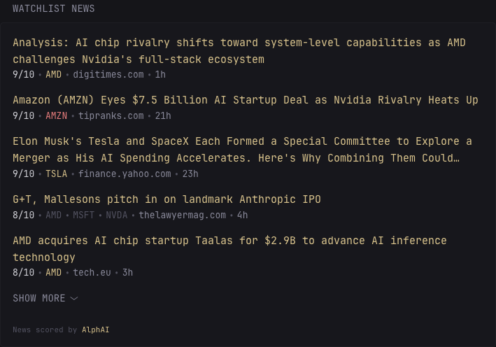

# AlphAI Watchlist News

News for the tickers you follow, from the [AlphAI](https://alphai.io/?utm_source=glance&utm_medium=partner) news API. Coverage of one event from several outlets is grouped into a single line, lines are ranked by a 1 to 10 relevance score, and each ticker is colored by the sentiment of the story toward that company. One request covers up to 100 tickers.



```yaml
- type: custom-api
  title: Watchlist News
  title-url: https://alphai.io/?utm_source=glance&utm_medium=partner
  cache: 30m
  url: https://api.alphai.io/api/news/brief/
  headers:
    Authorization: Bearer ${ALPHAI_API_KEY}
    Accept: application/json
    User-Agent: glance-alphai-watchlist-news/1.0
  parameters:
    tickers: NVDA,AAPL,MSFT,TSLA,AMZN,AMD,JPM
    hours: 24
    limit: 10
  template: |
    {{ if eq .Response.StatusCode 200 }}
      {{ $events := .JSON.Array "events" }}
      {{ if eq (len $events) 0 }}
        <p class="color-subdue">No scored news for these tickers in the last {{ .JSON.Int "hours" }} hours.</p>
      {{ else }}
        <ul class="list list-gap-14 collapsible-container" data-collapse-after="5">
        {{ range $events }}
          <li>
            <a class="size-title-dynamic color-primary-if-not-visited text-truncate-2-lines" href="{{ .String "url" }}" target="_blank" rel="noreferrer" title="{{ .String "summary" }}">{{ .String "title" }}</a>
            <ul class="list-horizontal-text flex-nowrap text-compact">
              <li class="color-highlight shrink-0" title="AlphAI relevance score, 1 to 10">{{ .Int "relevance_score" }}/10</li>
              {{ range .Array "signals" }}
                {{ $s := .String "sentiment" }}
                <li class="shrink-0 {{ if eq $s "positive" }}color-positive{{ else if eq $s "negative" }}color-negative{{ else }}color-subdue{{ end }}" title="{{ $s }}">{{ .String "ticker" }}</li>
              {{ end }}
              <li class="min-width-0 text-truncate">{{ .String "source_domain" }}</li>
              <li class="shrink-0" {{ .String "time_published" | parseRelativeTime "rfc3339" }}></li>
            </ul>
          </li>
        {{ end }}
        </ul>
      {{ end }}
      {{ $unknown := .JSON.Array "unknown_tickers" }}
      {{ if gt (len $unknown) 0 }}
        <p class="size-h6 color-negative margin-top-10">Unknown tickers:{{ range $unknown }} {{ .String "" }}{{ end }}</p>
      {{ end }}
      <p class="size-h6 color-subdue margin-top-10">News scored by <a class="color-primary" href="https://alphai.io/?utm_source=glance&utm_medium=partner" target="_blank">AlphAI</a></p>
    {{ else }}
      <p class="color-negative">AlphAI returned {{ .Response.StatusCode }}{{ if .JSON.Exists "message" }}: {{ .JSON.String "message" }}{{ end }}</p>
    {{ end }}
```

## Environment variables

- `ALPHAI_API_KEY`: an API key from [alphai.io/account/api-keys](https://alphai.io/account/api-keys?utm_source=glance&utm_medium=partner). The free plan is enough: it allows 100 requests a day, and with `cache: 30m` the widget makes at most 48.

## Parameters

| Parameter | Description | In the example |
| --- | --- | --- |
| `tickers` | Comma-separated symbols, up to 100. US stocks as `NVDA`, crypto as `BTC-USD`. A company with a US listing goes by its US ticker (`SAP`, not `SAP.DE`); other markets use a Yahoo suffix such as `0700.HK` | seven US stocks |
| `hours` | Look-back window, from 1 to 168 | `24` |
| `limit` | Maximum number of stories, from 1 to 20 (20 if omitted) | `10` |

## Notes

- The title links to the original publisher. Hover over it to read the AlphAI summary.
- Ticker colors follow your theme: `color-positive`, `color-negative`, and `color-subdue` for neutral.
- Symbols the API does not recognize are listed below the news.
- Weekends can be quiet with `hours: 24`. Use `72` if you want Friday's news on Monday morning.
- A wrong key or an exhausted daily quota shows the status code and the API's message instead of the list.
- The `User-Agent` header only names the widget, so its traffic can be told apart from other clients.
