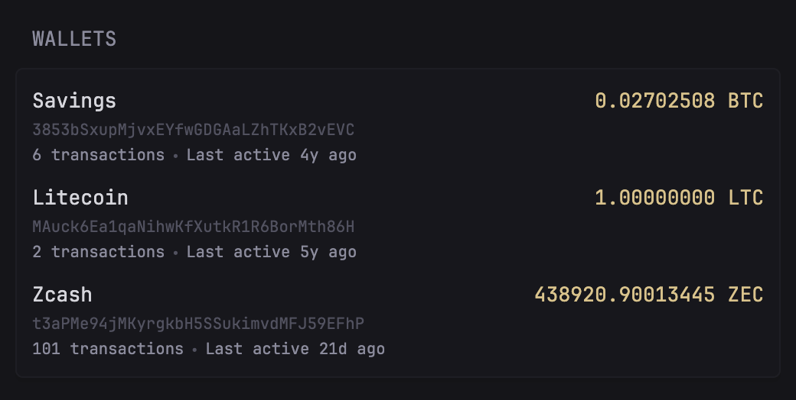

Shows the balance, transaction count and last activity of Bitcoin, Litecoin, Dogecoin and Zcash addresses, using the [SoChain API](https://sochain.com/docs). Each address links to its page on the SoChain explorer.

```yaml
- type: custom-api
  title: Wallets
  cache: 10m
  options:
    # Optional: a SoChain API key, for more than 2,500 lookups a day. See below.
    # api-key: <your key>
    wallets:
      - label: Savings
        network: BTC
        address: 3853bSxupMjvxEYfwGDGAaLZhTKxB2vEVC
      - label: Tips
        network: DOGE
        address: DH5yaieqoZN36fDVciNyRueRGvGLR3mr7L
  template: |
    {{ $key := .Options.StringOr "api-key" "" }}
    <ul class="list list-gap-10 collapsible-container" data-collapse-after="5">
    {{ range .Options.wallets }}
      {{ $network := index . "network" }}
      {{ $address := index . "address" }}
      {{ $request := newRequest (printf "https://sochain.com/api/v3/address_summary/%s/%s" $network $address) }}
      {{ if ne $key "" }}{{ $request = $request | withHeader "API-KEY" $key }}{{ end }}
      {{ $wallet := $request | getResponse }}
      <li>
        <div class="flex justify-between items-center gap-10">
          <a class="size-h4 color-highlight" href="https://sochain.com/{{ $network }}/address/{{ $address }}" target="_blank" rel="noreferrer">{{ or (index . "label") $network }}</a>
          {{ if eq $wallet.Response.StatusCode 200 }}
            <span class="size-h4 color-primary">{{ $wallet.JSON.String "data.confirmed_balance" }} {{ $network }}</span>
          {{ else }}
            <span class="color-negative">Error {{ $wallet.Response.StatusCode }}</span>
          {{ end }}
        </div>
        <div class="size-h6 color-subdue" style="overflow-wrap: anywhere;">{{ $address }}</div>
        {{ if eq $wallet.Response.StatusCode 200 }}
          <ul class="list-horizontal-text size-h6">
            <li>{{ $wallet.JSON.Int "data.txs_total" | formatNumber }} transactions</li>
            {{ if ne ($wallet.JSON.String "data.unconfirmed_balance") "0.00000000" }}
              <li class="color-positive">{{ $wallet.JSON.String "data.unconfirmed_balance" }} unconfirmed</li>
            {{ end }}
            {{ if $wallet.JSON.Exists "data.last_active.time" }}
              <li>Last active <span {{ printf "%d" ($wallet.JSON.Int "data.last_active.time") | parseTime "unix" | toRelativeTime }}></span> ago</li>
            {{ end }}
          </ul>
        {{ end }}
      </li>
    {{ end }}
    </ul>
```

## Options

- `wallets`: a list of addresses, each with:
  - `network`: `BTC`, `LTC`, `DOGE` or `ZEC`, or a testnet: `BTCTEST` (Bitcoin testnet4), `LTCTEST`, `DOGETEST`, `ZECTEST`
  - `address`: the address
  - `label`: optional, shown instead of the network name

## Environment variables

- `SOCHAIN_API_KEY`: optional. To use a key, replace the commented line with `api-key: ${SOCHAIN_API_KEY}` and set the variable. Without a key, SoChain allows 2,500 lookups a day per IP. A free account at https://sochain.com/dashboard gives 75,000 requests a month, and [paid plans](https://sochain.com/pricing) give more. The key is sent as the `API-KEY` header.

Each address is one request per refresh, so with the default `cache: 10m` five addresses use at most 720 lookups a day.
