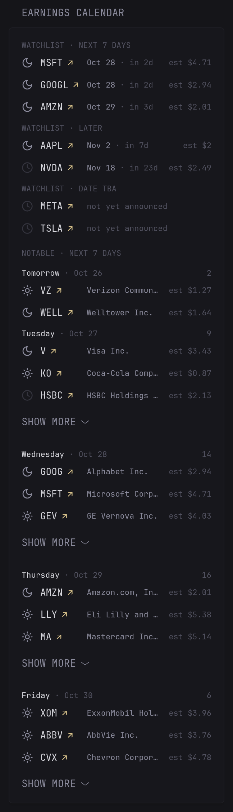

# Earnings Calendar

Upcoming earnings dates for a watchlist of stocks plus every company above a market cap cutoff reporting in the next few days.  Entries show before-open / after-close icons and consensus EPS estimates with notable reporters grouped by day. Data comes from Nasdaq's website (no API key or sign-up needed).



```yaml
- type: custom-api
  title: Earnings Calendar
  cache: 6h
  options:
    watchlist: AAPL,MSFT,NVDA,AMZN,GOOGL,META,TSLA
    days: 7
    min-market-cap: 100
    collapse-after: 3
  template: |
    {{ define "time-icon" }}
      {{ if eq . "time-pre-market" }}
        <span title="Before open" style="display: inline-flex;"><svg width="16" height="16" viewBox="0 0 24 24" fill="none" stroke="currentColor" stroke-width="2" stroke-linecap="round" stroke-linejoin="round"><circle cx="12" cy="12" r="4"/><path d="M12 2v2M12 20v2M4.93 4.93l1.41 1.41M17.66 17.66l1.41 1.41M2 12h2M20 12h2M6.34 17.66l-1.41 1.41M19.07 4.93l-1.41 1.41"/></svg></span>
      {{ else if eq . "time-after-hours" }}
        <span title="After close" style="display: inline-flex;"><svg width="16" height="16" viewBox="0 0 24 24" fill="none" stroke="currentColor" stroke-width="2" stroke-linecap="round" stroke-linejoin="round"><path d="M12 3a6 6 0 0 0 9 9 9 9 0 1 1-9-9Z"/></svg></span>
      {{ else }}
        <span title="Time not announced" class="color-subdue" style="display: inline-flex; opacity: 0.5;"><svg width="16" height="16" viewBox="0 0 24 24" fill="none" stroke="currentColor" stroke-width="2" stroke-linecap="round" stroke-linejoin="round"><circle cx="12" cy="12" r="10"/><path d="M12 6v6l4 2"/></svg></span>
      {{ end }}
    {{ end }}

    {{ $ua := "glance-earnings-calendar" }}
    {{ $days := .Options.IntOr "days" 7 }}
    {{ $collapse := .Options.IntOr "collapse-after" 3 }}
    {{ $minB := .Options.IntOr "min-market-cap" 100 }}
    {{ $minCap := "0" }}
    {{ if gt $minB 0 }}{{ $minCap = printf "%d000000000" $minB }}{{ end }}
    {{ $windowEnd := (parseLocalTime "2006-01-02" (offsetNow (printf "%dh" (mul $days 24)) | formatTime "2006-01-02")).Unix }}
    {{ $today := (parseLocalTime "2006-01-02" (now | formatTime "2006-01-02")).Unix }}
    {{ $failed := 0 }}

    {{ $list := .Options.StringOr "watchlist" "" }}
    {{ $acc := "" }}
    {{ $soon := 0 }}{{ $later := 0 }}{{ $tba := 0 }}
    {{ range $i := 20 }}
      {{ $sym := findSubmatch (printf `^(?:[^,]+,){%d}\s*([^,\s]+)` $i) $list }}
      {{ if ne $sym "" }}
        {{ $r := newRequest (concat "https://api.nasdaq.com/api/analyst/" $sym "/earnings-date") | withHeader "User-Agent" $ua | withHeader "Accept" "application/json" | getResponse }}
        {{ if ne $r.Response.StatusCode 200 }}
          {{ $failed = add $failed 1 }}
        {{ else }}
          {{ $ann := $r.JSON.String "data.announcement" }}
          {{ $date := findSubmatch `: ([A-Z][a-z]{2} \d{1,2}, \d{4})` $ann }}
          {{ if ne $date "" }}
            {{ $u := (parseLocalTime "Jan 2, 2006" $date).Unix }}
            {{ if ge $u $today }}
              {{ $text := $r.JSON.String "data.reportText" }}
              {{ $eps := findSubmatch `consensus EPS forecast for the quarter is (\$-?[0-9]+(?:\.[0-9]+)?)` $text }}
              {{ $tm := findSubmatch `(before market open|after market close)` $text }}
              {{ if eq $tm "before market open" }}{{ $tm = "time-pre-market" }}{{ else if eq $tm "after market close" }}{{ $tm = "time-after-hours" }}{{ end }}
              {{ $acc = concat $acc (printf "%d|%s|%s|%s|%s;" $u $sym $eps $tm $date) }}
              {{ if lt $u $windowEnd }}{{ $soon = add $soon 1 }}{{ else }}{{ $later = add $later 1 }}{{ end }}
            {{ end }}
          {{ else if ne (findMatch `:\s*$` $ann) "" }}
            {{ $acc = concat $acc (printf "0|%s|||;" $sym) }}
            {{ $tba = add $tba 1 }}
          {{ else }}
            {{ $failed = add $failed 1 }}
          {{ end }}
        {{ end }}
      {{ end }}
    {{ end }}

    {{ range $section := 3 }}
      {{ $n := $soon }}{{ $label := printf "WATCHLIST · NEXT %d DAYS" $days }}
      {{ if eq $section 1 }}{{ $n = $later }}{{ $label = "WATCHLIST · LATER" }}{{ end }}
      {{ if eq $section 2 }}{{ $n = $tba }}{{ $label = "WATCHLIST · DATE TBA" }}{{ end }}
      {{ if gt $n 0 }}
        <div class="size-h6 color-subdue" style="margin: {{ if eq $section 0 }}0{{ else }}1rem{{ end }} 0 0.5rem;">{{ $label }}</div>
        <ul class="list list-gap-10" style="display: flex; flex-direction: column;">
          {{ range $j := 20 }}
            {{ $e := findSubmatch (printf `^(?:[^;]*;){%d}([^;]+)` $j) $acc }}
            {{ if ne $e "" }}
              {{ $us := findSubmatch `^(\d+)\|` $e }}
              {{ $sym := findSubmatch `^\d+\|([^|]+)\|` $e }}
              {{ $eps := findSubmatch `^\d+\|[^|]+\|([^|]*)\|` $e }}
              {{ $tm := findSubmatch `^\d+\|[^|]+\|[^|]*\|([^|]*)\|` $e }}
              {{ $d := findSubmatch `\|([^|]*)$` $e }}
              {{ $in := 2 }}
              {{ $at := now }}
              {{ if ne $d "" }}
                {{ $at = parseLocalTime "Jan 2, 2006" $d }}
                {{ $in = 1 }}{{ if lt $at.Unix $windowEnd }}{{ $in = 0 }}{{ end }}
              {{ end }}
              {{ if eq $in $section }}
                <li class="flex items-center gap-10" style="order: {{ $us }};">
                  {{ template "time-icon" $tm }}
                  <a class="color-highlight visited-indicator shrink-0" style="width: 7ch; white-space: nowrap;" href="https://www.nasdaq.com/market-activity/stocks/{{ $sym }}/earnings" target="_blank" rel="noreferrer">{{ $sym }}</a>
                  <div class="size-h6" style="flex: 1; white-space: nowrap;">{{ if ne $d "" }}{{ $at | formatTime "Jan 2" }} <span class="color-subdue">&middot; <span {{ $at | toRelativeTime }}></span></span>{{ else }}<span class="color-subdue">not yet announced</span>{{ end }}</div>
                  <div class="size-h6 color-subdue">{{ if ne $eps "" }}est {{ $eps }}{{ end }}</div>
                </li>
              {{ end }}
            {{ end }}
          {{ end }}
        </ul>
      {{ end }}
    {{ end }}

    <div class="size-h6 color-subdue" style="margin: 1.5rem 0 0;">NOTABLE · NEXT {{ $days }} DAYS</div>
    {{ $total := 0 }}
    {{ range $i := $days }}
      {{ $day := offsetNow (printf "%dh" (mul $i 24)) }}
      {{ $dow := $day | formatTime "Mon" }}
      {{ if and (ne $dow "Sat") (ne $dow "Sun") }}
        {{ $r := newRequest "https://api.nasdaq.com/api/calendar/earnings" | withParameter "date" ($day | formatTime "2006-01-02") | withHeader "User-Agent" $ua | withHeader "Accept" "application/json" | getResponse }}
        {{ if ne $r.Response.StatusCode 200 }}
          {{ $failed = add $failed 1 }}
        {{ else }}
          {{ $n := 0 }}{{ $valid := 0 }}{{ $prev := "" }}
          {{ range $r.JSON.Array "data.rows" }}
            {{ $cap := replaceAll "," "" (replaceAll "$" "" (.String "marketCap")) }}
            {{ if ne (findMatch `^[0-9]+$` $cap) "" }}{{ $valid = add $valid 1 }}{{ end }}
            {{ if and (ne (.String "name") $prev) (ne (findMatch `^[0-9]+$` $cap) "") (or (gt (len $cap) (len $minCap)) (and (eq (len $cap) (len $minCap)) (ge $cap $minCap))) }}
              {{ $n = add $n 1 }}{{ $prev = .String "name" }}
            {{ end }}
          {{ end }}
          {{ if and (gt (len ($r.JSON.Array "data.rows")) 0) (eq $valid 0) }}{{ $failed = add $failed 1 }}{{ end }}
          {{ if gt $n 0 }}
            {{ $total = add $total $n }}
            <div class="flex justify-between size-h6" style="margin: 1rem 0 0.5rem;">
              <span class="color-highlight">{{ if eq $i 0 }}Today{{ else if eq $i 1 }}Tomorrow{{ else }}{{ $day | formatTime "Monday" }}{{ end }} <span class="color-subdue">&middot; {{ $day | formatTime "Jan 2" }}</span></span>
              <span class="color-subdue">{{ $n }}</span>
            </div>
            <ul class="list list-gap-10 collapsible-container" data-collapse-after="{{ $collapse }}">
              {{ $prev = "" }}
              {{ range $r.JSON.Array "data.rows" }}
                {{ $cap := replaceAll "," "" (replaceAll "$" "" (.String "marketCap")) }}
                {{ if and (ne (.String "name") $prev) (ne (findMatch `^[0-9]+$` $cap) "") (or (gt (len $cap) (len $minCap)) (and (eq (len $cap) (len $minCap)) (ge $cap $minCap))) }}
                  {{ $prev = .String "name" }}
                  {{ $url := concat "https://www.nasdaq.com/market-activity/stocks/" (.String "symbol") "/earnings" }}
                  <li class="flex items-center gap-10">
                    {{ template "time-icon" (.String "time") }}
                    <a class="color-highlight visited-indicator shrink-0" style="width: 7ch; white-space: nowrap;" href="{{ $url }}" target="_blank" rel="noreferrer">{{ .String "symbol" }}</a>
                    <a class="text-truncate size-h6" style="flex: 1; min-width: 0;" title="{{ .String "name" }}" href="{{ $url }}" target="_blank" rel="noreferrer">{{ .String "name" }}</a>
                    <div class="size-h6 color-subdue shrink-0">{{ with .String "epsForecast" }}est {{ . }}{{ end }}</div>
                  </li>
                {{ end }}
              {{ end }}
            </ul>
          {{ end }}
        {{ end }}
      {{ end }}
    {{ end }}
    {{ if and (eq $total 0) (eq $failed 0) }}<p class="color-subdue" style="margin-top: 0.5rem;">Nothing above the market cap cutoff.</p>{{ end }}
    {{ if gt $failed 0 }}<p class="color-negative size-h6" style="margin-top: 1rem;">{{ $failed }} request{{ if gt $failed 1 }}s{{ end }} to Nasdaq failed or returned unexpected data</p>{{ end }}
```

## Options

- `watchlist`: comma-separated symbols as listed on Nasdaq, in uppercase (up to 20)
- `days`: how many days ahead to look. Default `7`
- `min-market-cap`: cutoff in billions of USD for the day-by-day list; `0` shows everything. Default `100`
- `collapse-after`: companies shown per day before "show more". Default `3`

## Notes

- Data comes from the unofficial API behind nasdaq.com; [terms](https://www.nasdaq.com/legal) allow personal, non-commercial use only.
- If Nasdaq changes or blocks the API the widget shows how many requests failed.
- Each refresh makes one request per watchlist symbol and one per weekday in the window; keep low via `cache: 6h` or similar.
- Watchlist dates are estimates until companies confirm them.
- Day headings use the server's time zone. Set `TZ` on the Glance container to change it.
- Requires Glance v0.8.0 or newer.
- Icons are from [Lucide](https://lucide.dev) (ISC license).
