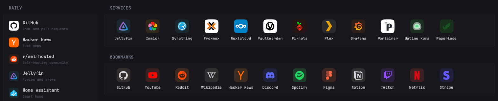
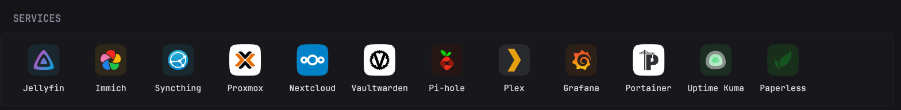
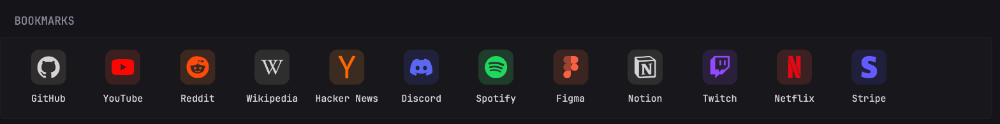
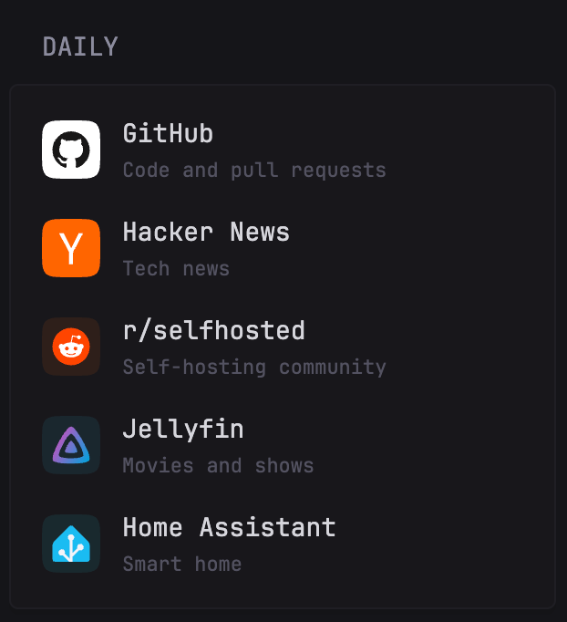

# Favicon Bookmarks

Bookmarks shown as a grid of icon tiles or as a list, with every site's icon drawn on a badge by [favicons.page](https://favicons.page). You only give the URL: the icon is looked up by domain, comes back as a clean 128x128 SVG on a plate in the site's own colours, and switches with Glance's light and dark themes.

No API key, no sign-up, nothing to run next to Glance. Icons can also be picked by name from icon packs such as selfh.st, Simple Icons and Dashboard Icons.

## Widget Type

`custom-api`

## Preview



## Configuration

```yaml
- type: custom-api
  title: Bookmarks
  cache: 1d
  options:
    style: color
    shape: superellipse
    layout: grid
    links:
      - url: https://github.com
        title: GitHub
      - url: https://news.ycombinator.com
        title: Hacker News
      - url: https://www.youtube.com
        title: YouTube
      - url: https://www.reddit.com/r/selfhosted
        title: r/selfhosted
      - url: https://en.wikipedia.org
        title: Wikipedia
      - url: https://jellyfin.example.com
        title: Jellyfin
        icon: selfhst/jellyfin
  template: |
    {{ $instance := trimSuffix "/" (.Options.StringOr "instance" "https://favicons.page") }}
    {{ $style := .Options.StringOr "style" "color" }}
    {{ $shape := .Options.StringOr "shape" "superellipse" }}
    {{ $list := eq (.Options.StringOr "layout" "grid") "list" }}

    <style>
      .grid-favicon-bookmarks {
        display: grid;
        grid-template-columns: repeat(auto-fill, minmax(8.5rem, 1fr));
        gap: 1.6rem 0.8rem;
      }

      .tile-favicon-bookmarks {
        display: flex;
        flex-direction: column;
        align-items: center;
        gap: 0.8rem;
        min-width: 0;
        text-align: center;
        text-decoration: none;
      }

      .row-favicon-bookmarks {
        display: flex;
        align-items: center;
        gap: 1.2rem;
        min-width: 0;
        text-decoration: none;
      }

      .icon-favicon-bookmarks {
        display: block;
        width: 4.4rem;
        height: 4.4rem;
        flex-shrink: 0;
        transition: transform 0.15s;
      }

      .row-favicon-bookmarks .icon-favicon-bookmarks {
        width: 3.2rem;
        height: 3.2rem;
      }

      .tile-favicon-bookmarks:hover .icon-favicon-bookmarks {
        transform: translateY(-0.2rem);
      }

      .tile-favicon-bookmarks:hover .title-favicon-bookmarks,
      .row-favicon-bookmarks:hover .title-favicon-bookmarks {
        color: var(--color-primary);
      }

      .title-favicon-bookmarks {
        max-width: 100%;
      }

      .light-favicon-bookmarks {
        display: none;
      }

      :root[data-scheme=light] .light-favicon-bookmarks {
        display: block;
      }

      :root[data-scheme=light] .dark-favicon-bookmarks {
        display: none;
      }
    </style>

    <ul class="{{ if $list }}list list-gap-14{{ else }}grid-favicon-bookmarks{{ end }}">
    {{ range $link := index .Options "links" }}
      {{ $url := printf "%v" (index $link "url") }}
      {{ $target := replaceMatches `^(?:[A-Za-z][A-Za-z0-9+.-]*://)?(?:[^@/]*@)?([^/:?#]*).*$` "$1" $url }}
      {{ with index $link "domain" }}{{ $target = printf "%v" . }}{{ end }}
      {{ with index $link "icon" }}{{ $target = printf "%v" . }}{{ end }}
      {{ $title := $target }}
      {{ with index $link "title" }}{{ $title = printf "%v" . }}{{ end }}
      {{ $badge := concat $instance "/" $style "/" $target "/" $shape }}
      <li class="min-width-0">
        <a
          class="{{ if $list }}row-favicon-bookmarks{{ else }}tile-favicon-bookmarks{{ end }}"
          href="{{ $url | safeURL }}"
          {{ if not (index $link "same-tab") }}target="_blank"{{ end }}
          rel="noopener noreferrer"
          title="{{ $title }}"
        >
          
          
          {{ if $list }}
            <div class="grow min-width-0">
              <span class="title-favicon-bookmarks size-h4 color-highlight text-truncate block">{{ $title }}</span>
              {{ with index $link "description" }}
                <span class="size-h6 color-subdue text-truncate block">{{ . }}</span>
              {{ end }}
            </div>
          {{ else }}
            <span class="title-favicon-bookmarks size-h5 color-highlight text-truncate block">{{ $title }}</span>
          {{ end }}
        </a>
      </li>
    {{ end }}
    </ul>
```

## Examples

Every example is the same widget with different `options`. Copy the full widget from [Configuration](#configuration) and swap in the options below.

### Self-hosted services from an icon pack



Local addresses have no public icon, so each link picks one from the selfh.st pack with `icon`.

```yaml
- type: custom-api
  title: Services
  cache: 1d
  options:
    style: color
    shape: superellipse
    layout: grid
    links:
      - url: http://jellyfin.lan
        title: Jellyfin
        icon: selfhst/jellyfin
      - url: http://immich.lan
        title: Immich
        icon: selfhst/immich
      - url: http://syncthing.lan
        title: Syncthing
        icon: selfhst/syncthing
      - url: http://proxmox.lan
        title: Proxmox
        icon: selfhst/proxmox
      - url: http://nextcloud.lan
        title: Nextcloud
        icon: selfhst/nextcloud
      - url: http://vaultwarden.lan
        title: Vaultwarden
        icon: selfhst/vaultwarden
      - url: http://pi-hole.lan
        title: Pi-hole
        icon: selfhst/pi-hole
      - url: http://plex.lan
        title: Plex
        icon: selfhst/plex
      - url: http://grafana.lan
        title: Grafana
        icon: selfhst/grafana
      - url: http://portainer.lan
        title: Portainer
        icon: selfhst/portainer
      - url: http://uptime-kuma.lan
        title: Uptime Kuma
        icon: selfhst/uptime-kuma
      - url: http://paperless-ngx.lan
        title: Paperless
        icon: selfhst/paperless-ngx
  # template: the same as in Configuration above
```

### Monochrome bookmarks



`style: mono` turns every icon into one colour on a soft plate in the site's brand colour, and `shape: rounded` uses rounded squares instead of superellipses.

```yaml
- type: custom-api
  title: Bookmarks
  cache: 1d
  options:
    style: mono
    shape: rounded
    layout: grid
    links:
      - url: https://github.com
        title: GitHub
      - url: https://www.youtube.com
        title: YouTube
      - url: https://www.reddit.com
        title: Reddit
      - url: https://en.wikipedia.org
        title: Wikipedia
      - url: https://news.ycombinator.com
        title: Hacker News
      - url: https://discord.com
        title: Discord
      - url: https://open.spotify.com
        title: Spotify
      - url: https://www.figma.com
        title: Figma
      - url: https://www.notion.so
        title: Notion
      - url: https://www.twitch.tv
        title: Twitch
      - url: https://www.netflix.com
        title: Netflix
      - url: https://dashboard.stripe.com
        title: Stripe
  # template: the same as in Configuration above
```

### A list with descriptions



`layout: list` fits a small column and shows each link's `description` under its title.

```yaml
- type: custom-api
  title: Daily
  cache: 1d
  options:
    style: color
    shape: superellipse
    layout: list
    links:
      - url: https://github.com
        title: GitHub
        description: Code and pull requests
      - url: https://news.ycombinator.com
        title: Hacker News
        description: Tech news
      - url: https://www.reddit.com/r/selfhosted
        title: r/selfhosted
        description: Self-hosting community
      - url: http://jellyfin.lan
        title: Jellyfin
        description: Movies and shows
        icon: selfhst/jellyfin
      - url: http://ha.lan
        title: Home Assistant
        description: Smart home
        icon: selfhst/home-assistant
  # template: the same as in Configuration above
```

## Options

| Name       | Type   | Required | Default                 |
| ---------- | ------ | -------- | ----------------------- |
| `links`    | array  | Yes      | —                       |
| `layout`   | string | No       | `grid`                  |
| `style`    | string | No       | `color`                 |
| `shape`    | string | No       | `superellipse`          |
| `instance` | string | No       | `https://favicons.page` |

### `links`

Shown in the order you list them.

| Name          | Type    | Required | Default                    |
| ------------- | ------- | -------- | -------------------------- |
| `url`         | string  | Yes      | —                          |
| `title`       | string  | No       | The domain or icon name    |
| `domain`      | string  | No       | The host of `url`          |
| `icon`        | string  | No       | —                          |
| `description` | string  | No       | —                          |
| `same-tab`    | boolean | No       | `false`                    |

* `url`: where the tile links to. Custom schemes such as `steam://` work, but then set `domain` or `icon`, since there is no host to take the icon from.
* `domain`: the site whose icon to show, when it is not the host of `url`. Useful for self-hosted services behind a local address, for example `url: ${JELLYFIN_URL}` with `domain: jellyfin.org`. Subdomains collapse to the registrable domain, so `en.wikipedia.org` shows the Wikipedia icon.
* `icon`: an icon from a pack, as `{pack}/{slug}`: `selfhst/jellyfin`, `simple-icons/github`, `dashboard-icons/proxmox`, `devicon/rust`, `twemoji/house`. Wins over `domain`. The full list of packs is at [favicons.page/catalogs.json](https://favicons.page/catalogs.json), and every pack's slugs at `https://favicons.page/catalogs/{pack}.json`.
* `description`: a second line of subdued text, shown in the `list` layout only.
* `same-tab`: open the link in the current tab instead of a new one.

### `layout`

`grid` draws a tile per link with the title under the icon. `list` draws one row per link with the title and description next to the icon, which fits small columns better when titles are long.

### `style`

`color` keeps the site's own colours. `mono` turns every icon into a single-colour mark in its brand colour, on a soft tinted plate, for a calmer look.

### `shape`

The badge shape: `superellipse` (like app icons on a phone) or `rounded` (a square with rounded corners).

### `instance`

The favicons server to load icons from. Point it at your own instance if you self-host one (a ~9 MB Docker image, see the [self-hosting guide](https://github.com/peleda-app/favicons/blob/main/docs/SELF-HOSTING.md)), for example `instance: https://${FAVICONS_URL}`. `https://private.favicons.page` answers from its cache only and never contacts the sites you bookmark.

## How it works

The widget has no `url`, so Glance makes no requests of its own: the browser loads one image per link from `{instance}/{style}/{domain or pack/slug}/{shape}/{light|dark}`. Each badge comes in a light and a dark version, and the widget shows the one that matches Glance's current theme, so icons keep their contrast when you switch themes. Both images are lazy-loaded, so browsers normally skip downloading the hidden one.

favicons.page decodes every icon in a sandbox and rebuilds it as a plain SVG without scripts, does not log client IP addresses, and returns a generated icon instead of a broken image when a site has none. The service is open source: [peleda-app/favicons](https://github.com/peleda-app/favicons), API reference in [docs/API.md](https://github.com/peleda-app/favicons/blob/main/docs/API.md).

## Using favicons.page in the built-in widgets

The `icon` property of the built-in `bookmarks` and `monitor` widgets (and the `glance.icon` label of `docker-containers`) accepts any image URL, so you can use the same icons there without this widget:

```yaml
icon: https://favicons.page/color/github.com
icon: auto-invert https://favicons.page/mono/github.com
```

The first line is the full-colour icon on a transparent background. The second is a black mask that Glance inverts to white on dark themes.


Above: the stock `bookmarks` and `monitor` widgets with their default icons, and the same widgets with `icon: https://favicons.page/mono/selfhst/jellyfin/superellipse/light` and similar URLs.
