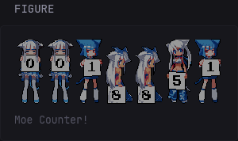

# Figure Card

A simple image widget with optional links, captions, an internal frame, and padding controls.

## Widget Type

`custom-api`

## Preview



*The preview shows one example using a padded Moe Counter. Frame, padding, and caption behavior can be configured independently.*

## Options

| Name        | Type    | Required | Default                  |
| ----------- | ------- | -------- | ------------------------ |
| `src`       | string  | Yes      | —                        |
| `alt`       | string  | No       | `""`                     |
| `url`       | string  | No       | No link                  |
| `same-tab`  | boolean | No       | `false`                  |
| `target`    | string  | No       | Determined by `same-tab` |
| `caption`   | string  | No       | —                        |
| `frameless` | boolean | No       | `false`                  |
| `padding`   | boolean | No       | `false`                  |

### `src`

Direct image URL or browser-accessible path, such as `/assets/image.png`.

The browser loads the image directly; Glance does not fetch it through the `custom-api` widget. The widget-level `cache` property therefore does not control image caching, which depends on the image server's HTTP cache headers.

### `alt`

Alternative text for the image. This maps directly to the HTML `alt` attribute and is used for accessibility.

This option may be omitted. The widget then renders `alt=""`.

When the Figure Card is linked, the image alternative text and caption provide the link's accessible name. If both are omitted, the widget uses the destination URL as a fallback label.

### `url`

An optional destination URL. When configured, the entire internal Figure Card is clickable, including its image, caption, padding, and frame. The outer Glance widget header is not part of the link.

Custom URL schemes are supported. Only configure URLs you trust.

### `same-tab`

Opens the link in the current tab when set to `true`.

### `target`

Sets the HTML link target.

Common values include `_blank`, `_self`, `_parent`, and `_top`, but any valid HTML link target is accepted.

When a non-empty `target` and `same-tab` are both configured, `target` takes precedence.

### `caption`

Optional text displayed below the image.

### `frameless`

Controls the *Figure Card's* internal frame.

This is separate from Glance's widget-level `frameless` property.

* `false`: render an inner Glance-style card frame.
* `true`: remove the inner frame.

### `padding`

Adds internal padding around the image and caption.

Use this for transparent PNGs, counters, diagrams, or other images that should not touch the card edge.

## Configuration

When adding multiple *Figure Cards*, define the template once with a YAML anchor and reuse it with an alias. This keeps the configuration compact and ensures every *Figure Card* uses the same rendering logic.

```yaml
- type: custom-api
  frameless: true
  title: Figure
  options:
    src: https://placehold.co/600x400
    alt: Example alt
    url: https://example.com/
    same-tab: false
    target: _blank
    caption: Example caption
    frameless: false
    padding: true
  template: &figure-card-template |
    {{ $src := .Options.StringOr "src" "" }}
    {{ $alt := .Options.StringOr "alt" "" }}
    {{ $url := .Options.StringOr "url" "" }}
    {{ $caption := .Options.StringOr "caption" "" }}
    {{ $frameless := .Options.BoolOr "frameless" false }}
    {{ $padding := .Options.BoolOr "padding" false }}

    {{ $target := "_blank" }}
    {{ if .Options.BoolOr "same-tab" false }}
      {{ $target = "" }}
    {{ end }}
    {{ with $configuredTarget := .Options.StringOr "target" "" }}
      {{ $target = $configuredTarget }}
    {{ end }}

    {{ if $src }}
      {{ if $url }}
        <a
          class="block"
          href="{{ $url | safeURL }}"
          {{ if $target }}target="{{ $target }}"{{ end }}
          rel="noopener noreferrer"
          style="text-decoration: none;"
          {{ if and (not $alt) (not $caption) }}aria-label="{{ $url }}"{{ end }}
        >
      {{ end }}

      <figure
        class="card{{ if not $frameless }} widget-content-frame{{ else }} rounded{{ end }}"
        style="
          margin: 0;
          overflow: hidden;
          {{ if $padding }}padding: var(--widget-content-padding);{{ end }}
        "
      >
        

        {{ with $caption }}
          <figcaption
            class="
              margin-top-10
              flex
              flex-column
              grow
              color-subdue
              {{ if not $padding }}padding-inline-widget margin-bottom-widget{{ end }}
            "
          >
            {{ . }}
          </figcaption>
        {{ end }}
      </figure>

      {{ if $url }}
        </a>
      {{ end }}
    {{ end }}
```

> **Note:** Set the outer Glance widget to `frameless: true`. Figure Card manages its own internal frame and padding through `options.frameless` and `options.padding`.
