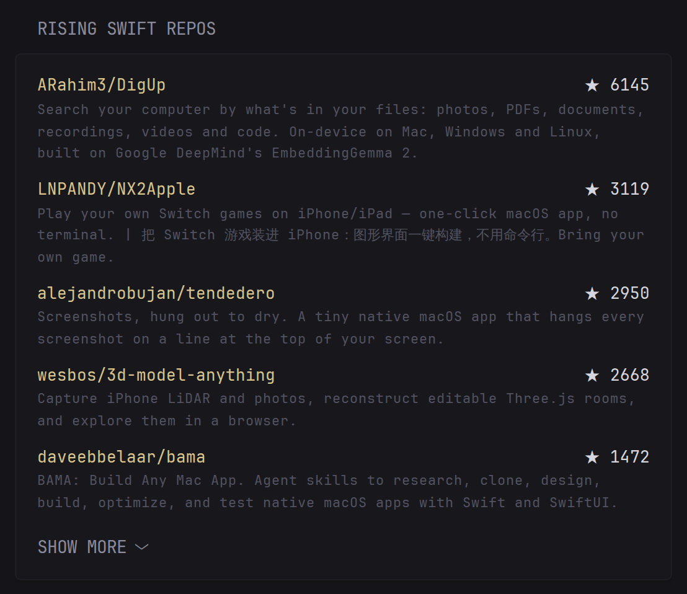

# Filtered GitHub Repos

A [Glance](https://github.com/glanceapp/glance) custom-api widget: the most-starred new repositories filtered by language, topic, age and stars. No API key, no extra service.

## Preview



Most-starred new repositories matching your filters, from the [GitHub search API](https://docs.github.com/en/rest/search/search#search-repositories). No API key and no extra service needed.

## Config

```yaml
- type: custom-api
  title: Rising Swift Repos
  cache: 6h
  body-type: string
  skip-json-validation: true
  options:
    language: swift
    # topic: ios
    # query: "server in:description"
    days: 30
    min-stars: 5
    limit: 10
  template: |
    {{ $q := "" }}
    {{ $language := .Options.StringOr "language" "" }}
    {{ if $language }}{{ $q = printf "%s language:%s" $q $language }}{{ end }}
    {{ $topic := .Options.StringOr "topic" "" }}
    {{ if $topic }}{{ $q = printf "%s topic:%s" $q $topic }}{{ end }}
    {{ $extra := .Options.StringOr "query" "" }}
    {{ if $extra }}{{ $q = printf "%s %s" $q $extra }}{{ end }}
    {{ $hours := mul (.Options.IntOr "days" 30) 24 }}
    {{ $since := (offsetNow (printf "-%dh" $hours)).Format "2006-01-02" }}
    {{ $q = printf "%s created:>%s stars:>=%d" $q $since (.Options.IntOr "min-stars" 5) }}
    {{ $r := newRequest "https://api.github.com/search/repositories"
       | withParameter "q" $q
       | withParameter "sort" "stars"
       | withParameter "order" "desc"
       | withParameter "per_page" (printf "%d" (.Options.IntOr "limit" 10))
       | withHeader "Accept" "application/vnd.github+json"
       | getResponse }}
    {{ if ne $r.Response.StatusCode 200 }}
    <p class="color-negative">GitHub returned {{ $r.Response.StatusCode }}</p>
    {{ else }}
    <ul class="list list-gap-10 collapsible-container" data-collapse-after="5">
      {{ range $r.JSON.Array "items" }}
      <li>
        <div class="flex justify-between gap-10">
          <a class="color-primary-if-not-visited min-width-0" href="{{ .String "html_url" }}" target="_blank" rel="noreferrer">{{ .String "full_name" }}</a>
          <span class="shrink-0 color-highlight">★ {{ .Int "stargazers_count" }}</span>
        </div>
        <p class="size-h6 color-subdue">{{ .String "description" }}</p>
      </li>
      {{ end }}
    </ul>
    {{ end }}
```

## Options

| Option | Default | Meaning |
|---|---|---|
| `language` | none | Repository language, e.g. `swift` |
| `topic` | none | GitHub topic, e.g. `ios` |
| `query` | none | Any extra [search qualifiers](https://docs.github.com/en/search-github/searching-on-github/searching-for-repositories) |
| `days` | `30` | Only repositories created in the last N days |
| `min-stars` | `5` | Minimum stars |
| `limit` | `10` | Number of results, up to 100 |

Unauthenticated search allows 10 requests per minute. The default 6 hour cache stays well below that.

Source and issues: [github.com/darkbringer1/filtered-github-repos](https://github.com/darkbringer1/filtered-github-repos)

## Screenshots

Two filters (Swift and Rust) next to [Berlin transit](https://github.com/darkbringer1/glance-berlin-transit)


On a Berlin page with transit, football and F1


## License

MIT, see [LICENSE](https://github.com/darkbringer1/filtered-github-repos/blob/main/LICENSE).
