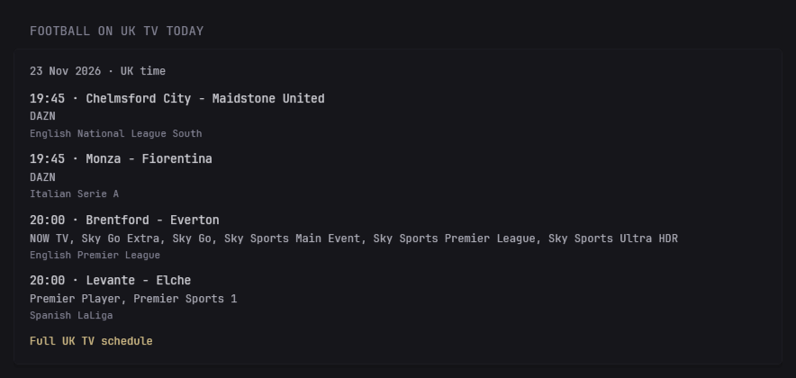

# Football on UK TV Today

See today's football matches with UK television or streaming listings, including their kick-off times in London time and the broadcaster names. Select **Full UK TV schedule** to open the SportSchedule.tv guide.



## Setup

Paste this widget into a column's `widgets` list in your Glance configuration. It uses Glance's built-in `custom-api` widget and a public TVEvents feed. It requires no account or API key.

```yaml
- type: custom-api
  title: Football on UK TV Today
  cache: 15m
  url: https://tvevents.org/widget/glance/football-on-uk-tv-today/feed.php
  headers:
    User-Agent: TVEventsGlanceWidget/1.0
  template: |
    <p class="color-paragraph size-h5 margin-bottom-10">{{ .JSON.String "date" }} · UK time</p>
    {{ with .JSON.Array "matches" }}
    <ul class="list list-gap-10 collapsible-container" data-collapse-after="6">
      {{ range . }}
      <li>
        <div class="color-highlight">{{ .String "time" }} · {{ .String "match" }}</div>
        <div class="color-paragraph size-h5">{{ range $i, $channel := .Array "channels" }}{{ if $i }}, {{ end }}{{ $channel.String "" }}{{ end }}</div>
        {{ with .String "competition" }}<div class="size-h6">{{ . }}</div>{{ end }}
      </li>
      {{ end }}
    </ul>
    {{ else }}
    <p class="color-paragraph">No UK TV listings are available today.</p>
    {{ end }}
    <a class="block color-primary size-h5 margin-top-10" href="https://sportschedule.tv/category/sports/footballtv/?utm_source=glance&utm_medium=referral&utm_campaign=football_on_uk_tv_today" target="_blank" rel="noopener">Full UK TV schedule</a>
```

The feed includes channels explicitly marked as UK listings. Broadcasters and their access requirements can change. The match day uses the Europe/London timezone.
