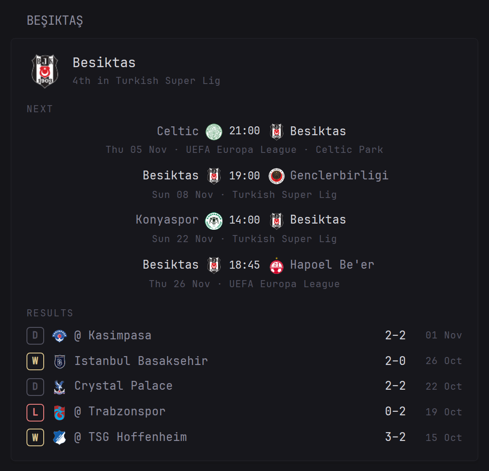

# Football Team Fixtures

A [Glance](https://github.com/glanceapp/glance) custom-api widget: next matches and recent results with crests for any football club or national team in the world. No API key, no extra service. Labels in English, Turkish, German, Spanish, French, Portuguese and Italian.

## Preview



Next matches and recent results for any football club or national team that ESPN covers, with crests, live scores, competition and venue. All competitions are merged (league, cup, Europe, internationals). No API key and no extra service.

## Config

```yaml
- type: custom-api
  title: Beşiktaş
  cache: 30m
  options:
    team-id: 1895        # ESPN team id, see README
    language: en         # en, tr, de, es, fr, pt, it
    next-count: 4
    result-count: 5
    # time-format: "15:04"   # Go layout, e.g. "3:04 PM"
    # season: 2026           # only if results stay empty after a season ends
    # label-next: Upcoming   # any label can be overridden, see README
  template: |
    {{ $id := printf "%d" (.Options.IntOr "team-id" 1895) }}
    {{ $lang := .Options.StringOr "language" "en" }}
    {{ $L := "next=Next|results=Results|none=No upcoming matches|noresults=No recent results|W=W|D=D|L=L|days=Sun Mon Tue Wed Thu Fri Sat|months=Jan Feb Mar Apr May Jun Jul Aug Sep Oct Nov Dec" }}
    {{ if eq $lang "tr" }}{{ $L = "next=Sıradaki|results=Sonuçlar|none=Yaklaşan maç yok|noresults=Son maç yok|W=G|D=B|L=M|days=Paz Pzt Sal Çar Per Cum Cmt|months=Oca Şub Mar Nis May Haz Tem Ağu Eyl Eki Kas Ara" }}{{ end }}
    {{ if eq $lang "de" }}{{ $L = "next=Nächste Spiele|results=Ergebnisse|none=Keine anstehenden Spiele|noresults=Keine aktuellen Ergebnisse|W=S|D=U|L=N|days=So Mo Di Mi Do Fr Sa|months=Jan Feb Mär Apr Mai Jun Jul Aug Sep Okt Nov Dez" }}{{ end }}
    {{ if eq $lang "es" }}{{ $L = "next=Próximos|results=Resultados|none=Sin próximos partidos|noresults=Sin resultados recientes|W=G|D=E|L=P|days=dom lun mar mié jue vie sáb|months=ene feb mar abr may jun jul ago sep oct nov dic" }}{{ end }}
    {{ if eq $lang "fr" }}{{ $L = "next=À venir|results=Résultats|none=Aucun match à venir|noresults=Aucun résultat récent|W=V|D=N|L=D|days=dim lun mar mer jeu ven sam|months=janv févr mars avr mai juin juil août sept oct nov déc" }}{{ end }}
    {{ if eq $lang "pt" }}{{ $L = "next=Próximos|results=Resultados|none=Sem jogos agendados|noresults=Sem resultados recentes|W=V|D=E|L=D|days=dom seg ter qua qui sex sáb|months=jan fev mar abr mai jun jul ago set out nov dez" }}{{ end }}
    {{ if eq $lang "it" }}{{ $L = "next=Prossime|results=Risultati|none=Nessuna partita in programma|noresults=Nessun risultato recente|W=V|D=N|L=P|days=dom lun mar mer gio ven sab|months=gen feb mar apr mag giu lug ago set ott nov dic" }}{{ end }}
    {{ $tNext := .Options.StringOr "label-next" (findSubmatch "next=([^|]*)" $L) }}
    {{ $tResults := .Options.StringOr "label-results" (findSubmatch "results=([^|]*)" $L) }}
    {{ $tNone := .Options.StringOr "label-no-matches" (findSubmatch "none=([^|]*)" $L) }}
    {{ $tNoRes := .Options.StringOr "label-no-results" (findSubmatch "noresults=([^|]*)" $L) }}
    {{ $tW := .Options.StringOr "label-win" (findSubmatch "W=([^|]*)" $L) }}
    {{ $tD := .Options.StringOr "label-draw" (findSubmatch "D=([^|]*)" $L) }}
    {{ $tL := .Options.StringOr "label-loss" (findSubmatch "L=([^|]*)" $L) }}
    {{ $days := .Options.StringOr "day-names" (findSubmatch "days=([^|]*)" $L) }}
    {{ $months := .Options.StringOr "month-names" (findSubmatch "months=([^|]*)" $L) }}
    {{ $clock := .Options.StringOr "time-format" "15:04" }}
    {{ $espnLang := "lang=en" }}{{ if eq $lang "es" }}{{ $espnLang = "lang=es&region=es" }}{{ end }}{{ if eq $lang "pt" }}{{ $espnLang = "lang=pt&region=br" }}{{ end }}
    {{ $base := printf "https://site.api.espn.com/apis/site/v2/sports/soccer/all/teams/%s/schedule?%s" $id $espnLang }}
    {{ $next := newRequest $base | withParameter "fixture" "true" | getResponse }}
    {{ $season := .Options.IntOr "season" 0 }}
    {{ $past := newRequest $base | getResponse }}
    {{ if $season }}{{ $past = newRequest $base | withParameter "season" (printf "%d" $season) | getResponse }}{{ end }}
    {{ if and (eq $season 0) (eq (len ($past.JSON.Array "events")) 0) }}
      {{ $past = newRequest $base | withParameter "season" (printf "%d" now.Year) | getResponse }}
    {{ end }}
    {{ $layout := "2006-01-02T15:04Z07:00" }}
    {{ $crest := "https://a.espncdn.com/combiner/i?img=/i/teamlogos/soccer/500/%s.png&w=56&h=56" }}
    {{ if or (ne $next.Response.StatusCode 200) (ne $past.Response.StatusCode 200) }}
      <p class="color-negative">ESPN: HTTP {{ $next.Response.StatusCode }} / {{ $past.Response.StatusCode }}</p>
    {{ else }}
      {{ $standing := $past.JSON.String "team.standingSummary" }}
      {{ if not (or (eq $lang "en") (eq $lang "es") (eq $lang "pt")) }}{{ $standing = replaceMatches `^(\d+)(st|nd|rd|th) in (.+)$` "#$1 · $3" $standing }}{{ end }}
      <div style="display:flex;align-items:center;gap:12px;margin-bottom:14px;">
        
        <div style="min-width:0;">
          <p class="color-highlight size-h3">{{ $past.JSON.String "team.displayName" }}</p>
          {{ if $standing }}<p class="size-h6 color-subdue">{{ $standing }}</p>{{ end }}
        </div>
      </div>
      {{ $events := $next.JSON.Array "events" }}
      <p class="size-h6 color-subdue" style="text-transform:uppercase;letter-spacing:.06em;margin-bottom:6px;">{{ $tNext }}</p>
      {{ if eq (len $events) 0 }}<p class="color-subdue">{{ $tNone }}</p>{{ end }}
      <ul class="list list-gap-10">
      {{ range $i, $e := $events }}{{ if lt $i ($.Options.IntOr "next-count" 4) }}
        {{ $t := (parseTime $layout ($e.String "date")).Local }}
        {{ $day := findSubmatch (printf `^(?:\S+ ){%d}(\S+)` $t.Weekday) $days }}
        {{ $mon := findSubmatch (printf `^(?:\S+ ){%d}(\S+)` $t.Month) (printf "_ %s" $months) }}
        {{ $state := $e.String "competitions.0.status.type.state" }}
        <li>
          <div style="display:grid;grid-template-columns:1fr auto 1fr;gap:8px;align-items:center;">
            {{ range $j, $c := $e.Array "competitions.0.competitors" }}
              {{ if eq $j 1 }}<span class="{{ if eq $state "in" }}color-negative{{ else }}color-highlight{{ end }} size-h5" style="text-align:center;white-space:nowrap;">{{ if eq $state "in" }}{{ $c.String "score.displayValue" }}{{ else }}{{ $t.Format $clock }}{{ end }}</span>{{ end }}
              <span style="display:flex;align-items:center;gap:6px;min-width:0;{{ if eq $j 0 }}justify-content:flex-end;text-align:right;{{ end }}">
                {{ if eq $j 1 }}{{ end }}
                <span class="{{ if eq ($c.String "team.id") $id }}color-highlight{{ end }}" style="overflow:hidden;text-overflow:ellipsis;white-space:nowrap;">{{ $c.String "team.displayName" }}</span>
                {{ if eq $j 0 }}{{ end }}
              </span>
            {{ end }}
          </div>
          <p class="size-h6 color-subdue" style="text-align:center;margin-top:2px;">{{ $day }} {{ $t.Format "02" }} {{ $mon }} · {{ $e.String "league.shortName" }}{{ if eq $i 0 }}{{ with $e.String "competitions.0.venue.fullName" }} · {{ . }}{{ end }}{{ end }}</p>
        </li>
      {{ end }}{{ end }}
      </ul>
      <p class="size-h6 color-subdue" style="text-transform:uppercase;letter-spacing:.06em;margin:16px 0 6px;">{{ $tResults }}</p>
      {{ if eq (len ($past.JSON.Array "events")) 0 }}<p class="color-subdue">{{ $tNoRes }}</p>{{ end }}
      <ul class="list list-gap-8">
      {{ range $i, $e := $past.JSON.Array "events" }}{{ if lt $i ($.Options.IntOr "result-count" 5) }}
        {{ $t := (parseTime $layout ($e.String "date")).Local }}
        {{ $mon := findSubmatch (printf `^(?:\S+ ){%d}(\S+)` $t.Month) (printf "_ %s" $months) }}
        {{ $opp := "" }}{{ $oppId := "" }}{{ $ms := 0 }}{{ $os := 0 }}{{ $home := false }}
        {{ range $e.Array "competitions.0.competitors" }}
          {{ if eq (.String "team.id") $id }}{{ $ms = .Int "score.value" }}{{ $home = eq (.String "homeAway") "home" }}
          {{ else }}{{ $opp = .String "team.displayName" }}{{ $oppId = .String "team.id" }}{{ $os = .Int "score.value" }}{{ end }}
        {{ end }}
        {{ $r := $tD }}{{ $col := "color-subdue" }}
        {{ if gt $ms $os }}{{ $r = $tW }}{{ $col = "color-positive" }}{{ else if lt $ms $os }}{{ $r = $tL }}{{ $col = "color-negative" }}{{ end }}
        <li style="display:flex;align-items:center;gap:8px;">
          <span class="{{ $col }}" style="flex:none;width:20px;height:20px;border:1px solid currentColor;border-radius:4px;display:inline-flex;align-items:center;justify-content:center;font-size:11px;font-weight:700;">{{ $r }}</span>
          
          <span style="flex:1;min-width:0;overflow:hidden;text-overflow:ellipsis;white-space:nowrap;">{{ if $home }}{{ $opp }}{{ else }}@ {{ $opp }}{{ end }}</span>
          <span class="color-highlight" style="flex:none;">{{ $ms }}–{{ $os }}</span>
          <span class="size-h6 color-subdue" style="flex:none;width:56px;text-align:right;">{{ $t.Format "02" }} {{ $mon }}</span>
        </li>
      {{ end }}{{ end }}
      </ul>
    {{ end }}
```

## Options

| Option | Default | Meaning |
|---|---|---|
| `team-id` | `1895` | ESPN team id (see below) |
| `language` | `en` | `en`, `tr`, `de`, `es`, `fr`, `pt`, `it` |
| `next-count` | `4` | Upcoming matches to show |
| `result-count` | `5` | Recent results to show |
| `time-format` | `15:04` | Go time layout, e.g. `3:04 PM` |
| `season` | auto | Force a season year for results. Only needed for leagues that run in a calendar year (MLS, Brazil, Japan) between seasons; the widget already falls back to the current year when results are empty |
| `label-next`, `label-results`, `label-no-matches`, `label-no-results`, `label-win`, `label-draw`, `label-loss` | per language | Override any label |
| `day-names`, `month-names` | per language | Space-separated, Sunday first / January first |

Times follow the `TZ` of your Glance server. Team and competition names come from ESPN in English; with `es` and `pt` ESPN also returns localized names.

## Finding a team id

Open the team on espn.com: the number in the URL is the id, e.g. `espn.com/soccer/team/_/id/359/arsenal` → `359`. Or list a league: `https://site.api.espn.com/apis/site/v2/sports/soccer/eng.1/teams` (`tur.1`, `ger.1`, `esp.1`, `usa.1`, `bra.1`, `jpn.1` …).

Tested ids: Beşiktaş 1895, Arsenal 359, Union Berlin 598, Atlético Mineiro 7632, Atlanta United 18418, Cerezo Osaka 7109, Al Ahli 8346, AmaZulu 7079, Auckland FC 22344, Argentina 202, Japan 627, Türkiye 465.

ESPN's site API is public but undocumented and may change without notice. Crests are loaded from ESPN's image CDN and belong to the clubs.

Source and issues: [github.com/darkbringer1/football-team-fixtures](https://github.com/darkbringer1/football-team-fixtures)

## Screenshots

Any team, anywhere: Arsenal, Atlético Mineiro and Japan


Turkish, German and Spanish labels


On a phone


On a sports page with the [Formula 1 Weekend Map](https://github.com/darkbringer1/formula1-weekend-map)


## License

MIT, see [LICENSE](https://github.com/darkbringer1/football-team-fixtures/blob/main/LICENSE).
