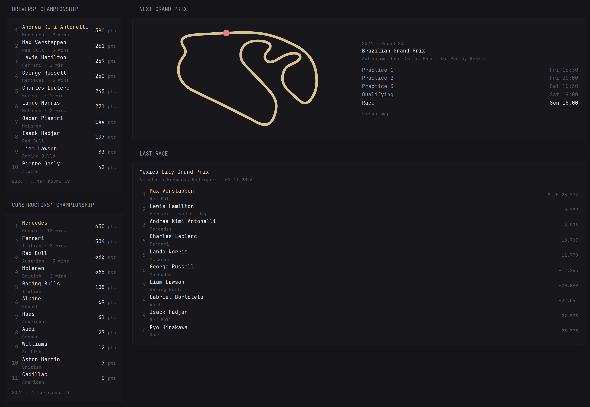

# Formula 1 Weekend Map

[Glance](https://github.com/glanceapp/glance) custom-api widgets for Formula 1: the next Grand Prix with the circuit outline and every session in your time zone, plus the drivers' and constructors' championship and the last race result. Plain YAML, no API key, no extra service to run. Labels in seven languages.

## Preview



- **Next Grand Prix**: the circuit drawn as an outline with the start/finish line marked, round, circuit and the full session schedule (sprint weekends included). Circuits without outline data switch to an OpenStreetMap view on their own, or pick the map yourself.
- **Drivers' Championship** and **Constructors' Championship**: positions, points, wins, leader highlighted.
- **Last Race**: top finishers with gaps or status and the fastest lap.

Times follow the `TZ` of your Glance server. The schedule works best in a full column, the standings fit a small one.

## Next Grand Prix

```yaml
- type: custom-api
  title: Next Grand Prix
  cache: 1h
  url: https://api.jolpi.ca/ergast/f1/current/next.json
  options:
    language: en         # en, tr, de, es, fr, pt, it
    map: track           # track (circuit outline), osm (street map) or none
    # time-format: "15:04"   # Go layout, e.g. "3:04 PM"
    # track-color: "#e5d486" # default: the theme's primary colour
  template: |
    {{ $lang := .Options.StringOr "language" "en" }}
    {{ $L := "fp1=Practice 1|fp2=Practice 2|fp3=Practice 3|sq=Sprint Qualifying|sprint=Sprint|quali=Qualifying|race=Race|map=Larger map|round=Round|days=Sun Mon Tue Wed Thu Fri Sat" }}
    {{ if eq $lang "tr" }}{{ $L = "fp1=1. Antrenman|fp2=2. Antrenman|fp3=3. Antrenman|sq=Sprint Sıralama|sprint=Sprint|quali=Sıralama|race=Yarış|map=Büyük harita|round=Etap|days=Paz Pzt Sal Çar Per Cum Cmt" }}{{ end }}
    {{ if eq $lang "de" }}{{ $L = "fp1=1. Training|fp2=2. Training|fp3=3. Training|sq=Sprint-Qualifying|sprint=Sprint|quali=Qualifying|race=Rennen|map=Größere Karte|round=Runde|days=So Mo Di Mi Do Fr Sa" }}{{ end }}
    {{ if eq $lang "es" }}{{ $L = "fp1=Libres 1|fp2=Libres 2|fp3=Libres 3|sq=Clasificación sprint|sprint=Sprint|quali=Clasificación|race=Carrera|map=Mapa más grande|round=Ronda|days=dom lun mar mié jue vie sáb" }}{{ end }}
    {{ if eq $lang "fr" }}{{ $L = "fp1=Essais libres 1|fp2=Essais libres 2|fp3=Essais libres 3|sq=Qualifications sprint|sprint=Sprint|quali=Qualifications|race=Course|map=Agrandir la carte|round=Manche|days=dim lun mar mer jeu ven sam" }}{{ end }}
    {{ if eq $lang "pt" }}{{ $L = "fp1=Treino livre 1|fp2=Treino livre 2|fp3=Treino livre 3|sq=Classificação sprint|sprint=Sprint|quali=Classificação|race=Corrida|map=Mapa maior|round=Etapa|days=dom seg ter qua qui sex sáb" }}{{ end }}
    {{ if eq $lang "it" }}{{ $L = "fp1=Prove libere 1|fp2=Prove libere 2|fp3=Prove libere 3|sq=Qualifiche sprint|sprint=Sprint|quali=Qualifiche|race=Gara|map=Mappa più grande|round=Round|days=dom lun mar mer gio ven sab" }}{{ end }}
    {{ $days := .Options.StringOr "day-names" (findSubmatch "days=([^|]*)" $L) }}
    {{ $clock := .Options.StringOr "time-format" "15:04" }}
    {{ $mode := .Options.StringOr "map" "track" }}
    {{ $r := "MRData.RaceTable.Races.0" }}
    {{ $season := .JSON.Int "MRData.RaceTable.season" }}
    {{ $lat := .JSON.Float (printf "%s.Circuit.Location.lat" $r) }}
    {{ $lon := .JSON.Float (printf "%s.Circuit.Location.long" $r) }}
    {{ $cid := .JSON.String (printf "%s.Circuit.circuitId" $r) }}
    {{ $keys := "albert_park=10|shanghai=49|suzuka=46|bahrain=63|jeddah=149|miami=151|villeneuve=23|monaco=22|catalunya=15|red_bull_ring=19|silverstone=2|spa=7|hungaroring=4|zandvoort=55|monza=39|madring=153|baku=144|sepang=12|marina_bay=61|americas=9|rodriguez=65|interlagos=14|vegas=152|losail=150|yas_marina=70|imola=6|portimao=147|ricard=28|istanbul=59|mugello=146|nurburgring=72|hockenheimring=34|sochi=79" }}
    {{ $key := findSubmatch (printf `(?:^|\|)%s=(\d+)` $cid) $keys }}
    {{ $mv := 0 }}{{ $hasTrack := false }}
    {{ if and (eq $mode "track") (ne $key "") }}
      {{ $mv = newRequest (printf "https://api.multiviewer.app/api/v1/circuits/%s/%d" $key $season) | getResponse }}
      {{ if eq $mv.Response.StatusCode 200 }}{{ $hasTrack = true }}{{ else }}
        {{ $mv = newRequest (printf "https://api.multiviewer.app/api/v1/circuits/%s/%d" $key (toInt (sub (toFloat $season) 1))) | getResponse }}
        {{ if eq $mv.Response.StatusCode 200 }}{{ $hasTrack = true }}{{ end }}
      {{ end }}
    {{ end }}
    {{ if and (eq $mode "track") (not $hasTrack) }}{{ $mode = "osm" }}{{ end }}
    <div style="display: grid; grid-template-columns: repeat(auto-fit, minmax(240px, 1fr)); gap: 16px; align-items: center;">
      {{ if $hasTrack }}
        {{ $deg := toInt ($mv.JSON.Float "rotation") }}{{ $deg = mod $deg 360 }}{{ if gt $deg 180 }}{{ $deg = add (toFloat $deg) -360.0 | toInt }}{{ end }}{{ if lt $deg -180 }}{{ $deg = add (toFloat $deg) 360.0 | toInt }}{{ end }}
        {{ $a := mul (toFloat $deg) 0.0174533 }}{{ $a2 := mul $a $a }}
        {{ $sin := mul $a (add 1.0 (mul $a2 (add -0.1666667 (mul $a2 (add 0.0083333 (mul $a2 (add -0.000198413 (mul $a2 (add 0.0000027557 (mul $a2 -0.0000000251)))))))))) }}
        {{ $cos := add 1.0 (mul $a2 (add -0.5 (mul $a2 (add 0.0416667 (mul $a2 (add -0.00138889 (mul $a2 (add 0.0000248016 (mul $a2 (add -0.000000275573 (mul $a2 0.00000000208768))))))))))) }}
        {{ $ys := $mv.JSON.Array "y" }}
        {{ $minx := 1e9 }}{{ $maxx := -1e9 }}{{ $miny := 1e9 }}{{ $maxy := -1e9 }}{{ $pts := "" }}{{ $sx := 0.0 }}{{ $sy := 0.0 }}
        {{ range $i, $e := $mv.JSON.Array "x" }}
          {{ $x0 := $e.Float "" }}{{ $y0 := (index $ys $i).Float "" }}
          {{ $x := sub (mul $x0 $cos) (mul $y0 $sin) }}{{ $y := mul (add (mul $x0 $sin) (mul $y0 $cos)) -1.0 }}
          {{ if eq $i 0 }}{{ $sx = $x }}{{ $sy = $y }}{{ end }}
          {{ if lt $x $minx }}{{ $minx = $x }}{{ end }}{{ if gt $x $maxx }}{{ $maxx = $x }}{{ end }}
          {{ if lt $y $miny }}{{ $miny = $y }}{{ end }}{{ if gt $y $maxy }}{{ $maxy = $y }}{{ end }}
          {{ $pts = printf "%s%.0f,%.0f " $pts $x $y }}
        {{ end }}
        {{ $w := sub $maxx $minx }}{{ $h := sub $maxy $miny }}{{ $pad := div (add $w $h) 25.0 }}
        <svg viewBox="{{ printf "%.0f %.0f %.0f %.0f" (sub $minx $pad) (sub $miny $pad) (add $w (mul $pad 2.0)) (add $h (mul $pad 2.0)) }}" role="img" aria-label="Circuit outline" class="color-primary" style="width: 100%; max-height: 280px;">
          <polygon points="{{ $pts }}" fill="none" stroke="{{ .Options.StringOr "track-color" "currentColor" }}" stroke-width="{{ printf "%.0f" (div (add $w $h) 90.0) }}" stroke-linejoin="round"/>
          <circle cx="{{ printf "%.0f" $sx }}" cy="{{ printf "%.0f" $sy }}" r="{{ printf "%.0f" (div (add $w $h) 70.0) }}" fill="var(--color-negative)"/>
        </svg>
      {{ else if eq $mode "osm" }}
      <iframe loading="lazy" referrerpolicy="no-referrer" title="Circuit map" style="width: 100%; height: 320px; border: 0; border-radius: var(--border-radius);"
        src="https://www.openstreetmap.org/export/embed.html?bbox={{ sub $lon 0.018 }}%2C{{ sub $lat 0.011 }}%2C{{ add $lon 0.018 }}%2C{{ add $lat 0.011 }}&amp;layer=mapnik&amp;marker={{ $lat }}%2C{{ $lon }}"></iframe>
      {{ end }}
      <div>
        <p class="size-h6 color-subdue">{{ $season }} · {{ .Options.StringOr "label-round" (findSubmatch "round=([^|]*)" $L) }} {{ .JSON.String (printf "%s.round" $r) }}</p>
        <p class="color-highlight">{{ .JSON.String (printf "%s.raceName" $r) }}</p>
        <p class="size-h6 color-subdue">{{ .JSON.String (printf "%s.Circuit.circuitName" $r) }}, {{ .JSON.String (printf "%s.Circuit.Location.locality" $r) }}, {{ .JSON.String (printf "%s.Circuit.Location.country" $r) }}</p>
        <ul class="list list-gap-6" style="margin-top: 10px;">
          {{ if .JSON.Exists (printf "%s.FirstPractice" $r) }}{{ $t := (parseTime "RFC3339" (printf "%sT%s" (.JSON.String (printf "%s.FirstPractice.date" $r)) (.JSON.String (printf "%s.FirstPractice.time" $r)))).Local }}<li class="flex justify-between gap-10"><span>{{ .Options.StringOr "label-fp1" (findSubmatch "fp1=([^|]*)" $L) }}</span><span class="color-subdue">{{ findSubmatch (printf `^(?:\S+ ){%d}(\S+)` $t.Weekday) $days }} {{ $t.Format $clock }}</span></li>{{ end }}
          {{ if .JSON.Exists (printf "%s.SecondPractice" $r) }}{{ $t := (parseTime "RFC3339" (printf "%sT%s" (.JSON.String (printf "%s.SecondPractice.date" $r)) (.JSON.String (printf "%s.SecondPractice.time" $r)))).Local }}<li class="flex justify-between gap-10"><span>{{ .Options.StringOr "label-fp2" (findSubmatch "fp2=([^|]*)" $L) }}</span><span class="color-subdue">{{ findSubmatch (printf `^(?:\S+ ){%d}(\S+)` $t.Weekday) $days }} {{ $t.Format $clock }}</span></li>{{ end }}
          {{ if .JSON.Exists (printf "%s.ThirdPractice" $r) }}{{ $t := (parseTime "RFC3339" (printf "%sT%s" (.JSON.String (printf "%s.ThirdPractice.date" $r)) (.JSON.String (printf "%s.ThirdPractice.time" $r)))).Local }}<li class="flex justify-between gap-10"><span>{{ .Options.StringOr "label-fp3" (findSubmatch "fp3=([^|]*)" $L) }}</span><span class="color-subdue">{{ findSubmatch (printf `^(?:\S+ ){%d}(\S+)` $t.Weekday) $days }} {{ $t.Format $clock }}</span></li>{{ end }}
          {{ if .JSON.Exists (printf "%s.SprintQualifying" $r) }}{{ $t := (parseTime "RFC3339" (printf "%sT%s" (.JSON.String (printf "%s.SprintQualifying.date" $r)) (.JSON.String (printf "%s.SprintQualifying.time" $r)))).Local }}<li class="flex justify-between gap-10"><span>{{ .Options.StringOr "label-sq" (findSubmatch "sq=([^|]*)" $L) }}</span><span class="color-subdue">{{ findSubmatch (printf `^(?:\S+ ){%d}(\S+)` $t.Weekday) $days }} {{ $t.Format $clock }}</span></li>{{ end }}
          {{ if .JSON.Exists (printf "%s.Sprint" $r) }}{{ $t := (parseTime "RFC3339" (printf "%sT%s" (.JSON.String (printf "%s.Sprint.date" $r)) (.JSON.String (printf "%s.Sprint.time" $r)))).Local }}<li class="flex justify-between gap-10"><span>{{ .Options.StringOr "label-sprint" (findSubmatch "sprint=([^|]*)" $L) }}</span><span class="color-subdue">{{ findSubmatch (printf `^(?:\S+ ){%d}(\S+)` $t.Weekday) $days }} {{ $t.Format $clock }}</span></li>{{ end }}
          {{ if .JSON.Exists (printf "%s.Qualifying" $r) }}{{ $t := (parseTime "RFC3339" (printf "%sT%s" (.JSON.String (printf "%s.Qualifying.date" $r)) (.JSON.String (printf "%s.Qualifying.time" $r)))).Local }}<li class="flex justify-between gap-10"><span>{{ .Options.StringOr "label-quali" (findSubmatch "quali=([^|]*)" $L) }}</span><span class="color-subdue">{{ findSubmatch (printf `^(?:\S+ ){%d}(\S+)` $t.Weekday) $days }} {{ $t.Format $clock }}</span></li>{{ end }}
          {{ $t := (parseTime "RFC3339" (printf "%sT%s" (.JSON.String (printf "%s.date" $r)) (.JSON.String (printf "%s.time" $r)))).Local }}
          <li class="flex justify-between gap-10"><span class="color-primary">{{ .Options.StringOr "label-race" (findSubmatch "race=([^|]*)" $L) }}</span><span class="color-highlight">{{ findSubmatch (printf `^(?:\S+ ){%d}(\S+)` $t.Weekday) $days }} {{ $t.Format $clock }}</span></li>
        </ul>
        <p class="size-h6 color-subdue" style="margin-top: 8px;"><a href="https://www.openstreetmap.org/?mlat={{ $lat }}&amp;mlon={{ $lon }}#map=15/{{ $lat }}/{{ $lon }}" target="_blank" rel="noreferrer">{{ .Options.StringOr "label-map" (findSubmatch "map=([^|]*)" $L) }}</a></p>
      </div>
    </div>
```

| Option | Default | Meaning |
|---|---|---|
| `language` | `en` | `en`, `tr`, `de`, `es`, `fr`, `pt`, `it` |
| `map` | `track` | `track` (circuit outline), `osm` (OpenStreetMap embed) or `none` |
| `track-color` | theme primary | Any CSS colour for the outline |
| `time-format` | `15:04` | Go time layout, e.g. `3:04 PM` |
| `label-fp1`, `label-fp2`, `label-fp3`, `label-sq`, `label-sprint`, `label-quali`, `label-race`, `label-map`, `label-round` | per language | Override any label |
| `day-names` | per language | Space-separated, Sunday first |

## Drivers' Championship

```yaml
- type: custom-api
  title: Drivers' Championship
  cache: 1h
  url: https://api.jolpi.ca/ergast/f1/current/driverStandings.json
  options:
    language: en         # en, tr, de, es, fr, pt, it
    limit: 10
  template: |
    {{ $lang := .Options.StringOr "language" "en" }}
    {{ $L := "pts=pts|win=win|wins=wins|after=After round %s" }}
    {{ if eq $lang "tr" }}{{ $L = "pts=puan|win=galibiyet|wins=galibiyet|after=%s. yarıştan sonra" }}{{ end }}
    {{ if eq $lang "de" }}{{ $L = "pts=Pkt.|win=Sieg|wins=Siege|after=Nach Runde %s" }}{{ end }}
    {{ if eq $lang "es" }}{{ $L = "pts=pts|win=victoria|wins=victorias|after=Tras la ronda %s" }}{{ end }}
    {{ if eq $lang "fr" }}{{ $L = "pts=pts|win=victoire|wins=victoires|after=Après la manche %s" }}{{ end }}
    {{ if eq $lang "pt" }}{{ $L = "pts=pts|win=vitória|wins=vitórias|after=Após a etapa %s" }}{{ end }}
    {{ if eq $lang "it" }}{{ $L = "pts=punti|win=vittoria|wins=vittorie|after=Dopo il round %s" }}{{ end }}
    {{ $s := "MRData.StandingsTable.StandingsLists.0" }}
    {{ $limit := .Options.IntOr "limit" 10 }}
    <ul class="list list-gap-6">
      {{ range $i, $d := .JSON.Array (printf "%s.DriverStandings" $s) }}{{ if lt $i $limit }}
      <li class="flex items-center gap-10">
        <span class="color-subdue" style="min-width: 2ch; text-align: right;">{{ $d.String "positionText" }}</span>
        <div class="grow min-width-0">
          <p class="{{ if eq $i 0 }}color-primary{{ else }}color-highlight{{ end }} text-truncate">{{ $d.String "Driver.givenName" }} {{ $d.String "Driver.familyName" }}</p>
          <p class="size-h6 color-subdue text-truncate">{{ $d.String "Constructors.0.name" | trimSuffix " F1 Team" | replaceMatches "^RB$" "Racing Bulls" }}{{ if gt ($d.Int "wins") 0 }} · {{ $d.String "wins" }} {{ if eq ($d.Int "wins") 1 }}{{ findSubmatch "win=([^|]*)" $L }}{{ else }}{{ findSubmatch "wins=([^|]*)" $L }}{{ end }}{{ end }}</p>
        </div>
        <span class="{{ if eq $i 0 }}color-primary{{ else }}color-highlight{{ end }}">{{ $d.String "points" }} <span class="size-h6 color-subdue">{{ findSubmatch "pts=([^|]*)" $L }}</span></span>
      </li>
      {{ end }}{{ end }}
    </ul>
    <p class="size-h6 color-subdue" style="margin-top: 8px;">{{ .JSON.String "MRData.StandingsTable.season" }} · {{ printf (findSubmatch "after=([^|]*)" $L) (.JSON.String (printf "%s.round" $s)) }}</p>
```

## Constructors' Championship

```yaml
- type: custom-api
  title: Constructors' Championship
  cache: 1h
  url: https://api.jolpi.ca/ergast/f1/current/constructorStandings.json
  options:
    language: en         # en, tr, de, es, fr, pt, it
    limit: 11
  template: |
    {{ $lang := .Options.StringOr "language" "en" }}
    {{ $L := "pts=pts|win=win|wins=wins|after=After round %s" }}
    {{ if eq $lang "tr" }}{{ $L = "pts=puan|win=galibiyet|wins=galibiyet|after=%s. yarıştan sonra" }}{{ end }}
    {{ if eq $lang "de" }}{{ $L = "pts=Pkt.|win=Sieg|wins=Siege|after=Nach Runde %s" }}{{ end }}
    {{ if eq $lang "es" }}{{ $L = "pts=pts|win=victoria|wins=victorias|after=Tras la ronda %s" }}{{ end }}
    {{ if eq $lang "fr" }}{{ $L = "pts=pts|win=victoire|wins=victoires|after=Après la manche %s" }}{{ end }}
    {{ if eq $lang "pt" }}{{ $L = "pts=pts|win=vitória|wins=vitórias|after=Após a etapa %s" }}{{ end }}
    {{ if eq $lang "it" }}{{ $L = "pts=punti|win=vittoria|wins=vittorie|after=Dopo il round %s" }}{{ end }}
    {{ $s := "MRData.StandingsTable.StandingsLists.0" }}
    {{ $limit := .Options.IntOr "limit" 11 }}
    <ul class="list list-gap-6">
      {{ range $i, $d := .JSON.Array (printf "%s.ConstructorStandings" $s) }}{{ if lt $i $limit }}
      <li class="flex items-center gap-10">
        <span class="color-subdue" style="min-width: 2ch; text-align: right;">{{ $d.String "positionText" }}</span>
        <div class="grow min-width-0">
          <p class="{{ if eq $i 0 }}color-primary{{ else }}color-highlight{{ end }} text-truncate">{{ $d.String "Constructor.name" | trimSuffix " F1 Team" | replaceMatches "^RB$" "Racing Bulls" }}</p>
          <p class="size-h6 color-subdue text-truncate">{{ $d.String "Constructor.nationality" }}{{ if gt ($d.Int "wins") 0 }} · {{ $d.String "wins" }} {{ if eq ($d.Int "wins") 1 }}{{ findSubmatch "win=([^|]*)" $L }}{{ else }}{{ findSubmatch "wins=([^|]*)" $L }}{{ end }}{{ end }}</p>
        </div>
        <span class="{{ if eq $i 0 }}color-primary{{ else }}color-highlight{{ end }}">{{ $d.String "points" }} <span class="size-h6 color-subdue">{{ findSubmatch "pts=([^|]*)" $L }}</span></span>
      </li>
      {{ end }}{{ end }}
    </ul>
    <p class="size-h6 color-subdue" style="margin-top: 8px;">{{ .JSON.String "MRData.StandingsTable.season" }} · {{ printf (findSubmatch "after=([^|]*)" $L) (.JSON.String (printf "%s.round" $s)) }}</p>
```

## Last Race

```yaml
- type: custom-api
  title: Last Race
  cache: 1h
  url: https://api.jolpi.ca/ergast/f1/current/last/results.json
  options:
    language: en         # en, tr, de, es, fr, pt, it
    limit: 10
  template: |
    {{ $lang := .Options.StringOr "language" "en" }}
    {{ $L := "pts=pts|fl=Fastest lap|Retired=Retired|Lapped=Lapped|Disqualified=Disqualified|Did not start=Did not start" }}
    {{ if eq $lang "tr" }}{{ $L = "pts=puan|fl=En hızlı tur|Retired=Yarış dışı|Lapped=Tur geride|Disqualified=Diskalifiye|Did not start=Başlamadı" }}{{ end }}
    {{ if eq $lang "de" }}{{ $L = "pts=Pkt.|fl=Schnellste Runde|Retired=Ausgefallen|Lapped=Überrundet|Disqualified=Disqualifiziert|Did not start=Nicht gestartet" }}{{ end }}
    {{ if eq $lang "es" }}{{ $L = "pts=pts|fl=Vuelta rápida|Retired=Abandono|Lapped=Doblado|Disqualified=Descalificado|Did not start=No tomó la salida" }}{{ end }}
    {{ if eq $lang "fr" }}{{ $L = "pts=pts|fl=Meilleur tour|Retired=Abandon|Lapped=Doublé|Disqualified=Disqualifié|Did not start=Non partant" }}{{ end }}
    {{ if eq $lang "pt" }}{{ $L = "pts=pts|fl=Volta mais rápida|Retired=Abandono|Lapped=Retardatário|Disqualified=Desclassificado|Did not start=Não largou" }}{{ end }}
    {{ if eq $lang "it" }}{{ $L = "pts=punti|fl=Giro più veloce|Retired=Ritirato|Lapped=Doppiato|Disqualified=Squalificato|Did not start=Non partito" }}{{ end }}
    {{ $r := "MRData.RaceTable.Races.0" }}
    {{ $limit := .Options.IntOr "limit" 10 }}
    <p class="color-highlight">{{ .JSON.String (printf "%s.raceName" $r) }}</p>
    <p class="size-h6 color-subdue">{{ .JSON.String (printf "%s.Circuit.circuitName" $r) }} · {{ (parseTime "DateOnly" (.JSON.String (printf "%s.date" $r))).Format "02.01.2006" }}</p>
    <ul class="list list-gap-6" style="margin-top: 10px;">
      {{ range $i, $d := .JSON.Array (printf "%s.Results" $r) }}{{ if lt $i $limit }}
      <li class="flex items-center gap-10">
        <span class="color-subdue" style="min-width: 2ch; text-align: right;">{{ $d.String "positionText" }}</span>
        <div class="grow min-width-0">
          <p class="{{ if eq $i 0 }}color-primary{{ else }}color-highlight{{ end }} text-truncate">{{ $d.String "Driver.givenName" }} {{ $d.String "Driver.familyName" }}</p>
          <p class="size-h6 color-subdue text-truncate">{{ $d.String "Constructor.name" | trimSuffix " F1 Team" | replaceMatches "^RB$" "Racing Bulls" }}{{ if eq ($d.String "FastestLap.rank") "1" }} · {{ findSubmatch "fl=([^|]*)" $L }}{{ end }}</p>
        </div>
        <span class="size-h6 color-subdue text-right">{{ if $d.Exists "Time.time" }}{{ $d.String "Time.time" }}{{ else }}{{ $st := $d.String "status" }}{{ $tr := findSubmatch (printf `(?:^|\|)%s=([^|]*)` $st) $L }}{{ if $tr }}{{ $tr }}{{ else }}{{ $st }}{{ end }}{{ end }}</span>
      </li>
      {{ end }}{{ end }}
    </ul>
```

The standings and last race widgets take `language` (same seven) and `limit` (rows to show).

## Screenshots

Turkish and German labels


Circuit outlines: Monaco and Yas Marina


A circuit without outline data falls back to the map (Madring, left); Suzuka on the right


Standings and last race, English and Turkish


On a sports page with [Football Team Fixtures](https://github.com/darkbringer1/football-team-fixtures)


## Credits

- The track outline, standings and last race ideas come from [SkyAllinott/glance-F1](https://github.com/SkyAllinott/glance-F1), which is no longer actively maintained and needs its own API server. These widgets rebuild those features from scratch as plain custom-api templates (no server, no code copied) and add localization and the full weekend schedule.
- Circuit outlines from the public [MultiViewer](https://multiviewer.app) circuit API. It is unofficial and may change; the widget then falls back to the map.
- Race data from the [Jolpica F1 API](https://github.com/jolpica/jolpica-f1).
- Map © [OpenStreetMap contributors](https://www.openstreetmap.org/copyright).

Formula 1 is a trademark of Formula One Licensing B.V. This project is not affiliated with Formula 1.


## License

MIT, see [LICENSE](https://github.com/darkbringer1/formula1-weekend-map/blob/main/LICENSE).
