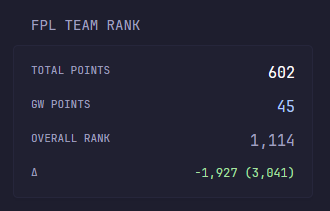

# FPL Team Rank



A `custom-api` widget that displays current [Fantasy Premier League](https://fantasy.premierleague.com) team data. Requires no API key, so a simple copy-paste is all that is needed.

## Required environment variable

- `FPL_TEAM_ID`: Fantasy Premier League team ID.

## Widget

```yaml
- type: custom-api
  title: FPL Team Rank
  cache: 5m
  url: https://fantasy.premierleague.com/api/entry/${FPL_TEAM_ID}/history/
  template: |
    {{ $data := .JSON }}
    {{ $current := $data.Array "current" }}
    {{ if ge (len $current) 1 }}
      {{ $last := index $current (sub (len $current) 1) }}
      {{ $gwPoints := $last.Int "points" }}
      {{ $total := $last.Int "total_points" }}
      {{ $rank := $last.Int "overall_rank" }}
      <div class="flex flex-column gap-10">
        <div class="flex justify-between">
          <div class="size-h6">TOTAL POINTS</div>
          <div class="color-highlight size-h3">{{ $total | formatNumber }}</div>
        </div>
        <div class="flex justify-between">
          <div class="size-h6">GW POINTS</div>
          <div class="color-primary size-h3">{{ $gwPoints | formatNumber }}</div>
        </div>
        <div class="flex justify-between">
          <div class="size-h6">OVERALL RANK</div>
          <div class="size-h3">{{ $rank | formatNumber }}</div>
        </div>
        {{ if ge (len $current) 2 }}
          {{ $prev := index $current (sub (len $current) 2) }}
          {{ $prevValue := $prev.Int "overall_rank" }}
          {{ $currValue := $last.Int "overall_rank" }}
          {{ $delta := sub $currValue $prevValue }}
          <div class="flex justify-between">
            <div class="size-h6">Δ</div>
            {{ if gt $delta 0 }}
              <div class="color-negative size-h5">+{{ $delta | formatNumber }} ({{ $prevValue | formatNumber}})</div>
            {{ else if lt $delta 0 }}
              <div class="color-positive size-h5">{{ $delta | formatNumber }} ({{ $prevValue | formatNumber}})</div>
            {{ else }}
              <div class="color-subdue size-h5">-</div>
            {{ end }}
          </div>
        {{ end }}
      </div>
    {{ end }}
```
