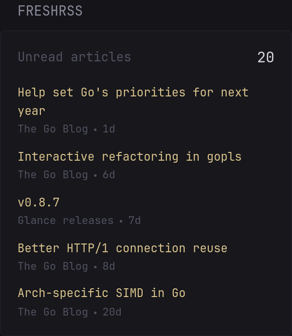

Shows the number of unread articles in [FreshRSS](https://github.com/FreshRSS/FreshRSS) and lists the latest unread ones with feed name and age. Uses the Google Reader-compatible API of FreshRSS.

```yaml
- type: custom-api
  title: FreshRSS
  title-url: ${FRESHRSS_URL}
  cache: 5m
  url: ${FRESHRSS_URL}/api/greader.php/reader/api/0/unread-count?output=json
  headers:
    Authorization: GoogleLogin auth=${FRESHRSS_API_TOKEN}
  options:
    item-count: 5
  template: |
    {{ $unread := 0 }}
    {{ range .JSON.Array "unreadcounts" }}
      {{ if eq (.String "id") "user/-/state/com.google/reading-list" }}{{ $unread = .Int "count" }}{{ end }}
    {{ end }}

    <div class="flex justify-between items-center margin-bottom-15">
      <span class="color-subdue">Unread articles</span>
      <span class="color-highlight size-h3">{{ $unread | formatNumber }}</span>
    </div>

    {{ $stream := newRequest (printf "%s/api/greader.php/reader/api/0/stream/contents/user/-/state/com.google/reading-list?output=json&xt=user/-/state/com.google/read&n=%d" "${FRESHRSS_URL}" (.Options.IntOr "item-count" 5))
        | withHeader "Authorization" "GoogleLogin auth=${FRESHRSS_API_TOKEN}"
        | getResponse }}

    {{ if ne $stream.Response.StatusCode 200 }}
      <p class="color-negative">Could not load the articles: {{ $stream.Response.Status }}</p>
    {{ else }}
      {{ $items := $stream.JSON.Array "items" }}
      {{ if eq (len $items) 0 }}
        <p class="color-positive">All caught up</p>
      {{ else }}
        <ul class="list list-gap-10">
          {{ range $items }}
            {{/* FreshRSS sends "&" as the full-width "＆" for compatibility with older clients */}}
            {{ $title := .String "title" | replaceAll "＆" "&" }}
            {{ $href := "" }}
            {{ range .Array "alternate" }}{{ $href = .String "href" }}{{ end }}
            <li>
              {{ if $href }}
                <a class="size-h5 color-primary-if-not-visited text-truncate-2-lines" href="{{ $href }}" target="_blank" rel="noreferrer">{{ $title }}</a>
              {{ else }}
                <span class="size-h5 text-truncate-2-lines">{{ $title }}</span>
              {{ end }}
              <ul class="list-horizontal-text color-subdue size-h6">
                <li>{{ .String "origin.title" | replaceAll "＆" "&" }}</li>
                <li {{ .String "published" | parseRelativeTime "unix" }}></li>
              </ul>
            </li>
          {{ end }}
        </ul>
      {{ end }}
    {{ end }}
```

## Environment variables

- `FRESHRSS_URL` - the URL of your FreshRSS instance without a trailing slash, e.g. `http://192.168.1.2:8080` or `https://freshrss.example.com`
- `FRESHRSS_API_TOKEN` - the API token of your FreshRSS user, in the form `your-username/0123abcd...` (see below)

## Getting the API token

1. As an administrator, open the settings menu (⚙) → **Authentication** and make sure **Allow API access** is enabled. FreshRSS may ask for your password again before showing this page.
2. Open the settings menu (⚙) → **Profile** and set an **API password** under *External access via API*. This is a separate password that is only used for the API.
3. Request the token with your username and the API password:

   ```sh
   curl --data-urlencode "Email=your-username" --data-urlencode "Passwd=your-api-password" \
     "https://freshrss.example.com/api/greader.php/accounts/ClientLogin"
   ```

   The response contains a line `Auth=your-username/0123abcd...`. Use everything after `Auth=` as `FRESHRSS_API_TOKEN`.

Sending the credentials in the request body, as above, keeps them out of the web server's access log. If FreshRSS is reachable from the internet, use HTTPS. The command, including the API password, may end up in your shell history.

The token gives access to the whole API of your account, including changes such as marking articles as read, and stays valid until you change the API password.

## Options

- `item-count` - how many unread articles to list (default: `5`)

## Notes

- For compatibility with older clients, the Google Reader API of FreshRSS sends `&` as the full-width `＆`. The widget turns it back into `&`. Other characters replaced the same way (`<` and `>` in titles, `? \ / , ;` in feed names) are shown as delivered, because their full-width forms are also regular text in some languages.
- If the token is wrong, Glance shows `401 Unauthorized` instead of the widget content.

Tested with Glance v0.8.7 and FreshRSS 1.30.4.
