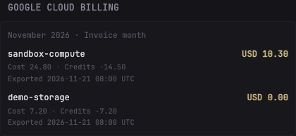

# Google Cloud Billing



Show each project's cost, applied credits, net charges and last export time for the current invoice month. Glance exchanges an OAuth refresh token and queries the BigQuery API directly. The preview uses fictional projects and amounts.

## Set up the export and access

1. Enable the [standard usage cost export](https://cloud.google.com/billing/docs/how-to/export-data-bigquery-setup) for your Cloud Billing account. Wait for the first rows in the `gcp_billing_export_v1_...` table. Note its fully qualified table ID and the dataset's location.
2. Enable the BigQuery API in the project that will run the queries. Give the dashboard identity **BigQuery Job User** on that project and **BigQuery Data Viewer** on the export table. Everyone who can view the dashboard can see the displayed costs.
3. Create a Google OAuth **Desktop app** client and authorize the dashboard identity for the `https://www.googleapis.com/auth/bigquery` scope. One way to obtain an offline grant with the Google Cloud CLI is to use a separate configuration directory:

   ```sh
   billing_auth_dir=$(mktemp -d)
   CLOUDSDK_CONFIG="$billing_auth_dir" gcloud auth application-default login \
     --client-id-file=desktop-client.json \
     --scopes=https://www.googleapis.com/auth/bigquery
   ```

   Use the `client_id`, `client_secret` and `refresh_token` from the generated `application_default_credentials.json` in that directory. Store them in your deployment's secret store. An external OAuth app in Testing typically issues refresh tokens that expire after seven days.

4. Pass the following environment variables to the **Glance process or container**. With Compose, list the variables under the Glance service’s `environment` or `env_file`.

   | Variable | Value |
   | --- | --- |
   | `GCP_BILLING_JOB_PROJECT` | Project ID where BigQuery runs and bills the query |
   | `GCP_BILLING_EXPORT_TABLE` | Fully qualified export table ID, in `project.dataset.table` form, without backticks |
   | `GCP_BILLING_LOCATION` | Exact location of the export dataset, e.g. `US` or `europe-west1` |
   | `GCP_BILLING_CLIENT_ID` | OAuth client ID |
   | `GCP_BILLING_CLIENT_SECRET` | OAuth client secret |
   | `GCP_BILLING_REFRESH_TOKEN` | Offline refresh token for the dashboard identity |

## What the numbers cover

The query uses the current UTC month and the export's [invoice.month and credits fields](https://cloud.google.com/billing/docs/how-to/export-data-bigquery-tables/standard-usage). Net charges are cost plus signed credits. Rows without a project appear under **Account charges**. Export times are per project and currency. Exports can arrive late and amounts can change before the invoice is final.

One widget reads one export table. For separate billing accounts, add another copy with its own table and settings. The widget displays up to 20 project/currency rows, ordered by currency and then net cost. It caches results for six hours and caps each query at 1 GiB of bytes billed. BigQuery can scan older partitions when filtering by invoice month. If your table exceeds the cap, review BigQuery's scan estimate before adjusting `maximumBytesBilled` in the widget.

## Glance configuration

Tested with Glance v0.8.8. Copy the YAML below or download [widget.yml](widget.yml) and include it in the page’s widgets list.

```yaml
- type: custom-api
  title: Google Cloud Billing
  title-url: https://console.cloud.google.com/billing
  cache: 6h
  options:
    job-project: "${GCP_BILLING_JOB_PROJECT}"
    location: "${GCP_BILLING_LOCATION}"
    client-id: "${GCP_BILLING_CLIENT_ID}"
    client-secret: "${GCP_BILLING_CLIENT_SECRET}"
    refresh-token: "${GCP_BILLING_REFRESH_TOKEN}"
    query: |
      SELECT
        COALESCE(project.id, 'Account charges') AS project_id,
        currency,
        FORMAT('%.2f', SUM(gross)) AS cost,
        FORMAT('%.2f', SUM(credit)) AS credits,
        FORMAT('%.2f', SUM(gross + credit)) AS net,
        FORMAT_TIMESTAMP('%F %R UTC', MAX(export_time)) AS updated,
        FORMAT_DATE('%B %Y', CURRENT_DATE('UTC')) AS invoice_month
      FROM (
        SELECT project, currency, export_time, CAST(cost AS NUMERIC) AS gross,
          IFNULL((SELECT SUM(CAST(c.amount AS NUMERIC)) FROM UNNEST(credits) AS c), 0) AS credit
        FROM `${GCP_BILLING_EXPORT_TABLE}`
        WHERE invoice.month = FORMAT_DATE('%Y%m', CURRENT_DATE('UTC'))
      )
      GROUP BY project_id, currency
      ORDER BY currency, SUM(gross + credit) DESC, project_id
  template: |
    {{ if eq (.Options.StringOr "job-project" "") "" }}
      <p class="color-subdue">Connect a BigQuery billing export to see charges.</p>
    {{ else }}
      {{ $form := printf "grant_type=refresh_token&client_id=%s&client_secret=%s&refresh_token=%s"
         (urlquery (.Options.StringOr "client-id" "")) (urlquery (.Options.StringOr "client-secret" ""))
         (urlquery (.Options.StringOr "refresh-token" "")) }}
      {{ $auth := newRequest "https://oauth2.googleapis.com/token"
         | withHeader "Content-Type" "application/x-www-form-urlencoded" | withStringBody $form | getResponse }}
      {{ if or (ne $auth.Response.StatusCode 200) (eq ($auth.JSON.String "access_token") "") }}
        <p class="color-negative">Google authorization failed. Check the billing credentials.</p>
      {{ else }}
        {{ $base := printf "https://bigquery.googleapis.com/bigquery/v2/projects/%s/queries" (urlquery (.Options.StringOr "job-project" "")) }}
        {{ $location := .Options.StringOr "location" "US" }}
        {{ $bearer := print "Bearer " ($auth.JSON.String "access_token") }}
        {{ $body := printf `{"query":%q,"location":%q,"useLegacySql":false,"timeoutMs":3000,"maximumBytesBilled":"1073741824","maxResults":20}` (.Options.StringOr "query" "") $location }}
        {{ $res := newRequest $base | withHeader "Authorization" $bearer | withHeader "Content-Type" "application/json" | withStringBody $body | getResponse }}
        {{ if and (eq $res.Response.StatusCode 200) (not ($res.JSON.Bool "jobComplete")) (ne ($res.JSON.String "jobReference.jobId") "") }}
          {{ $res = newRequest (printf "%s/%s" $base (urlquery ($res.JSON.String "jobReference.jobId")))
             | withHeader "Authorization" $bearer | withParameter "location" $location
             | withParameter "timeoutMs" "3000" | withParameter "maxResults" "20" | getResponse }}
        {{ end }}
        {{ if ne $res.Response.StatusCode 200 }}
          <p class="color-negative">BigQuery error {{ $res.Response.StatusCode }} · {{ $res.JSON.String "error.errors.0.reason" }}</p>
        {{ else if not ($res.JSON.Bool "jobComplete") }}
          <p class="color-subdue">Query still running. Check BigQuery job history.</p>
        {{ else if eq ($res.JSON.Int "totalRows") 0 }}
          <p class="color-subdue">No exported charges for this invoice month.</p>
        {{ else }}
          <p class="size-h5 color-subdue margin-bottom-10">{{ $res.JSON.String "rows.0.f.6.v" }} · Invoice month</p>
          <ul class="list list-gap-10">
            {{ range $res.JSON.Array "rows" }}
              <li>
                <div class="flex justify-between gap-10">
                  <span class="color-highlight" style="overflow-wrap: anywhere;">{{ .String "f.0.v" }}</span>
                  <strong class="color-primary" style="white-space: nowrap;">{{ .String "f.1.v" }} {{ .String "f.4.v" }}</strong>
                </div>
                <div class="size-h6 color-subdue">Cost {{ .String "f.2.v" }} · Credits {{ .String "f.3.v" }}</div>
                <div class="size-h6 color-subdue">Exported {{ .String "f.5.v" }}</div>
              </li>
            {{ end }}
          </ul>
          {{ if ne ($res.JSON.String "pageToken") "" }}
            <p class="size-h6 color-subdue margin-top-10">Showing the first 20 rows. Open Billing for all projects.</p>
          {{ end }}
        {{ end }}
      {{ end }}
    {{ end }}
```
