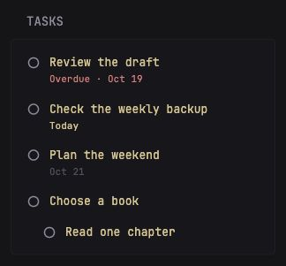

# Google Tasks



Display pending Google Tasks with due dates, overdue/today indicators, indented subtasks and optional notes. Uses the Tasks API directly through Glance's `custom-api` widget, with no companion service or browser-side credentials. Task links open Google Tasks; completing or editing tasks happens there.

## Configuration

Copy this YAML into your Glance configuration, or download [widget.yml](widget.yml) and include it:

```yaml
- type: custom-api
  title: Tasks
  title-url: https://tasks.google.com/
  cache: 15m
  options:
    client-id: "${GOOGLE_CLIENT_ID}"
    client-secret: "${GOOGLE_CLIENT_SECRET}"
    refresh-token: "${GOOGLE_REFRESH_TOKEN}"
    list-id: "@default"
    collapse-after: 5
    show-notes: false
  template: |
    {{ $clientID := .Options.StringOr "client-id" "" | trimSpace }}
    {{ $clientSecret := .Options.StringOr "client-secret" "" | trimSpace }}
    {{ $refreshToken := .Options.StringOr "refresh-token" "" | trimSpace }}
    {{ if or (eq $clientID "") (eq $clientSecret "") (eq $refreshToken "") }}
      <p class="color-subdue">Authorization needed.</p>
    {{ else }}
      {{ $body := printf "client_id=%s&client_secret=%s&refresh_token=%s&grant_type=refresh_token" (urlquery $clientID) (urlquery $clientSecret) (urlquery $refreshToken) }}
      {{ $token := newRequest "https://oauth2.googleapis.com/token"
        | withHeader "Content-Type" "application/x-www-form-urlencoded"
        | withStringBody $body
        | getResponse }}
      {{ if ne $token.Response.StatusCode 200 }}
        <p class="color-negative">Authorization failed. Reconnect Google.</p>
      {{ else }}
        {{ $listID := .Options.StringOr "list-id" "@default" | trimSpace }}
        {{ if eq $listID "" }}{{ $listID = "@default" }}{{ end }}
        {{ $tasks := newRequest (concat "https://tasks.googleapis.com/tasks/v1/lists/" (urlquery $listID) "/tasks")
          | withParameter "showCompleted" "false"
          | withParameter "showDeleted" "false"
          | withParameter "showHidden" "false"
          | withParameter "showAssigned" "true"
          | withParameter "maxResults" "100"
          | withHeader "Authorization" (print "Bearer " ($token.JSON.String "access_token"))
          | getResponse }}
        {{ if ne $tasks.Response.StatusCode 200 }}
          <p class="color-negative">Unavailable (HTTP {{ $tasks.Response.StatusCode }})</p>
        {{ else }}
          {{ $today := now.Local | formatTime "2006-01-02" }}
          {{ $showNotes := .Options.BoolOr "show-notes" false }}
          {{ $collapseAfter := .Options.IntOr "collapse-after" 5 }}
          {{ if lt $collapseAfter 1 }}{{ $collapseAfter = 5 }}{{ end }}
          {{ $count := 0 }}
          <ul class="list list-gap-14 collapsible-container" data-collapse-after="{{ $collapseAfter }}">
            {{ range $tasks.JSON.Array "items" }}
              {{ if and (ne (.String "status") "completed") (not (.Bool "deleted")) (not (.Bool "hidden")) }}
                {{ $count = add $count 1 }}
                {{ $title := .String "title" }}
                {{ if eq $title "" }}{{ $title = "Untitled" }}{{ end }}
                {{ $link := .String "webViewLink" }}
                {{ if eq $link "" }}{{ $link = "https://tasks.google.com/" }}{{ end }}
                <li class="flex items-start gap-10" {{ if ne (.String "parent") "" }}style="margin-left: 1.8rem;"{{ end }}>
                  <svg aria-hidden="true" width="16" height="16" viewBox="0 0 16 16" fill="none" style="flex-shrink: 0; margin-top: 3px;"><circle cx="8" cy="8" r="5.5" stroke="currentColor" stroke-width="1.5"/></svg>
                  <div class="grow min-width-0">
                    <a class="color-primary" href="{{ $link }}" target="_blank" rel="noopener noreferrer" style="overflow-wrap: anywhere;">{{ $title }}</a>
                    {{ $due := .String "due" }}
                    {{ if ne $due "" }}
                      {{ $date := $due | parseTime "rfc3339" }}
                      {{ $day := $date | formatTime "2006-01-02" }}
                      <div class="size-h6 {{ if lt $day $today }}color-negative{{ else if eq $day $today }}color-primary{{ else }}color-subdue{{ end }}">
                        {{ if lt $day $today }}Overdue · {{ $date | formatTime "Jan 02" }}{{ else if eq $day $today }}Today{{ else }}{{ $date | formatTime "Jan 02" }}{{ end }}
                      </div>
                    {{ end }}
                    {{ if and $showNotes (ne (.String "notes") "") }}
                      <p class="size-h6 color-subdue" style="white-space: pre-wrap; overflow-wrap: anywhere;">{{ .String "notes" }}</p>
                    {{ end }}
                  </div>
                </li>
              {{ end }}
            {{ end }}
          </ul>
          {{ if eq $count 0 }}<p class="color-subdue">No tasks.</p>{{ end }}
          {{ if ne ($tasks.JSON.String "nextPageToken") "" }}
            <p class="size-h6 color-subdue margin-top-10">Showing the first 100 tasks. <a class="color-primary" href="https://tasks.google.com/" target="_blank" rel="noopener noreferrer">Open Tasks →</a></p>
          {{ end }}
        {{ end }}
      {{ end }}
    {{ end }}
```

### Options

| Option | Default | Description |
| --- | --- | --- |
| `client-id` | `${GOOGLE_CLIENT_ID}` | OAuth Desktop client ID |
| `client-secret` | `${GOOGLE_CLIENT_SECRET}` | OAuth client secret |
| `refresh-token` | `${GOOGLE_REFRESH_TOKEN}` | Refresh token with Tasks read-only access |
| `list-id` | `@default` | Default task list, or a specific list ID |
| `collapse-after` | `5` | Tasks visible before expanding the list |
| `show-notes` | `false` | Show task notes as escaped plain text |

Use separate widget instances, optionally inside a Glance group, to display several task lists. Change `title` to distinguish them. Retrieve list IDs through [`tasklists.list`](https://developers.google.com/workspace/tasks/reference/rest/v1/tasklists/list) using an authorized access token; use the returned `id`, not the list's title.

## Google setup

1. Create or choose a Google Cloud project and enable **Google Tasks API**.
2. Configure the OAuth consent screen and create a **Desktop app** OAuth client. Download its client JSON.
3. Follow Google's [Python quickstart](https://developers.google.com/workspace/tasks/quickstart/python) to authorize the account with this scope:

   ```text
   https://www.googleapis.com/auth/tasks.readonly
   ```

   The quickstart uses a loopback browser callback and saves `token.json`. Use its `client_id`, `client_secret` and `refresh_token` fields for the environment variables below. An access token alone expires and is not sufficient. If an existing token was created with different scopes, authorize again with the intended scope set.

4. Set the variables in Glance's environment and recreate the container:

   ```dotenv
   GOOGLE_CLIENT_ID=your-client-id
   GOOGLE_CLIENT_SECRET=your-client-secret
   GOOGLE_REFRESH_TOKEN=your-refresh-token
   ```

   When using Docker Compose, pass these variables into the Glance service; placing them in `.env` alone does not inject them into the container.

If you also use [Google Calendar List](../google-calendar-list/), the same credential set can serve both widgets, but authorize **both** `calendar.readonly` and `tasks.readonly`. A Calendar-only grant cannot read Tasks; a Tasks-only grant cannot read Calendar. Use a separate OAuth credential set if you prefer to isolate the widgets, and change the three option values accordingly.

For an External OAuth app in Testing, refresh tokens for these scopes can expire after seven days. See Google's [refresh-token expiration documentation](https://developers.google.com/identity/protocols/oauth2#expiration). Publishing a personal-use app and reauthorizing removes that testing-specific expiry; tokens can still be revoked or expire for other reasons.

## Behavior and limits

- Read-only: token exchange plus task-list reads. No task creation, completion, deletion or modification.
- Completed, hidden and deleted tasks are excluded. Assigned tasks from supported Google surfaces are requested as well.
- Dates come from the task's `due` calendar date. The API does not expose due times; no time is invented or shifted through the local timezone. Today is based on Glance's local timezone (`TZ` in Docker).
- Subtasks are indented; a parent absent from the returned page is not fetched separately.
- Up to 100 pending tasks are requested per refresh. A continuation notice appears when Google returns another page. This is a dashboard preview, not a complete task export.
- Titles and notes are escaped by the template. Notes are hidden by default.
- Empty lists, missing credentials, failed authorization and API errors have explicit states. The card caches for 15 minutes; refresh the page after the cache expires to fetch changes.

Tested with Glance v0.8.5 using synthetic tasks, including empty/error states, date-only deadlines, subtasks, pagination notices, credential form encoding and HTML escaping. The preview contains fictional data.

## Troubleshooting

| Display | Check |
| --- | --- |
| Authorization needed | All three credential options must be set |
| Authorization failed | Matching OAuth client/refresh token, grant validity and network access |
| HTTP 403 | Tasks API enabled and `tasks.readonly` granted |
| HTTP 404 | `list-id` belongs to the authorized account |
| No tasks | Selected list has no visible pending tasks |

The OAuth refresh pattern is inspired by [Google Calendar List](../google-calendar-list/). API behavior follows Google's [`tasks.list`](https://developers.google.com/workspace/tasks/reference/rest/v1/tasks/list) and [Task resource](https://developers.google.com/tasks/reference/rest/v1/tasks) documentation.
