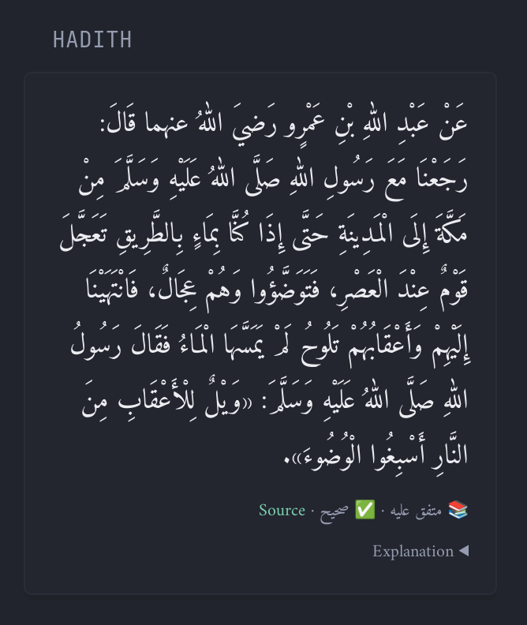

Shows a random hadith with its source (e.g. Bukhari, Muslim), its grade of authenticity and a collapsible explanation. A new hadith appears each time the cache expires.

Hadiths come from the free [HadeethEnc API](https://hadeethenc.com/en/home) (Encyclopedia of Translated Prophetic Hadiths), whose content is reviewed and graded by scholars. No API key is needed. It is available in **72 languages**: Arabic, English, French, Urdu, Indonesian, Turkish, Spanish, German and more.

```yaml
- type: custom-api
  title: Hadith
  cache: 6h                       # a new hadith each time the cache expires
  options:
    language: ar                  # ar, en, fr, ur, id, tr, es, de... (72 languages, see https://hadeethenc.com/api/v1/languages)
    show-explanation: true        # collapsible explanation under the hadith
  template: |
    {{ $lang := .Options.StringOr "language" "ar" }}
    {{ $api := "https://hadeethenc.com/api/v1" }}
    {{ $cats := newRequest (concat $api "/categories/roots/") | withParameter "language" $lang | getResponse }}

    {{ if ne $cats.Response.StatusCode 200 }}
      <p class="color-negative">Could not load hadith: {{ $cats.Response.Status }}</p>
    {{ else }}
    {{/* Total number of hadiths available in this language */}}
    {{ $total := 0 }}
    {{ range $cats.JSON.Array "@this" }}{{ $total = toInt (add (toFloat $total) (.Float "hadeeths_count")) }}{{ end }}

    {{/* Pseudo-random index from the current time (no random function in templates) */}}
    {{ $t := now }}
    {{ $seed := add (mul (toFloat $t.YearDay) 86400) (add (mul (toFloat $t.Hour) 3600) (add (mul (toFloat $t.Minute) 60) (toFloat $t.Second))) }}
    {{ $r := mod (toInt (mul $seed 7919)) $total }}

    {{/* Find the category and position that index falls in */}}
    {{ $acc := 0 }}{{ $cat := "" }}{{ $page := 1 }}
    {{ range $cats.JSON.Array "@this" }}
      {{ $n := toInt (.Float "hadeeths_count") }}
      {{ $end := toInt (add (toFloat $acc) (toFloat $n)) }}
      {{ if and (eq $cat "") (lt $r $end) }}
        {{ $cat = .String "id" }}{{ $page = toInt (add (sub (toFloat $r) (toFloat $acc)) 1) }}
      {{ end }}
      {{ $acc = $end }}
    {{ end }}

    {{ $list := newRequest (concat $api "/hadeeths/list/")
        | withParameter "language" $lang | withParameter "category_id" $cat
        | withParameter "page" (printf "%d" $page) | withParameter "per_page" "1" | getResponse }}
    {{ $id := $list.JSON.String "data.0.id" }}
    {{ $h := newRequest (concat $api "/hadeeths/one/") | withParameter "language" $lang | withParameter "id" $id | getResponse }}

    {{ $rtl := or (eq $lang "ar") (eq $lang "ur") (eq $lang "fa") (eq $lang "ps") (eq $lang "ug") (eq $lang "prs") (eq $lang "ku") }}
    {{ $explanation := $h.JSON.String "explanation" }}
    {{ $short := findMatch "(?s)^.{0,700}" $explanation }}

    <div {{ if $rtl }}dir="rtl" style="text-align:right;line-height:2;font-family:'Amiri','Noto Naskh Arabic','Scheherazade New',serif"{{ else }}style="line-height:1.7"{{ end }}>
      <p class="color-highlight" style="{{ if $rtl }}font-size:1.35em;{{ end }}margin:0">{{ $h.JSON.String "hadeeth" }}</p>
      <p class="size-h6" style="margin-top:0.6rem">
        📚 <bdi>{{ $h.JSON.String "attribution" }}</bdi> · ✅ <bdi>{{ $h.JSON.String "grade" }}</bdi> ·
        <a href="https://hadeethenc.com/{{ $lang }}/browse/hadith/{{ $id }}" target="_blank" rel="noreferrer" class="color-primary">Source</a>
      </p>
      {{ if and (.Options.BoolOr "show-explanation" true) (ne $explanation "") }}
      <details style="margin-top:0.4rem">
        <summary class="size-h6" style="cursor:pointer">Explanation</summary>
        <p class="size-h5" style="margin-top:0.4rem">{{ $short }}{{ if ne (len $short) (len $explanation) }}…{{ end }}</p>
      </details>
      {{ end }}
    </div>
    {{ end }}
```

## Options

| Option | Description |
|---|---|
| `language` | Language code, default `ar`. Full list: [hadeethenc.com/api/v1/languages](https://hadeethenc.com/api/v1/languages). Arabic, Urdu, Persian and other right-to-left languages are displayed right-to-left automatically. |
| `show-explanation` | `true` to show a collapsible explanation under the hadith (trimmed to about 700 characters, with a link to the full page). |

## Notes

- Templates have no random function, so the hadith is picked from the current time (seconds in the year multiplied by a prime, modulo the number of hadiths in that language). Each cache refresh gives a different hadith.
- `cache: 6h` gives about four hadiths a day. Use `24h` for a "hadith of the day".
- Arabic uses the Amiri / Noto Naskh Arabic fonts if they are installed, and falls back to the system's serif font otherwise.
- The number of available hadiths depends on the language (about 4,270 in Arabic, 2,780 in English, 2,120 in French).
