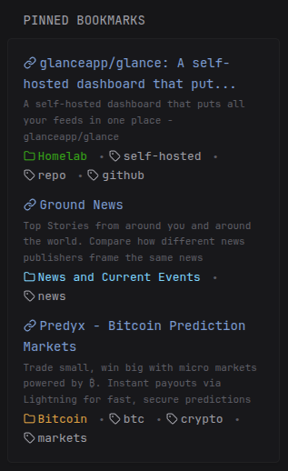

# Linkwarden bookmark lists
Display all kinds of lists from a Linkwarden instance by using Linkwarden's [Advanced Search](https://docs.linkwarden.app/usage/advanced-search) options.



## Environment Variables
The following environment variables are required in your `.env` file:

| Variable | Description | Example |
|-----------|--------------|----------|
| `LINKWARDEN_HOST` | The URL of your Linkwarden instance. No trailing slash.| `https://my-linkwarden.host` |
| `LINKWARDEN_API_KEY` | Linkwarden Access Key generated in your Linkwarden Settings UI.|  |
---

## Configuring your search query
Choose the content of your list by replacing `<SEARCH QUERY>` in the widget config with a search string. Write it exactly as you would in the Linkwarden search box; Glance URL-encodes it for you. See the [Linkwarden docs](https://docs.linkwarden.app/usage/advanced-search) for the full list of advanced search parameters. Some examples:

| Description | Search string |
|-------------|---------------|
| Your pinned bookmarks | `pinned:true` |
| All bookmarks with a specific tag | `tag:my-tag` |
| All bookmarks in a collection | `collection:my-collection` |
| All three combined | `tag:my-tag collection:my-collection pinned:true` |

Keep the single quotes around the search string in the YAML.

### Sorting
Set the `sort` parameter to one of the following values:

| Value | Order |
|-------|-------|
| `0` | Date, newest first (default) |
| `1` | Date, oldest first |
| `2` | Name, A–Z |
| `3` | Name, Z–A |
| `4` | Description, A–Z |
| `5` | Description, Z–A |
---

### Configure how bookmarks are displayed

You can also choose whether to display tags, collection name, bookmark description, and icons by setting any of the relevant `options` to true or false in the widget YAML

---

## Widget
```yaml
        - type: custom-api
          cache: 30m
          headers:
            Authorization: Bearer ${LINKWARDEN_API_KEY}
          method: GET
          title: Bookmarks
          url: ${LINKWARDEN_HOST}/api/v1/search
          parameters:
            searchQueryString: '<SEARCH QUERY>'
            sort: 0
          options:
            show_tags: true
            show_collection: true
            show_description: true
            show_icons: true
            max_items: 0
            collapse_after: 5
            debug: false
          template: |
            {{ $show_tags := .Options.show_tags }}
            {{ $show_collection := .Options.show_collection }}
            {{ $show_description := .Options.show_description }}
            {{ $show_icons := .Options.show_icons }}
            {{ $max_items := .Options.IntOr "max_items" 0 }}
            {{ $collapse_after := .Options.IntOr "collapse_after" 5 }}
            {{ $debug := .Options.debug }}
            {{ if $debug }}
                <details>
                    <summary>Debug JSON</summary>
                    <pre style="font-size:10px;white-space: pre-wrap">
                    <code>
                        {{ (printf "%+v" .JSON) }}
                    </code>
                    </pre>
                </details>
            {{ end }}
            <ul class="list list-gap-10 collapsible-container" data-collapse-after="{{ $collapse_after }}">
                {{ range $i, $link := .JSON.Array "data.links" }}
                {{ if or (eq $max_items 0) (lt $i $max_items) }}
                    <li>
                    {{ $title := .String "name" }}
                    {{ if gt (len $title) 50 }}
                        {{ $title = (slice $title 0 50) | printf "%s..." }}
                    {{ end }}
                    {{ $description := .String "metaDescription" }}
                    {{ if gt (len $description) 120 }}
                        {{ $description = (slice $description 0 120) | printf "%s..." }}
                    {{ end }}

                    <a class="size-title-dynamic color-primary-if-not-visited"
                        href="{{ .String "url" }}"
                        target="_self"
                        rel="noopener noreferrer">
                        {{ if $show_icons }}<svg xmlns="http://www.w3.org/2000/svg" viewBox="0 0 24 24" fill="none" stroke="currentColor" stroke-width="2" stroke-linecap="round" stroke-linejoin="round" style="display: inline-block; width: 1em; height: 1em; vertical-align: -0.125em; margin-right: 4px;"><path d="M10 13a5 5 0 0 0 7.54.54l3-3a5 5 0 0 0-7.07-7.07l-1.72 1.71"/><path d="M14 11a5 5 0 0 0-7.54-.54l-3 3a5 5 0 0 0 7.07 7.07l1.71-1.71"/></svg>{{ end }}{{ $title }}
                    </a>

                    {{ if and $show_description $description }}
                        <p class="size-h6 color-subdue" style="margin-top: 3px;">
                            {{ $description }}
                        </p>
                    {{ end }}

                    {{ if or $show_collection $show_tags }}
                    <ul class="list-horizontal-text" style="margin-top: 3px;">
                        {{ if $show_collection }}
                            <li style="color: {{ .String "collection.color" }};">
                            {{ if $show_icons }}<svg xmlns="http://www.w3.org/2000/svg" viewBox="0 0 24 24" fill="none" stroke="currentColor" stroke-width="2" stroke-linecap="round" stroke-linejoin="round" style="display: inline-block; width: 1em; height: 1em; vertical-align: -0.125em; margin-right: 3px;"><path d="M20 20a2 2 0 0 0 2-2V8a2 2 0 0 0-2-2h-7.9a2 2 0 0 1-1.69-.9L9.6 3.9A2 2 0 0 0 7.93 3H4a2 2 0 0 0-2 2v13a2 2 0 0 0 2 2Z"/></svg>{{ end }}{{ .String "collection.name" }}
                            </li>
                        {{ end }}
                        {{ if $show_tags }}
                            {{ range .Array "tags" }}
                            <li>
                            {{ if $show_icons }}<svg xmlns="http://www.w3.org/2000/svg" viewBox="0 0 24 24" fill="none" stroke="currentColor" stroke-width="2" stroke-linecap="round" stroke-linejoin="round" style="display: inline-block; width: 1em; height: 1em; vertical-align: -0.125em; margin-right: 3px;"><path d="M12.586 2.586A2 2 0 0 0 11.172 2H4a2 2 0 0 0-2 2v7.172a2 2 0 0 0 .586 1.414l8.704 8.704a2.426 2.426 0 0 0 3.42 0l6.58-6.58a2.426 2.426 0 0 0 0-3.42z"/><circle cx="7.5" cy="7.5" r=".5" fill="currentColor"/></svg>{{ end }}{{ .String "name" }}
                            </li>
                            {{ end }}
                        {{ end }}
                    </ul>
                    {{ end }}
                    </li>
                {{ end }}
                {{ end }}
            </ul>
```
