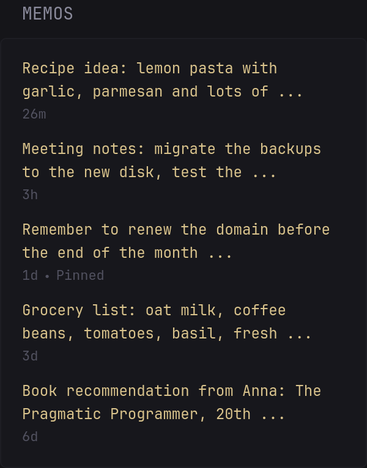

Shows the latest memos from [Memos](https://github.com/usememos/memos) that are visible to your account, newest first, each linking to the memo. Pinned memos are marked.

```yaml
- type: custom-api
  title: Memos
  title-url: ${MEMOS_URL}
  cache: 5m
  url: ${MEMOS_URL}/api/v1/memos
  parameters:
    pageSize: 5
  headers:
    Authorization: Bearer ${MEMOS_TOKEN}
  template: |
    {{ if ne .Response.StatusCode 200 }}
      <p class="color-negative">Memos returned HTTP {{ .Response.StatusCode }}. Check MEMOS_URL and MEMOS_TOKEN.</p>
    {{ else }}
      {{ $memos := .JSON.Array "memos" }}
      {{ if eq (len $memos) 0 }}
        <p class="color-subdue">No memos yet</p>
      {{ else }}
        <ul class="list list-gap-10">
          {{ range $memos }}
            {{ $text := .String "snippet" | trimSpace }}
            {{ if eq $text "" }}{{ $text = .String "content" | trimSpace }}{{ end }}
            {{ if eq $text "" }}{{ $text = "(no text)" }}{{ end }}
            <li>
              <a class="size-h5 color-primary-if-not-visited text-truncate-2-lines" href="${MEMOS_URL}/{{ .String "name" }}" target="_blank" rel="noreferrer">{{ $text }}</a>
              <ul class="list-horizontal-text color-subdue size-h6">
                <li {{ .String "createTime" | parseRelativeTime "rfc3339" }}></li>
                {{ if .Bool "pinned" }}<li>Pinned</li>{{ end }}
              </ul>
            </li>
          {{ end }}
        </ul>
      {{ end }}
    {{ end }}
```

## Environment variables

- `MEMOS_URL` - the URL of your Memos instance without a trailing slash, e.g. `http://192.168.1.2:5230` or `https://memos.example.com`
- `MEMOS_TOKEN` - a personal access token, created in Memos under **Settings** → **Access Tokens** → **Create**

A personal access token can do everything your account can do in Memos. Create a separate token for Glance, ideally with an expiration date, and keep it in an environment variable or secret rather than in the config file.

## Options

- `pageSize` under `parameters` - how many memos to show (`5` in the example; without it, Memos returns up to 50)
- On an instance with several users, the list also includes memos of other users with the visibility *Public* or *Protected*. To show only your own memos, add a filter with your username:

  ```yaml
    parameters:
      pageSize: 5
      filter: creator == "users/your-username"
  ```

Tested with Glance v0.8.7 and Memos v0.31.0.
