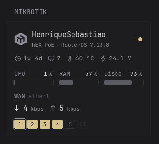

# MikroTik Widget

Display information about your MikroTik device, such as resources, WAN traffic, temperature, uptime, among other things.

## Configure your MikroTik

Configure your MikroTik to have a read-only user which will be used to retrieve information via the API and set up the `www-ssl` service with a self-signed certificate by running the commands below in your MikroTik terminal.

**Attention**: replace `STRONG-PASSWORD` with the password you wish to use for the user, and change port `3443` in the command to the port you wish to use; ensure that the chosen port is accessible from the Glance host.

```rsc
/user group add name=glance-ro policy=read,api,rest-api
/user add name=glance group=glance-ro password="STRONG-PASSWORD"
/certificate add name=rest-api common-name=rest-api days-valid=3650
/certificate sign rest-api
/ip service set www-ssl certificate=rest-api disabled=no port=3443
```

## Required environment variables

- `MIKROTIK_URL` - URL for your MikroTik device for the `www-ssl` service, e.g.: `https://192.168.88.1:3443`
- `MIKROTIK_USER` - Read-only user
- `MIKROTIK_PASS` - Read-only user password

## Preview



```yml
- type: custom-api
  title: MikroTik
  cache: 30s
  options:
    # General options (all optional)
    show-ports: true      # set of physical ports (Ether/SFP)
    show-clients: true    # DHCP lease and Wi-Fi client count
    show-updates: true    # notification of a new RouterOS version (the router needs to run check-for-updates)
    # One item per device. URL/username/password come from environment variables.
    devices:
      - url: ${MIKROTIK_URL}               # e.g.: https://192.168.88.1:3443
        username: "${MIKROTIK_USER}"
        password: "${MIKROTIK_PASS}"
        allow-insecure: true                   # self-signed certificate on www-ssl
        wan: ether1                            # optional: WAN interface (traffic + IP)
  template: |
    <style>
      .mkt-device + .mkt-device { margin-top: 1.8rem; padding-top: 1.8rem; border-top: 1px solid var(--color-separator); }
      .mkt-head { display: flex; align-items: center; gap: 1rem; min-width: 0; }
      .mkt-logo { width: 2.6rem; height: 2.6rem; flex-shrink: 0; color: var(--color-text-subdue); }
      .mkt-online .mkt-logo { color: var(--color-text-base); }
      .mkt-dot { width: 0.8rem; height: 0.8rem; border-radius: 50%; flex-shrink: 0; background: var(--color-negative); }
      .mkt-online .mkt-dot { background: var(--color-positive); }
      .mkt-facts { margin-top: 0.9rem; }
      .list-horizontal-text.mkt-facts > *:not(:last-child)::after { content: none; }
      .list-horizontal-text.mkt-facts > *:not(:last-child) { margin-right: 1.2rem; }
      .mkt-fact { display: inline-flex; align-items: center; gap: 0.4rem; }
      .mkt-fact svg { width: 1.1em; height: 1.1em; flex-shrink: 0; }
      .mkt-stats { display: flex; gap: 1.5rem; margin-top: 1.2rem; }
      .mkt-stats > * { flex: 1; min-width: 0; }
      .mkt-wan { margin-top: 1.2rem; }
      .mkt-rates { display: flex; gap: 1.5rem; margin-top: 0.3rem; }
      .mkt-ports { display: flex; flex-wrap: wrap; gap: 0.4rem; margin-top: 1.2rem; }
      .mkt-port {
        min-width: 2.2rem; height: 1.8rem; padding-inline: 0.3rem; border-radius: 0.3rem;
        display: inline-flex; align-items: center; justify-content: center;
        font-size: var(--font-size-h6); font-variant-numeric: tabular-nums;
        border: 1px solid var(--color-progress-border); color: var(--color-text-subdue);
      }
      .mkt-port { --mkt-port-color: var(--color-positive); }
      .mkt-port-up { background: var(--mkt-port-color); border-color: var(--mkt-port-color); color: var(--color-widget-background); }
      .mkt-poe-auto { --mkt-port-color: hsl(135, 50%, 52%); }     /* PoE out auto-on */
      .mkt-poe-forced { --mkt-port-color: var(--color-negative); } /* PoE out forced-on */
      .mkt-poe-auto:not(.mkt-port-up), .mkt-poe-forced:not(.mkt-port-up) { border-color: var(--mkt-port-color); color: var(--mkt-port-color); }
      .mkt-port-off { border-style: dashed; opacity: 0.45; }
      .mkt-port-wan { outline: 1px solid var(--color-text-base); outline-offset: 2px; }
      .mkt-debug { margin-top: 1rem; font-size: var(--font-size-h6); color: var(--color-text-subdue); white-space: pre-line; overflow-wrap: anywhere; }
      @container widget (min-width: 600px) {
        .mkt-body { display: grid; grid-template-columns: 1fr 1fr; column-gap: 2.5rem; align-items: end; }
      }
    </style>

    {{- define "mkt-bps" -}}
      {{- if ge . 1e9 }}{{ printf "%.2f" (div . 1e9) }}<span class="color-base size-h6"> Gbps</span>
      {{- else if ge . 1e6 }}{{ printf "%.1f" (div . 1e6) }}<span class="color-base size-h6"> Mbps</span>
      {{- else if ge . 1e3 }}{{ printf "%.0f" (div . 1e3) }}<span class="color-base size-h6"> kbps</span>
      {{- else }}{{ printf "%.0f" . }}<span class="color-base size-h6"> bps</span>{{ end -}}
    {{- end -}}

    {{- define "mkt-bytes" -}}
      {{- if ge . 1073741824.0 }}{{ printf "%.1f" (div . 1073741824.0) }} GiB
      {{- else }}{{ printf "%.0f" (div . 1048576.0) }} MiB{{ end -}}
    {{- end -}}

    {{- $showPorts := .Options.BoolOr "show-ports" true }}
    {{- $showClients := .Options.BoolOr "show-clients" true }}
    {{- $showUpdates := .Options.BoolOr "show-updates" true }}
    {{- $debug := .Options.BoolOr "debug" false }}
    {{- $tplVersion := "2026-10-21 v4 (rate)" }}
    {{- $devices := .JSON.Get (concat "!" (.Options.JSON "devices")) }}

    {{- range $devices.Array "" }}
      {{- $base := .String "url" | trimSuffix "/" }}
      {{- $api := concat $base "/rest" }}
      {{- $user := .String "username" }}
      {{- $pass := .String "password" }}
      {{- $insecure := .Bool "allow-insecure" }}
      {{- $wan := .String "wan" }}
      {{- $name := .String "name" }}

      {{- $res := newRequest (concat $api "/system/resource") | withBasicAuth $user $pass | withAllowInsecure $insecure | getResponse }}
      {{- $online := eq $res.Response.StatusCode 200 }}

      {{- if and $online (not $name) }}
        {{- $id := newRequest (concat $api "/system/identity") | withBasicAuth $user $pass | withAllowInsecure $insecure | getResponse }}
        {{- $name = $id.JSON.String "name" }}
      {{- end }}
      {{- if not $name }}{{ $name = $base | replaceMatches "^https?://" "" }}{{ end }}

    <div class="mkt-device{{ if $online }} mkt-online{{ end }}">
      <div class="mkt-head">
        <svg class="mkt-logo" viewBox="0 0 24 24" fill="currentColor" aria-hidden="true"><path d="M23.041 6.188a1.404 1.404 0 0 0-.218-.36c-.24-.296-.634-.586-1.14-.864l-4.052-2.22L13.576.519C13.074.243 12.61.065 12.22.013A1.772 1.772 0 0 0 12 0c-.432 0-.974.192-1.576.52L6.37 2.74 2.317 4.96c-.504.279-.9.569-1.14.867a1.59 1.59 0 0 0-.122.17 1.654 1.654 0 0 0-.096.19c-.15.348-.22.816-.22 1.368v8.887c0 .66.1 1.2.316 1.558.216.356.66.706 1.262 1.036l4.054 2.22 4.053 2.223c.504.276.966.456 1.36.506.145.02.291.02.436 0 .39-.05.852-.228 1.356-.506l8.107-4.443c.6-.33 1.046-.68 1.262-1.036.036-.06.068-.123.096-.188.15-.348.22-.818.22-1.37V7.556c0-.552-.07-1.02-.22-1.368zM7.233 16.618c0 .2-.218.33-.396.233l-1.45-.796a1.066 1.066 0 0 1-.552-.934v-4.296c0-.2.216-.33.394-.235l1.728.947a.53.53 0 0 1 .276.468v4.612zm11.934-1.497c0 .39-.213.748-.554.936l-1.45.794a.266.266 0 0 1-.394-.234v-5.692c0-.2-.217-.33-.395-.232l-2.62 1.434c-.34.187-.552.545-.552.934v5.646a.532.532 0 0 1-.278.468l-.41.224c-.32.176-.707.176-1.026 0l-.408-.224a.532.532 0 0 1-.278-.468v-5.646c0-.389-.212-.747-.552-.934L4.835 9.16v-.28c0-.388.212-.746.552-.934l.6-.328a1.064 1.064 0 0 1 1.022 0l4.48 2.452c.318.176.704.176 1.021 0l2.07-1.134a.266.266 0 0 0 0-.468L9.932 5.922a.266.266 0 0 1 0-.468l1.556-.852c.32-.176.707-.176 1.026 0l6.1 3.34c.342.188.554.547.553.936v6.243z"/></svg>
        <div class="grow min-width-0">
          <a class="size-h3 color-highlight block text-truncate" href="{{ $base }}" target="_blank" rel="noreferrer">{{ $name }}</a>
          {{- if $online }}
          {{- $rb := newRequest (concat $api "/system/routerboard") | withBasicAuth $user $pass | withAllowInsecure $insecure | getResponse }}
          {{- $fwCur := $rb.JSON.String "current-firmware" }}
          {{- $fwNew := $rb.JSON.String "upgrade-firmware" }}
          {{- $version := $res.JSON.String "version" | replaceMatches " \\(.*\\)$" "" }}
          {{- $updOk := false }}
          {{- $updStatus := "" }}
          {{- $updLatest := "" }}
          {{- $updChannel := "" }}
          {{- if $showUpdates }}
            {{- $upd := newRequest (concat $api "/system/package/update") | withBasicAuth $user $pass | withAllowInsecure $insecure | getResponse }}
            {{- $updOk = eq $upd.Response.StatusCode 200 }}
            {{- $updStatus = $upd.JSON.String "status" }}
            {{- $updLatest = $upd.JSON.String "latest-version" }}
            {{- $updChannel = $upd.JSON.String "channel" }}
          {{- end }}
          <ul class="list-horizontal-text size-h6 text-truncate">
            <li>{{ $res.JSON.String "board-name" }}</li>
            {{- if and $updOk (eq $updStatus "New version is available") }}
            <li class="color-primary" data-popover-type="text" data-popover-text="RouterOS {{ $updLatest }} disponível no canal {{ $updChannel }}. Para instalar: /system/package/update/install">RouterOS {{ $version }} → {{ $updLatest }}</li>
            {{- else if $updOk }}
            <li data-popover-type="text" data-popover-text="Canal {{ $updChannel }}: {{ if eq $updStatus "System is already up to date" }}sistema atualizado{{ else if $updStatus }}{{ $updStatus }}{{ else }}nenhuma verificação desde o boot (check-for-updates não rodou){{ end }}">RouterOS {{ $version }}</li>
            {{- else }}
            <li>RouterOS {{ $version }}</li>
            {{- end }}
            {{- if and $fwCur $fwNew (ne $fwCur $fwNew) }}
            <li class="color-negative" data-popover-type="text" data-popover-text="Firmware RouterBOOT {{ $fwCur }} → {{ $fwNew }}: /system/routerboard/upgrade e reboot">firmware desatualizado</li>
            {{- end }}
          </ul>
          {{- else }}
          <div class="size-h6 color-negative text-truncate" data-popover-type="text" data-popover-text="{{ $res.Response.Status }}">
            {{- if eq $res.Response.StatusCode 401 }}credenciais recusadas (401)
            {{- else if $res.Response.StatusCode }}erro {{ $res.Response.Status }}
            {{- else }}sem resposta{{ end -}}
          </div>
          {{- end }}
        </div>
        <span class="mkt-dot" data-popover-type="text" data-popover-text="{{ if $online }}Online{{ else if $res.Response.StatusCode }}Responde, mas a API retornou erro{{ else }}Offline{{ end }}"></span>
      </div>

      {{- if $online }}
      {{- $dbg := "" }}
      {{- $health := newRequest (concat $api "/system/health") | withBasicAuth $user $pass | withAllowInsecure $insecure | getResponse }}
      {{- $tempQuery := `#(name=="cpu-temperature").value` }}
      {{- if not ($health.JSON.Exists $tempQuery) }}{{ $tempQuery = `#(name=="temperature").value` }}{{ end }}
      {{- if not ($health.JSON.Exists $tempQuery) }}{{ $tempQuery = `#(name=="board-temperature1").value` }}{{ end }}
      {{- $hasTemp := $health.JSON.Exists $tempQuery }}
      {{- $voltQuery := `#(name=="voltage").value` }}
      {{- if not ($health.JSON.Exists $voltQuery) }}{{ $voltQuery = `#(name=="psu1-voltage").value` }}{{ end }}
      {{- $volt := $health.JSON.String $voltQuery }}

      <ul class="list-horizontal-text mkt-facts">
        {{- $uptime := $res.JSON.String "uptime" }}
        <li class="mkt-fact" data-popover-type="text" data-popover-text="Uptime: {{ $uptime }}">
          <svg viewBox="0 0 24 24" fill="none" stroke="currentColor" stroke-width="1.8" aria-hidden="true"><path stroke-linecap="round" stroke-linejoin="round" d="M12 6v6h4.5m4.5 0a9 9 0 1 1-18 0 9 9 0 0 1 18 0Z"/></svg>
          {{ $uptime | replaceMatches "^([0-9]+[wdhm])([0-9]+[dhms])?.*$" "$1 $2" | trimSpace }}
        </li>
        {{- if $showClients }}
          {{- $leases := newRequest (concat $api "/ip/dhcp-server/lease?status=bound&.proplist=address") | withBasicAuth $user $pass | withAllowInsecure $insecure | getResponse }}
          {{- $leaseCount := len ($leases.JSON.Array "") }}
          {{- if gt $leaseCount 0 }}
        <li class="mkt-fact" data-popover-type="text" data-popover-text="{{ $leaseCount }} leases DHCP ativos">
          <svg viewBox="0 0 24 24" fill="none" stroke="currentColor" stroke-width="1.8" aria-hidden="true"><path stroke-linecap="round" stroke-linejoin="round" d="M9 17.25v1.007a3 3 0 0 1-.879 2.122L7.5 21h9l-.621-.621A3 3 0 0 1 15 18.257V17.25m6-12V15a2.25 2.25 0 0 1-2.25 2.25H5.25A2.25 2.25 0 0 1 3 15V5.25m18 0A2.25 2.25 0 0 0 18.75 3H5.25A2.25 2.25 0 0 0 3 5.25m18 0V12a2.25 2.25 0 0 1-2.25 2.25H5.25A2.25 2.25 0 0 1 3 12V5.25"/></svg>
          {{ $leaseCount }}
        </li>
          {{- end }}
          {{- /* Clientes Wi-Fi: soma as tabelas de registro de todos os subsistemas sem fio que tenham
                interfaces neste aparelho (não depende do campo "type" nem de qual pacote está instalado):
                - /interface/wifi     pacote novo (wifi-qcom/-ac) e CAPsMAN novo; existe em todo RouterOS >= 7.13, mas vazio sem rádio
                - /interface/wireless pacote "wireless" legado; inclui interfaces físicas e APs virtuais (wlan1, wlan2...)
                - /caps-man           CAPsMAN legado (controlador)
                No legado, entradas com ap=true (o aparelho é estação e esse é o AP dele) ou wds=true (enlace WDS)
                não são clientes: entram como "enlaces" no popover. */ -}}
          {{- $hasRadio := false }}
          {{- $wifiCount := 0 }}
          {{- $wifiLinks := 0 }}
          {{- $wifiPerIface := "" }}
          {{- $wifiErr := "" }}
          {{- range ($.JSON.Get `![{"list":"/interface/wifi","table":"/interface/wifi/registration-table","props":"interface"},{"list":"/interface/wireless","table":"/interface/wireless/registration-table","props":"interface,ap,wds"},{"list":"/caps-man/interface","table":"/caps-man/registration-table","props":"interface"}]`).Array "" }}
            {{- $radios := newRequest (concat $api (.String "list") "?.proplist=name") | withBasicAuth $user $pass | withAllowInsecure $insecure | getResponse }}
            {{- $listStatus := $radios.Response.StatusCode }}
            {{- $dbg = concat $dbg "\n" (.String "list") ": " (or $radios.Response.Status "sem resposta") }}
            {{- if eq $listStatus 200 }}{{ $dbg = concat $dbg ", " (printf "%d" (len ($radios.JSON.Array ""))) " interface(s)" }}{{ end }}
            {{- if and (eq $listStatus 200) (gt (len ($radios.JSON.Array "")) 0) }}
              {{- $hasRadio = true }}
              {{- $reg := newRequest (concat $api (.String "table") "?.proplist=" (.String "props")) | withBasicAuth $user $pass | withAllowInsecure $insecure | getResponse }}
              {{- if ne $reg.Response.StatusCode 200 }}
                {{- /* algumas versões podem recusar o filtro: tenta de novo sem .proplist */ -}}
                {{- $dbg = concat $dbg "\n" (.String "table") " com .proplist: " (or $reg.Response.Status "sem resposta") ", tentando sem filtro" }}
                {{- $reg = newRequest (concat $api (.String "table")) | withBasicAuth $user $pass | withAllowInsecure $insecure | getResponse }}
              {{- end }}
              {{- $dbg = concat $dbg "\n" (.String "table") ": " (or $reg.Response.Status "sem resposta") }}
              {{- if eq $reg.Response.StatusCode 200 }}{{ $dbg = concat $dbg ", " (printf "%d" (len ($reg.JSON.Array ""))) " entrada(s)" }}{{ end }}
              {{- if eq $reg.Response.StatusCode 200 }}
                {{- $clients := $reg.JSON.Get "@this" }}
                {{- if $clients.Exists "0.ap" }}{{ $clients = $clients.Get `#(ap!="true")#` }}{{ end }}
                {{- if $clients.Exists "0.wds" }}{{ $clients = $clients.Get `#(wds!="true")#` }}{{ end }}
                {{- $n := len ($clients.Array "") }}
                {{- $wifiCount = add $wifiCount $n }}
                {{- $wifiLinks = add $wifiLinks (sub (len ($reg.JSON.Array "")) $n) }}
                {{- range sortByString "interface" "asc" (unique "interface" ($clients.Array "")) }}
                  {{- $ifc := .String "interface" }}
                  {{- $wifiPerIface = concat $wifiPerIface ", " $ifc ": " (printf "%d" (len ($clients.Array (concat "#(interface==\"" $ifc "\")#")))) }}
                {{- end }}
              {{- else }}
                {{- $wifiErr = concat $wifiErr " " (.String "table") " (" (or $reg.Response.Status "sem resposta") ")" }}
              {{- end }}
            {{- else if and (ne $listStatus 200) (ne $listStatus 400) (ne $listStatus 404) }}
              {{- /* 400/404 = menu inexistente (normal). Timeout, 401, 403, 500... são falhas reais: mostra "?" em vez de esconder */ -}}
              {{- $hasRadio = true }}
              {{- $wifiErr = concat $wifiErr " " (.String "list") " (" (or $radios.Response.Status "sem resposta") ")" }}
            {{- end }}
          {{- end }}
          {{- if $hasRadio }}
        <li class="mkt-fact{{ if $wifiErr }} color-negative{{ end }}" data-popover-type="text" data-popover-text="{{ $wifiCount }} clientes Wi-Fi{{ with trimPrefix ", " $wifiPerIface }} ({{ . }}){{ end }}{{ if gt $wifiLinks 0 }}. Fora da contagem: {{ $wifiLinks }} enlace{{ if gt $wifiLinks 1 }}s{{ end }} com AP/WDS{{ end }}{{ if $wifiErr }}. Falha ao ler:{{ $wifiErr }}{{ end }}">
          <svg viewBox="0 0 24 24" fill="none" stroke="currentColor" stroke-width="1.8" aria-hidden="true"><path stroke-linecap="round" stroke-linejoin="round" d="M8.288 15.038a5.25 5.25 0 0 1 7.424 0M5.106 11.856c3.807-3.808 9.98-3.808 13.788 0M1.924 8.674c5.565-5.565 14.587-5.565 20.152 0M12.53 18.22l-.53.53-.53-.53a.75.75 0 0 1 1.06 0Z"/></svg>
          {{ if and $wifiErr (eq $wifiCount 0) }}?{{ else }}{{ $wifiCount }}{{ end }}
        </li>
          {{- end }}
        {{- end }}
        {{- if $hasTemp }}
        <li class="mkt-fact{{ if ge ($health.JSON.Float $tempQuery) 70.0 }} color-negative{{ end }}" data-popover-type="text" data-popover-text="Temperatura">
          <svg viewBox="0 0 24 24" fill="none" stroke="currentColor" stroke-width="1.8" aria-hidden="true"><path stroke-linecap="round" stroke-linejoin="round" d="M14 4v10.54a4 4 0 1 1-4 0V4a2 2 0 0 1 4 0Z"/></svg>
          {{ $health.JSON.String $tempQuery }} °C
        </li>
        {{- end }}
        {{- if $volt }}
        <li class="mkt-fact" data-popover-type="text" data-popover-text="Tensão de entrada (alimentação do aparelho)">
          <svg viewBox="0 0 24 24" fill="none" stroke="currentColor" stroke-width="1.8" aria-hidden="true"><path stroke-linecap="round" stroke-linejoin="round" d="M13 2 4 14h7l-1 8 9-12h-7l1-8Z"/></svg>
          {{ $volt }} V
        </li>
        {{- end }}
      </ul>

      <div class="mkt-body">
        {{- $cpu := $res.JSON.Int "cpu-load" }}
        {{- $memTotal := $res.JSON.Float "total-memory" }}
        {{- $memUsed := sub $memTotal ($res.JSON.Float "free-memory") }}
        {{- $memPct := div (mul $memUsed 100.0) $memTotal | toInt }}
        {{- $hddTotal := $res.JSON.Float "total-hdd-space" }}
        {{- $hddUsed := sub $hddTotal ($res.JSON.Float "free-hdd-space") }}
        {{- $hddPct := div (mul $hddUsed 100.0) $hddTotal | toInt }}
        <div class="mkt-stats">
          <div data-popover-type="html">
            <div data-popover-html>
              <div class="color-highlight">{{ $res.JSON.String "cpu" }}</div>
              <div class="size-h5 margin-top-3">{{ $res.JSON.String "cpu-count" }} × {{ $res.JSON.String "cpu-frequency" }} MHz ({{ $res.JSON.String "architecture-name" }})</div>
            </div>
            <div class="flex justify-between items-end size-h5">
              <div>CPU</div>
              <div class="color-highlight text-very-compact">{{ $cpu }} <span class="color-base">%</span></div>
            </div>
            <div class="progress-bar"><div class="progress-value{{ if ge $cpu 85 }} progress-value-notice{{ end }}" style="--percent: {{ $cpu }}"></div></div>
          </div>
          <div data-popover-type="html">
            <div data-popover-html>
              <div class="color-highlight">{{ template "mkt-bytes" $memUsed }} <span class="color-base size-h5">/</span> {{ template "mkt-bytes" $memTotal }}</div>
            </div>
            <div class="flex justify-between items-end size-h5">
              <div>RAM</div>
              <div class="color-highlight text-very-compact">{{ $memPct }} <span class="color-base">%</span></div>
            </div>
            <div class="progress-bar"><div class="progress-value{{ if ge $memPct 85 }} progress-value-notice{{ end }}" style="--percent: {{ $memPct }}"></div></div>
          </div>
          <div data-popover-type="html">
            <div data-popover-html>
              <div class="color-highlight">{{ template "mkt-bytes" $hddUsed }} <span class="color-base size-h5">/</span> {{ template "mkt-bytes" $hddTotal }}</div>
            </div>
            <div class="flex justify-between items-end size-h5">
              <div>Disco</div>
              <div class="color-highlight text-very-compact">{{ $hddPct }} <span class="color-base">%</span></div>
            </div>
            <div class="progress-bar"><div class="progress-value{{ if ge $hddPct 85 }} progress-value-notice{{ end }}" style="--percent: {{ $hddPct }}"></div></div>
          </div>
        </div>

        {{- if $wan }}
        {{- $traffic := newRequest (concat $api "/interface/monitor-traffic") | withHeader "Content-Type" "application/json" | withStringBody (concat `{"interface":"` $wan `","once":"",".proplist":"rx-bits-per-second,tx-bits-per-second"}`) | withBasicAuth $user $pass | withAllowInsecure $insecure | getResponse }}
        {{- $addr := newRequest (concat $api "/ip/address") | withParameter "interface" $wan | withParameter ".proplist" "address" | withBasicAuth $user $pass | withAllowInsecure $insecure | getResponse }}
        <div class="mkt-wan">
          <div class="flex justify-between items-end size-h5 gap-10">
            <div class="shrink-0">WAN <span class="color-subdue">{{ $wan }}</span></div>
            <div class="text-truncate">{{ $addr.JSON.String "0.address" | replaceMatches "/[0-9]+$" "" }}</div>
          </div>
          {{- if eq $traffic.Response.StatusCode 200 }}
          <div class="mkt-rates size-h3 color-highlight">
            <div data-popover-type="text" data-popover-text="Download (rx em {{ $wan }})">↓ {{ template "mkt-bps" ($traffic.JSON.Float "0.rx-bits-per-second") }}</div>
            <div data-popover-type="text" data-popover-text="Upload (tx em {{ $wan }})">↑ {{ template "mkt-bps" ($traffic.JSON.Float "0.tx-bits-per-second") }}</div>
          </div>
          {{- else }}
          <div class="size-h6 color-negative">monitor-traffic falhou: {{ $traffic.Response.Status }}</div>
          {{- end }}
        </div>
        {{- end }}
      </div>

      {{- if $showPorts }}
      {{- $ifaces := newRequest (concat $api "/interface?type=ether&.proplist=name,running,disabled,comment") | withBasicAuth $user $pass | withAllowInsecure $insecure | getResponse }}
      {{- $poe := newRequest (concat $api "/interface/ethernet/poe?.proplist=.id,name,poe-out") | withBasicAuth $user $pass | withAllowInsecure $insecure | getResponse }}
      {{- $poeIds := "" }}
      {{- if eq $poe.Response.StatusCode 200 }}
        {{- range $poe.JSON.Array "" }}{{ $poeIds = concat $poeIds "," (.String `\.id`) }}{{ end }}
      {{- end }}
      {{- $poeIds = trimPrefix "," $poeIds }}
      {{- $poeMon := $poe }}
      {{- if $poeIds }}
        {{- $poeMon = newRequest (concat $api "/interface/ethernet/poe/monitor") | withHeader "Content-Type" "application/json" | withStringBody (concat `{"numbers":"` $poeIds `","once":""}`) | withBasicAuth $user $pass | withAllowInsecure $insecure | getResponse }}
        {{- $dbg = concat $dbg "\n/interface/ethernet/poe/monitor: " (or $poeMon.Response.Status "sem resposta") }}
      {{- end }}
      {{- /* Rate negociado: /interface/ethernet/monitor com os .id do próprio menu ethernet, uma chamada para todas as portas */ -}}
      {{- $eth := newRequest (concat $api "/interface/ethernet?.proplist=.id,name") | withBasicAuth $user $pass | withAllowInsecure $insecure | getResponse }}
      {{- $ethIds := "" }}
      {{- if eq $eth.Response.StatusCode 200 }}
        {{- range $eth.JSON.Array "" }}{{ $ethIds = concat $ethIds "," (.String `\.id`) }}{{ end }}
      {{- end }}
      {{- $ethIds = trimPrefix "," $ethIds }}
      {{- $ethMon := $eth }}
      {{- if $ethIds }}
        {{- $ethMon = newRequest (concat $api "/interface/ethernet/monitor") | withHeader "Content-Type" "application/json" | withStringBody (concat `{"numbers":"` $ethIds `","once":"",".proplist":"name,status,rate,full-duplex,auto-negotiation"}`) | withBasicAuth $user $pass | withAllowInsecure $insecure | getResponse }}
        {{- $dbg = concat $dbg "\n/interface/ethernet/monitor: " (or $ethMon.Response.Status "sem resposta") }}
      {{- end }}
      {{- $ethOk := and $ethIds (eq $ethMon.Response.StatusCode 200) }}
      {{- if eq $ifaces.Response.StatusCode 200 }}
      <div class="mkt-ports">
        {{- range $ifaces.JSON.Array "" }}
          {{- $ifName := .String "name" }}
          {{- $up := .Bool "running" }}
          {{- $off := .Bool "disabled" }}
          {{- $label := findMatch "[0-9]+$" $ifName }}
          {{- if findMatch "^(q?sfp|combo)" $ifName }}{{ $label = concat "S" $label }}{{ end }}
          {{- $rate := "" }}{{ $fullDuplex := "" }}{{ $autoNeg := "" }}
          {{- if $ethOk }}
            {{- $em := $ethMon.JSON.Get (concat "#(name==\"" $ifName "\")") }}
            {{- $rate = $em.String "rate" }}
            {{- $fullDuplex = $em.String "full-duplex" }}
            {{- $autoNeg = $em.String "auto-negotiation" }}
          {{- end }}
          {{- $halfDuplex := or (eq $fullDuplex "false") (eq $fullDuplex "no") }}
          {{- /* PoE out: config em /interface/ethernet/poe, leituras em .../poe/monitor */ -}}
          {{- $poeOut := "" }}{{ $poeStatus := "" }}{{ $poeI := "" }}{{ $poeV := "" }}{{ $poeW := "" }}
          {{- if $poeIds }}
            {{- $q := concat "#(name==\"" $ifName "\")" }}
            {{- $poeOut = $poe.JSON.String (concat $q ".poe-out") }}
            {{- $pm := $poeMon.JSON.Get $q }}
            {{- $poeStatus = $pm.String "poe-out-status" }}
            {{- $poeI = $pm.String "poe-out-current" | replaceMatches "\\s*mA$" "" }}
            {{- /* REST devolve volts/watts. Se a tensão vier em décimos (519 = 51.9 V): PoE nunca passa de ~57 V, então >60 indica escala x10, que vale também para a potência */ -}}
            {{- $scale := 1.0 }}
            {{- if gt ($pm.Float "poe-out-voltage") 60.0 }}{{ $scale = 10.0 }}{{ end }}
            {{- $rawV := $pm.String "poe-out-voltage" }}
            {{- if findMatch "[A-Za-z]" $rawV }}{{ $poeV = $rawV | replaceMatches "\\s*V$" "" }}{{ else if $rawV }}{{ $poeV = printf "%.1f" (div ($pm.Float "poe-out-voltage") $scale) }}{{ end }}
            {{- $rawW := $pm.String "poe-out-power" }}
            {{- if findMatch "[A-Za-z]" $rawW }}{{ $poeW = $rawW | replaceMatches "\\s*W$" "" }}{{ else if $rawW }}{{ $poeW = printf "%.1f" (div ($pm.Float "poe-out-power") $scale) }}{{ end }}
          {{- end }}
        <div class="mkt-port{{ if $off }} mkt-port-off{{ else if $up }} mkt-port-up{{ end }}{{ if eq $poeOut "auto-on" }} mkt-poe-auto{{ else if eq $poeOut "forced-on" }} mkt-poe-forced{{ end }}{{ if eq $ifName $wan }} mkt-port-wan{{ end }}" data-popover-type="html">
          <div data-popover-html>
            <div class="color-highlight">{{ $ifName }}{{ if eq $ifName $wan }}, porta WAN{{ end }}: {{ if $off }}desabilitada{{ else if $up }}link ativo{{ else }}sem link{{ end }}</div>
            {{- with .String "comment" }}
            <div class="size-h6">{{ . }}</div>
            {{- end }}
            {{- if and $up $rate }}
            <div class="flex margin-top-7">
              <div class="size-h5">Rate</div>
              <div class="value-separator"></div>
              <div class="{{ if or $halfDuplex (eq $autoNeg "failed") }}color-negative{{ else }}color-highlight{{ end }}">{{ $rate }}{{ if $halfDuplex }} half-duplex{{ else if $fullDuplex }} full-duplex{{ end }}</div>
            </div>
            {{- if eq $autoNeg "failed" }}
            <div class="size-h6 color-negative">auto-negociação falhou</div>
            {{- else if eq $autoNeg "disabled" }}
            <div class="size-h6">velocidade fixa (auto-negociação desligada)</div>
            {{- end }}
            {{- end }}
            {{- if $poeOut }}
            <div class="size-h5 margin-top-7">PoE out <span class="color-highlight">{{ $poeOut }}</span>{{ with $poeStatus }} ({{ . }}){{ end }}</div>
            <div class="flex margin-top-3"><div class="size-h5">Corrente</div><div class="value-separator"></div><div class="color-highlight text-very-compact">{{ if $poeI }}{{ $poeI }} <span class="color-base size-h5">mA</span>{{ else }}—{{ end }}</div></div>
            <div class="flex margin-top-3"><div class="size-h5">Tensão</div><div class="value-separator"></div><div class="color-highlight text-very-compact">{{ if $poeV }}{{ $poeV }} <span class="color-base size-h5">V</span>{{ else }}—{{ end }}</div></div>
            <div class="flex margin-top-3"><div class="size-h5">Potência</div><div class="value-separator"></div><div class="color-highlight text-very-compact">{{ if $poeW }}{{ $poeW }} <span class="color-base size-h5">W</span>{{ else }}—{{ end }}</div></div>
            {{- end }}
          </div>
          {{ or $label $ifName }}
        </div>
        {{- end }}
      </div>
      {{- end }}
      {{- end }}
      {{- if $debug }}
      <div class="mkt-debug">template {{ $tplVersion }}{{ $dbg }}</div>
      {{- end }}
      {{- end }}
    </div>
    {{- end }}
```
