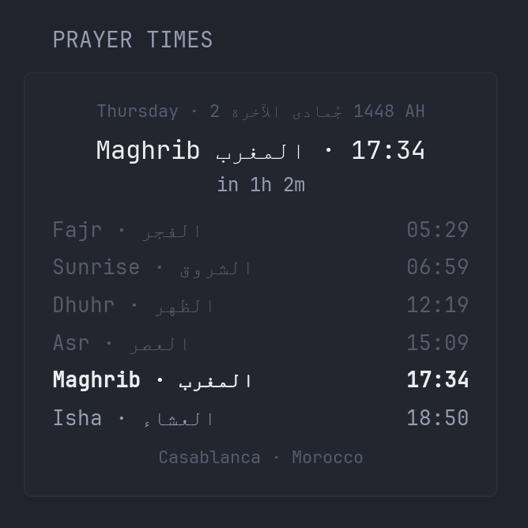

Today's five daily prayers plus sunrise, with the **next prayer highlighted**, a **countdown**, and the **Hijri date**. After Isha it shows **tomorrow's Fajr**. Past prayers are dimmed. Arabic prayer names are optional.

Times come from the free [Aladhan API](https://aladhan.com/prayer-times-api) (no API key needed). Times are requested in ISO 8601 with the location's UTC offset, so the countdown is correct whatever time zone your Glance server runs in.

```yaml
- type: custom-api
  title: Prayer Times
  cache: 5m
  options:
    city: Casablanca              # label shown at the bottom
    latitude: 33.5731
    longitude: -7.5898
    timezone: Africa/Casablanca   # IANA time zone of the location
    method: 21                    # calculation method, see https://aladhan.com/calculation-methods
    show-arabic: true             # show Arabic prayer names and Hijri month
  template: |
    {{ $lat := printf "%v" (.Options.FloatOr "latitude" 0.0) }}
    {{ $lon := printf "%v" (.Options.FloatOr "longitude" 0.0) }}
    {{ $method := printf "%d" (.Options.IntOr "method" 3) }}
    {{ $tz := .Options.StringOr "timezone" "UTC" }}
    {{ $ar := .Options.BoolOr "show-arabic" true }}

    {{ $res := newRequest "https://api.aladhan.com/v1/timings"
        | withParameter "latitude" $lat | withParameter "longitude" $lon
        | withParameter "method" $method | withParameter "timezonestring" $tz
        | withParameter "iso8601" "true" | getResponse }}

    {{ if ne $res.Response.StatusCode 200 }}
      <p class="color-negative">Could not load prayer times: {{ $res.Response.Status }}</p>
    {{ else }}
    {{ $d := $res.JSON }}
    {{ $fajr    := $d.String "data.timings.Fajr"    | parseTime "rfc3339" }}
    {{ $sunrise := $d.String "data.timings.Sunrise" | parseTime "rfc3339" }}
    {{ $dhuhr   := $d.String "data.timings.Dhuhr"   | parseTime "rfc3339" }}
    {{ $asr     := $d.String "data.timings.Asr"     | parseTime "rfc3339" }}
    {{ $maghrib := $d.String "data.timings.Maghrib" | parseTime "rfc3339" }}
    {{ $isha    := $d.String "data.timings.Isha"    | parseTime "rfc3339" }}
    {{ $now := (now).Unix }}

    {{/* Next prayer (sunrise is not a prayer). After Isha: tomorrow's Fajr. */}}
    {{ $next := "" }}{{ $nextAr := "" }}{{ $nextTime := $fajr }}{{ $tomorrow := false }}
    {{ if lt $now $fajr.Unix }}{{ $next = "Fajr" }}{{ $nextAr = "الفجر" }}{{ $nextTime = $fajr }}
    {{ else if lt $now $dhuhr.Unix }}{{ $next = "Dhuhr" }}{{ $nextAr = "الظهر" }}{{ $nextTime = $dhuhr }}
    {{ else if lt $now $asr.Unix }}{{ $next = "Asr" }}{{ $nextAr = "العصر" }}{{ $nextTime = $asr }}
    {{ else if lt $now $maghrib.Unix }}{{ $next = "Maghrib" }}{{ $nextAr = "المغرب" }}{{ $nextTime = $maghrib }}
    {{ else if lt $now $isha.Unix }}{{ $next = "Isha" }}{{ $nextAr = "العشاء" }}{{ $nextTime = $isha }}
    {{ else }}
      {{ $tomorrowDate := ($d.String "data.date.gregorian.date" | parseTime "02-01-2006").Add (duration "24h") | formatTime "02-01-2006" }}
      {{ $res2 := newRequest (concat "https://api.aladhan.com/v1/timings/" $tomorrowDate)
          | withParameter "latitude" $lat | withParameter "longitude" $lon
          | withParameter "method" $method | withParameter "timezonestring" $tz
          | withParameter "iso8601" "true" | getResponse }}
      {{ $next = "Fajr" }}{{ $nextAr = "الفجر" }}{{ $tomorrow = true }}
      {{ $nextTime = $res2.JSON.String "data.timings.Fajr" | parseTime "rfc3339" }}
    {{ end }}
    {{ $left := (($nextTime.Sub (now)).Round (duration "1m")).String | trimSuffix "0s" | replaceAll "h" "h " }}

    <div style="text-align:center">
      <div class="size-h6 color-subdue">
        {{ $d.String "data.date.gregorian.weekday.en" }} · {{ $d.String "data.date.hijri.day" }}
        {{ if $ar }}<bdi lang="ar">{{ $d.String "data.date.hijri.month.ar" }}</bdi>{{ else }}{{ $d.String "data.date.hijri.month.en" }}{{ end }}
        {{ $d.String "data.date.hijri.year" }} AH
      </div>
      <div class="color-highlight size-h2" style="margin-top:0.3rem">
        {{ $next }}{{ if $ar }} <bdi lang="ar">{{ $nextAr }}</bdi>{{ end }} · {{ $nextTime.Format "15:04" }}
      </div>
      <div class="size-h5">in {{ $left }}{{ if $tomorrow }} (tomorrow){{ end }}</div>
    </div>

    <ul style="margin-top:0.8rem;display:flex;flex-direction:column;gap:0.3rem">
      <li style="display:flex;justify-content:space-between;{{ if and (eq $next "Fajr") (not $tomorrow) }}font-weight:bold{{ else if lt $fajr.Unix $now }}opacity:0.45{{ end }}" {{ if and (eq $next "Fajr") (not $tomorrow) }}class="color-highlight"{{ end }}>
        <span>Fajr{{ if $ar }} · <bdi lang="ar">الفجر</bdi>{{ end }}</span><span>{{ $fajr.Format "15:04" }}</span></li>
      <li style="display:flex;justify-content:space-between;{{ if lt $sunrise.Unix $now }}opacity:0.45{{ end }}">
        <span>Sunrise{{ if $ar }} · <bdi lang="ar">الشروق</bdi>{{ end }}</span><span>{{ $sunrise.Format "15:04" }}</span></li>
      <li style="display:flex;justify-content:space-between;{{ if eq $next "Dhuhr" }}font-weight:bold{{ else if lt $dhuhr.Unix $now }}opacity:0.45{{ end }}" {{ if eq $next "Dhuhr" }}class="color-highlight"{{ end }}>
        <span>Dhuhr{{ if $ar }} · <bdi lang="ar">الظهر</bdi>{{ end }}</span><span>{{ $dhuhr.Format "15:04" }}</span></li>
      <li style="display:flex;justify-content:space-between;{{ if eq $next "Asr" }}font-weight:bold{{ else if lt $asr.Unix $now }}opacity:0.45{{ end }}" {{ if eq $next "Asr" }}class="color-highlight"{{ end }}>
        <span>Asr{{ if $ar }} · <bdi lang="ar">العصر</bdi>{{ end }}</span><span>{{ $asr.Format "15:04" }}</span></li>
      <li style="display:flex;justify-content:space-between;{{ if eq $next "Maghrib" }}font-weight:bold{{ else if lt $maghrib.Unix $now }}opacity:0.45{{ end }}" {{ if eq $next "Maghrib" }}class="color-highlight"{{ end }}>
        <span>Maghrib{{ if $ar }} · <bdi lang="ar">المغرب</bdi>{{ end }}</span><span>{{ $maghrib.Format "15:04" }}</span></li>
      <li style="display:flex;justify-content:space-between;{{ if eq $next "Isha" }}font-weight:bold{{ else if lt $isha.Unix $now }}opacity:0.45{{ end }}" {{ if eq $next "Isha" }}class="color-highlight"{{ end }}>
        <span>Isha{{ if $ar }} · <bdi lang="ar">العشاء</bdi>{{ end }}</span><span>{{ $isha.Format "15:04" }}</span></li>
    </ul>

    <div class="size-h6 color-subdue" style="text-align:center;margin-top:0.6rem">
      {{ .Options.StringOr "city" "" }} · {{ $d.String "data.meta.method.name" }}
    </div>
    {{ end }}
```

## Options

| Option | Description |
|---|---|
| `city` | Label shown under the list (display only). |
| `latitude`, `longitude` | Your location. Coordinates are used instead of a city name because city lookup can resolve to the wrong place. |
| `timezone` | IANA time zone of the location, e.g. `Europe/London`, `America/New_York`, `Asia/Dubai`. Decides which day "today" is. |
| `method` | Calculation method ID, see [aladhan.com/calculation-methods](https://aladhan.com/calculation-methods). Examples: `2` ISNA (North America), `3` Muslim World League, `4` Umm al-Qura (Makkah), `5` Egypt, `16` Dubai, `20` Indonesia, `21` Morocco. |
| `show-arabic` | `true` to show Arabic prayer names and Hijri month, `false` for English only. |

## Notes

- `cache: 5m` keeps the countdown reasonably fresh with one request per refresh. Use `1m` for a more precise countdown, or a longer cache if you only care about the times.
- Times are calculated, not taken from a local mosque. Compare once with your mosque and pick the method that matches.
- Arabic text is wrapped in `<bdi>` so it doesn't reorder the neighbouring numbers.
