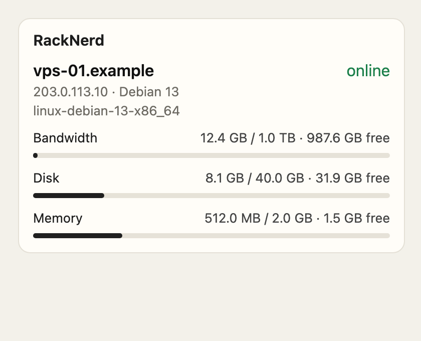

# RackNerd



Show one RackNerd VPS: hostname, power state, addresses, operating system, template, and bandwidth, disk, and memory usage. Glance calls the per-server client API directly. The preview uses a fictional server.

The widget requests `info` only. It does not boot, reboot, or shut down the VPS.

## Set up access

1. In the RackNerd panel, open the VPS and enable its API. Copy that server's API key and API hash. Each key controls only that VPS.
2. Pass the key and hash to the **Glance process or container**. With Compose, list them under the Glance service's `environment` or `env_file`.

   | Variable | Value |
   | --- | --- |
   | `RACKNERD_API_KEY` | API key for this VPS |
   | `RACKNERD_API_HASH` | API hash for this VPS |

For another VPS, add a second copy of the widget and point it at a different pair of variables.

## What the numbers cover

One request asks for status, addresses, bandwidth, disk, and memory. Bandwidth, disk, and memory arrive as byte counters. The text shows those counters in decimal units (powers of 1,000), with one decimal place. The bar uses the percent returned by the API. A rejected key is shown as “API authentication failed.” The same key can also power the VPS on or off from the RackNerd panel; this widget never sends those actions.

The card caches results for five minutes.

## Glance configuration

Tested with Glance v0.8.8. Copy the YAML below or download [widget.yml](widget.yml) and include it in the page’s widgets list.

```yaml
- type: custom-api
  title: RackNerd
  title-url: https://ctrl.racknerd.com/
  cache: 5m
  options:
    api-key: "${RACKNERD_API_KEY}"
    api-hash: "${RACKNERD_API_HASH}"
  template: |
    {{ define "rnSize" }}
      {{- $n := . -}}
      {{- $l := len $n -}}
      {{- if or (eq $n "") (le $l 3) -}}{{ if eq $n "" }}0{{ else }}{{ $n }}{{ end }} B
      {{- else -}}
        {{- $cut := 3 -}}{{- $unit := "KB" -}}
        {{- if gt $l 12 -}}{{- $cut = 12 -}}{{- $unit = "TB" -}}
        {{- else if gt $l 9 -}}{{- $cut = 9 -}}{{- $unit = "GB" -}}
        {{- else if gt $l 6 -}}{{- $cut = 6 -}}{{- $unit = "MB" -}}
        {{- end -}}
        {{- $whole := sub $l $cut -}}
        {{- slice $n 0 $whole -}}.{{- slice $n $whole (add $whole 1) }} {{ $unit -}}
      {{- end -}}
    {{ end }}
    {{ define "rnUsage" }}
      {{- $label := findSubmatch "^([^:]+)" . -}}
      {{- $raw := trimPrefix (printf "%s:" $label) . -}}
      {{- if $raw -}}
        {{- $used := findSubmatch "^[^,]+,([0-9]+)" $raw -}}
        {{- $total := findSubmatch "^([0-9]+)" $raw -}}
        {{- $free := findSubmatch "^[^,]+,[^,]+,([0-9]+)" $raw -}}
        {{- $pct := findSubmatch "^[0-9.]+" (findSubmatch "^[^,]+,[^,]+,[^,]+,([^,]+)" $raw) -}}
        <div class="flex justify-between size-h6 margin-top-10"><span>{{ $label }}</span><span>{{ template "rnSize" $used }} / {{ template "rnSize" $total }} · {{ template "rnSize" $free }} free</span></div>
        <div style="height: 5px; margin-top: 8px; border-radius: 5px; background: var(--color-separator);">
          <div style="height: 100%; width: {{ $pct }}%; max-width: 100%; border-radius: 5px; background: var(--color-primary);"></div>
        </div>
      {{- end -}}
    {{ end }}
    {{ if or (eq (.Options.StringOr "api-key" "") "") (eq (.Options.StringOr "api-hash" "") "") }}
      <p class="color-subdue">Add the RackNerd API key and hash to show this VPS.</p>
    {{ else }}
      {{ $body := printf "key=%s&hash=%s&action=info&rdtype=json&status=1&ipaddr=1&bw=1&hdd=1&mem=1"
           (urlquery (.Options.StringOr "api-key" "")) (urlquery (.Options.StringOr "api-hash" "")) }}
      {{ $res := newRequest "https://ctrl.racknerd.com/api/client/command.php"
           | withHeader "Content-Type" "application/x-www-form-urlencoded"
           | withHeader "Accept" "application/json"
           | withHeader "User-Agent" "glance-community-racknerd/1.0"
           | withStringBody $body
           | getResponse }}
      {{ if ne $res.Response.StatusCode 200 }}
        <p class="color-negative">RackNerd returned HTTP {{ $res.Response.StatusCode }}.</p>
      {{ else if eq ($res.JSON.String "status") "error" }}
        <p class="color-negative">
          {{- if or (findSubmatch "(?i)invalid key" ($res.JSON.String "statusmsg")) (findSubmatch "(?i)invalid hash" ($res.JSON.String "statusmsg")) -}}
            API authentication failed.
          {{- else -}}
            {{ $res.JSON.String "statusmsg" }}
          {{- end -}}
        </p>
      {{ else }}
        {{ $status := $res.JSON.String "vmstat" }}
        {{ $ip := $res.JSON.String "ipaddress" }}
        {{ $ips := $res.JSON.String "ipaddr" }}
        <div class="flex justify-between gap-10">
          <a class="color-highlight" style="overflow-wrap: anywhere;" href="https://ctrl.racknerd.com/">{{ $res.JSON.String "hostname" }}</a>
          {{ if eq $status "online" }}
            <span class="color-positive" style="white-space: nowrap;">online</span>
          {{ else if or (eq $status "offline") (eq $status "disabled") }}
            <span class="color-negative" style="white-space: nowrap;">{{ $status }}</span>
          {{ else }}
            <span style="white-space: nowrap;">{{ $status }}</span>
          {{ end }}
        </div>
        {{ if or $ip ($res.JSON.String "os") }}
          <div class="size-h6 color-subdue margin-top-5">{{ $ip }}{{ if and $ip ($res.JSON.String "os") }} · {{ end }}{{ $res.JSON.String "os" }}</div>
        {{ end }}
        {{ if $res.JSON.String "template" }}
          <div class="size-h6 color-subdue">{{ $res.JSON.String "template" }}</div>
        {{ end }}
        {{ if and $ips (ne $ips $ip) }}
          <div class="size-h6 color-subdue">Other IPs {{ $ips }}</div>
        {{ end }}
        {{ template "rnUsage" (printf "Bandwidth:%s" ($res.JSON.String "bw")) }}
        {{ template "rnUsage" (printf "Disk:%s" ($res.JSON.String "hdd")) }}
        {{ template "rnUsage" (printf "Memory:%s" ($res.JSON.String "mem")) }}
      {{ end }}
    {{ end }}
```
