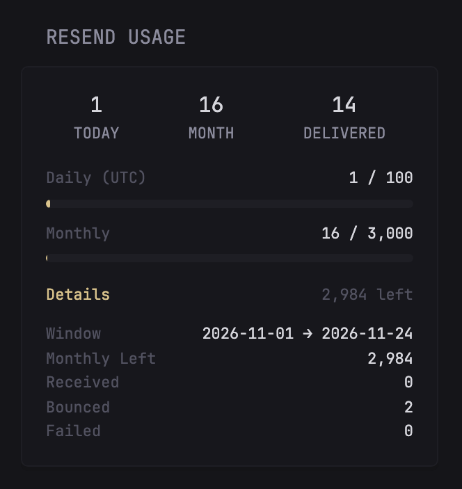

# Resend Usage

Display your [Resend](https://resend.com/) daily (UTC) and monthly email quota consumption (`sent + received`) along with monthly delivery metrics (`delivered`, `received`, `bounced`, `failed`).

## Preview



## Config

```yaml
- type: custom-api
  title: Resend Usage
  title-url: https://resend.com/emails
  cache: 15m
  options:
    api-key: ${RESEND_API_KEY}
    daily-limit: 100
    monthly-limit: 3000
  template: |
    {{ $apiKey := .Options.StringOr "api-key" "" | trimSpace }}
    {{ if eq $apiKey "" }}
      <p class="color-negative">RESEND_API_KEY is not set.</p>
    {{ else }}
      {{ $nowUTC := now.UTC }}
      {{ $today := $nowUTC | formatTime "2006-01-02" }}
      {{ $monthDate := printf "%s-01" ($nowUTC | formatTime "2006-01") }}
      {{ $todayStart := printf "%sT00:00:00Z" $today }}
      {{ $monthStart := printf "%sT00:00:00Z" $monthDate }}
      {{ $nowISO := $nowUTC | formatTime "rfc3339" }}
      {{ $auth := print "Bearer " $apiKey }}
      {{ $dailyRes := newRequest "https://api.resend.com/emails/metrics"
        | withParameter "start_date" $todayStart
        | withParameter "end_date" $nowISO
        | withParameter "metrics" "sent,received,delivered,bounced,failed"
        | withHeader "Authorization" $auth
        | withHeader "Accept" "application/json"
        | getResponse }}
      {{ $monthlyRes := newRequest "https://api.resend.com/emails/metrics"
        | withParameter "start_date" $monthStart
        | withParameter "end_date" $nowISO
        | withParameter "metrics" "sent,received,delivered,bounced,failed"
        | withHeader "Authorization" $auth
        | withHeader "Accept" "application/json"
        | getResponse }}
      {{ if or (eq $dailyRes.Response.StatusCode 0) (eq $monthlyRes.Response.StatusCode 0) }}
        <p class="color-subdue">Resend temporarily unavailable.</p>
      {{ else if or (eq $dailyRes.Response.StatusCode 401) (eq $dailyRes.Response.StatusCode 403) (eq $monthlyRes.Response.StatusCode 401) (eq $monthlyRes.Response.StatusCode 403) }}
        <p class="color-negative">API authentication failed. Full Access key required.</p>
      {{ else if or (ne $dailyRes.Response.StatusCode 200) (ne $monthlyRes.Response.StatusCode 200) }}
        <p class="color-negative">Unavailable (HTTP {{ $dailyRes.Response.StatusCode }}/{{ $monthlyRes.Response.StatusCode }}).</p>
      {{ else }}
        {{ $dailyLimit := .Options.IntOr "daily-limit" 100 }}
        {{ if eq (printf "%v" (index .Options "daily-limit")) "0" }}{{ $dailyLimit = 0 }}{{ end }}
        {{ $monthlyLimit := .Options.IntOr "monthly-limit" 3000 }}
        {{ $dailyUsed := add ($dailyRes.JSON.Int "totals.sent") ($dailyRes.JSON.Int "totals.received") }}
        {{ $monthlySent := $monthlyRes.JSON.Int "totals.sent" }}
        {{ $monthlyRecv := $monthlyRes.JSON.Int "totals.received" }}
        {{ $monthlyUsed := add $monthlySent $monthlyRecv }}
        {{ $delivered := $monthlyRes.JSON.Int "totals.delivered" }}
        {{ $bounced := $monthlyRes.JSON.Int "totals.bounced" }}
        {{ $failed := $monthlyRes.JSON.Int "totals.failed" }}
        {{ $monthlyRem := sub $monthlyLimit $monthlyUsed }}
        {{ if lt $monthlyRem 0 }}{{ $monthlyRem = 0 }}{{ end }}
        {{ $dailyPct := 0.0 }}
        {{ if gt $dailyLimit 0 }}
          {{ $dailyPct = mul (div (mul $dailyUsed 1.0) (mul $dailyLimit 1.0)) 100.0 }}
        {{ end }}
        {{ $dailyBar := $dailyPct }}
        {{ if lt $dailyBar 0.0 }}{{ $dailyBar = 0.0 }}{{ end }}
        {{ if gt $dailyBar 100.0 }}{{ $dailyBar = 100.0 }}{{ end }}
        {{ $monthlyPct := 0.0 }}
        {{ if gt $monthlyLimit 0 }}
          {{ $monthlyPct = mul (div (mul $monthlyUsed 1.0) (mul $monthlyLimit 1.0)) 100.0 }}
        {{ end }}
        {{ $monthlyBar := $monthlyPct }}
        {{ if lt $monthlyBar 0.0 }}{{ $monthlyBar = 0.0 }}{{ end }}
        {{ if gt $monthlyBar 100.0 }}{{ $monthlyBar = 100.0 }}{{ end }}
        <div class="flex justify-between text-center gap-10">
          <div class="grow">
            <div class="color-highlight size-h3">{{ $dailyUsed | formatNumber }}</div>
            <div class="size-h6">TODAY</div>
          </div>
          <div class="grow">
            <div class="color-highlight size-h3">{{ $monthlyUsed | formatNumber }}</div>
            <div class="size-h6">MONTH</div>
          </div>
          <div class="grow">
            <div class="color-highlight size-h3">{{ $delivered | formatNumber }}</div>
            <div class="size-h6">DELIVERED</div>
          </div>
        </div>
        {{ if gt $dailyLimit 0 }}
          <div class="margin-top-15">
            <div class="flex justify-between gap-10 size-h6">
              <span class="color-subdue">Daily (UTC)</span>
              <span class="{{ if ge $dailyPct 80.0 }}color-negative{{ else }}color-highlight{{ end }}">{{ $dailyUsed | formatNumber }} / {{ $dailyLimit | formatNumber }}</span>
            </div>
            <div style="height: 6px; margin-top: 6px; border-radius: 999px; background: var(--color-separator); overflow: hidden;">
              <div style="height: 100%; border-radius: inherit; width: {{ printf "%.1f" $dailyBar }}%; background: {{ if ge $dailyPct 80.0 }}var(--color-negative){{ else }}var(--color-primary){{ end }};"></div>
            </div>
          </div>
        {{ end }}
        <div class="{{ if gt $dailyLimit 0 }}margin-top-10{{ else }}margin-top-15{{ end }}">
          <div class="flex justify-between gap-10 size-h6">
            <span class="color-subdue">Monthly</span>
            <span class="{{ if ge $monthlyPct 80.0 }}color-negative{{ else }}color-highlight{{ end }}">{{ $monthlyUsed | formatNumber }} / {{ $monthlyLimit | formatNumber }}</span>
          </div>
          <div style="height: 6px; margin-top: 6px; border-radius: 999px; background: var(--color-separator); overflow: hidden;">
            <div style="height: 100%; border-radius: inherit; width: {{ printf "%.1f" $monthlyBar }}%; background: {{ if ge $monthlyPct 80.0 }}var(--color-negative){{ else }}var(--color-primary){{ end }};"></div>
          </div>
        </div>
        <details class="margin-top-15">
          <summary style="cursor: pointer;" class="flex justify-between gap-10 size-h6 color-primary">
            <span>Details</span>
            <span class="color-subdue">{{ $monthlyRem | formatNumber }} left</span>
          </summary>
          <ul class="list list-gap-5 margin-top-10 size-h6">
            <li class="flex justify-between gap-10"><span class="color-subdue">Window</span><span class="color-highlight">{{ $monthDate }} → {{ $today }}</span></li>
            <li class="flex justify-between gap-10"><span class="color-subdue">Monthly Left</span><span class="color-highlight">{{ $monthlyRem | formatNumber }}</span></li>
            <li class="flex justify-between gap-10"><span class="color-subdue">Received</span><span class="color-highlight">{{ $monthlyRecv | formatNumber }}</span></li>
            <li class="flex justify-between gap-10"><span class="color-subdue">Bounced</span><span class="color-highlight">{{ $bounced | formatNumber }}</span></li>
            <li class="flex justify-between gap-10"><span class="color-subdue">Failed</span><span class="color-highlight">{{ $failed | formatNumber }}</span></li>
          </ul>
        </details>
      {{ end }}
    {{ end }}
```

## Environment variables

- `RESEND_API_KEY` - Your Resend API key (`re_...`) with **Full Access** permission (Sending-only keys cannot read `GET /emails/metrics`).

## Options

| Option | Default | Meaning |
|---|---|---|
| `api-key` | `${RESEND_API_KEY}` | Resend API key with Full Access permission |
| `daily-limit` | `100` | Daily UTC quota (Free plan = `100`; set to `0` on paid plans without a daily cap) |
| `monthly-limit` | `3000` | Monthly email allowance (Free plan = `3000`) |

## Notes

- Uses the official [`GET https://api.resend.com/emails/metrics`](https://resend.com/docs/api-reference/emails/retrieve-email-metrics) endpoint (cached up to 15 minutes upstream) with full UTC RFC3339 timestamps so same-day emails are always included.
- Both sent and received emails count toward Resend plan quotas (`totals.sent + totals.received`).
- Highlights progress bars using `color-negative` once daily or monthly usage reaches `>= 80%`.
