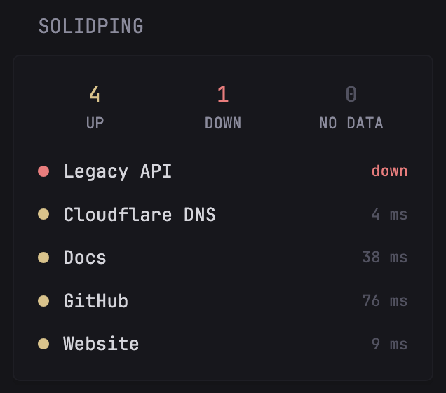

```yaml
- type: custom-api
  title: SolidPing
  title-url: ${SOLIDPING_URL}
  cache: 1m
  url: ${SOLIDPING_URL}/api/v1/orgs/${SOLIDPING_ORG}/checks?with=last_result&limit=100
  headers:
    Authorization: Bearer ${SOLIDPING_TOKEN}
    Accept: application/json
  template: |
    {{ if not (.JSON.Exists "data") }}
    <p class="color-negative">Could not read checks. Check SOLIDPING_URL, SOLIDPING_ORG and SOLIDPING_TOKEN.</p>
    {{ else if eq (len (.JSON.Array "data")) 0 }}
    <p>No checks yet.</p>
    {{ else }}
    {{ $up := 0 }}
    {{ $down := 0 }}
    {{ $other := 0 }}
    {{ range .JSON.Array "data" }}
      {{ $s := .String "status" }}
      {{ if or (eq $s "up") (eq $s "warning") }}
        {{ $up = add $up 1 }}
      {{ else if or (eq $s "down") (eq $s "validating") (eq $s "degraded") }}
        {{ $down = add $down 1 }}
      {{ else }}
        {{ $other = add $other 1 }}
      {{ end }}
    {{ end }}
    <div class="widget-small-content-bounds">
      <div style="display: grid; grid-template-columns: 1fr 1fr 1fr; gap: 10px; text-align: center;">
        <div>
          <p class="size-h3 color-positive">{{ $up }}</p>
          <p class="size-h6">UP</p>
        </div>
        <div>
          <p class="size-h3 {{ if gt $down 0 }}color-negative{{ else }}color-highlight{{ end }}">{{ $down }}</p>
          <p class="size-h6">DOWN</p>
        </div>
        <div>
          <p class="size-h3 color-subdue">{{ $other }}</p>
          <p class="size-h6">NO DATA</p>
        </div>
      </div>
      <ul class="margin-top-15 list list-gap-10 collapsible-container" data-collapse-after="6">
        {{ range .JSON.Array "data" }}
          {{ $s := .String "status" }}
          <li class="flex items-center justify-between gap-10">
            <div class="flex items-center gap-10 min-width-0">
              {{ if or (eq $s "up") (eq $s "warning") }}
                <span style="width: 8px; height: 8px; border-radius: 50%; flex-shrink: 0; background: var(--color-positive);"></span>
              {{ else if or (eq $s "down") (eq $s "validating") (eq $s "degraded") }}
                <span style="width: 8px; height: 8px; border-radius: 50%; flex-shrink: 0; background: var(--color-negative);"></span>
              {{ else }}
                <span style="width: 8px; height: 8px; border-radius: 50%; flex-shrink: 0; background: var(--color-text-subdue);"></span>
              {{ end }}
              <p class="color-highlight text-truncate" title="{{ .String "type" }}">{{ .String "name" }}</p>
            </div>
            {{ if and (.Exists "lastResult") (or (eq $s "up") (eq $s "warning")) }}
              <p class="size-h6 color-subdue shrink-0">{{ .Float "lastResult.durationMs" | printf "%.0f" }} ms</p>
            {{ else }}
              <p class="size-h6 shrink-0 {{ if or (eq $s "down") (eq $s "validating") (eq $s "degraded") }}color-negative{{ else }}color-subdue{{ end }}">{{ $s }}</p>
            {{ end }}
          </li>
        {{ end }}
      </ul>
    </div>
    {{ end }}
```

## Environment variables

- `SOLIDPING_URL`: the URL of your SolidPing instance, without a trailing slash. For example `https://solidping.example.com`, or `https://solidping.io` for the hosted version.
- `SOLIDPING_ORG`: your organization slug, the part after `/orgs/` in the dashboard URL. A fresh self-hosted instance uses `default`.
- `SOLIDPING_TOKEN`: a personal access token. Create one in the dashboard under Account, Tokens (`/orgs/<org>/account/tokens`).

## What it shows

- Counts of checks that are up, down (including failures not confirmed yet) and without recent data.
- One line per check with its last response time, or its status when it isn't up.
- Up to 100 checks, the first 6 shown and the rest collapsed.

[SolidPing](https://github.com/fclairamb/solidping) is an open-source uptime monitor (HTTP, DNS, TCP, TLS, databases, heartbeats and more). This widget only reads `GET /api/v1/orgs/{org}/checks`, so a token from any member of the organization works.
