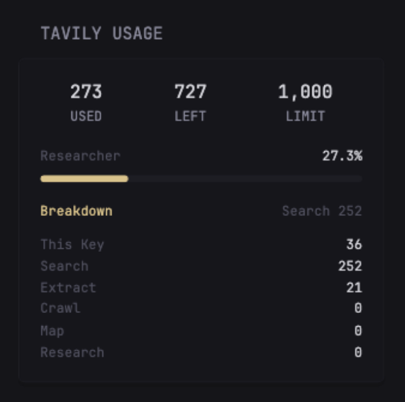

# Tavily Usage

Display your [Tavily](https://tavily.com/) API plan credits, remaining quota, usage percentage, and per-endpoint consumption (`search`, `extract`, `crawl`, `map`, `research`, and optional PayGo usage).

## Preview



## Config

```yaml
- type: custom-api
  title: Tavily Usage
  title-url: https://app.tavily.com/home
  cache: 15m
  url: https://api.tavily.com/usage
  headers:
    Authorization: Bearer ${TAVILY_API_KEY}
    Accept: application/json
  template: |
    {{ if eq .Response.StatusCode 0 }}
      <p class="color-subdue">Tavily temporarily unavailable.</p>
    {{ else if or (eq .Response.StatusCode 401) (eq .Response.StatusCode 403) }}
      <p class="color-negative">API authentication failed. Check TAVILY_API_KEY.</p>
    {{ else if eq .Response.StatusCode 429 }}
      <p class="color-subdue">Rate limited (HTTP 429).</p>
    {{ else if ne .Response.StatusCode 200 }}
      <p class="color-negative">Unavailable (HTTP {{ .Response.StatusCode }}).</p>
    {{ else }}
      {{ $plan := .JSON.String "account.current_plan" }}
      {{ $used := .JSON.Int "account.plan_usage" }}
      {{ $limit := .JSON.Int "account.plan_limit" }}
      {{ if le $limit 0 }}
        {{ $used = .JSON.Int "key.usage" }}
        {{ $limit = .JSON.Int "key.limit" }}
      {{ end }}
      {{ $rem := sub $limit $used }}
      {{ if lt $rem 0 }}{{ $rem = 0 }}{{ end }}
      {{ $pct := 0.0 }}
      {{ if gt $limit 0 }}
        {{ $pct = mul (div (mul $used 1.0) (mul $limit 1.0)) 100.0 }}
      {{ end }}
      {{ $barPct := $pct }}
      {{ if lt $barPct 0.0 }}{{ $barPct = 0.0 }}{{ end }}
      {{ if gt $barPct 100.0 }}{{ $barPct = 100.0 }}{{ end }}
      {{ $keyUsage := .JSON.Int "key.usage" }}
      {{ $keyLimit := .JSON.Int "key.limit" }}
      {{ $paygoUsed := .JSON.Int "account.paygo_usage" }}
      {{ $paygoLimit := .JSON.Int "account.paygo_limit" }}
      <div class="flex justify-between text-center gap-10">
        <div class="grow">
          <div class="color-highlight size-h3">{{ $used | formatNumber }}</div>
          <div class="size-h6">USED</div>
        </div>
        <div class="grow">
          <div class="color-highlight size-h3">{{ $rem | formatNumber }}</div>
          <div class="size-h6">LEFT</div>
        </div>
        <div class="grow">
          <div class="color-highlight size-h3">{{ $limit | formatNumber }}</div>
          <div class="size-h6">LIMIT</div>
        </div>
      </div>
      <div class="margin-top-15">
        <div class="flex justify-between gap-10 size-h6">
          <span class="color-subdue">{{ if ne $plan "" }}{{ $plan }}{{ else }}Plan{{ end }}</span>
          <span class="{{ if ge $pct 80.0 }}color-negative{{ else }}color-highlight{{ end }}">{{ printf "%.1f" $pct }}%</span>
        </div>
        <div style="height: 6px; margin-top: 6px; border-radius: 999px; background: var(--color-separator); overflow: hidden;">
          <div style="height: 100%; border-radius: inherit; width: {{ printf "%.1f" $barPct }}%; background: {{ if ge $pct 80.0 }}var(--color-negative){{ else }}var(--color-primary){{ end }};"></div>
        </div>
      </div>
      <details class="margin-top-15">
        <summary style="cursor: pointer;" class="flex justify-between gap-10 size-h6 color-primary">
          <span>Breakdown</span>
          <span class="color-subdue">Search {{ .JSON.Int "account.search_usage" | formatNumber }}</span>
        </summary>
        <ul class="list list-gap-5 margin-top-10 size-h6">
          <li class="flex justify-between gap-10"><span class="color-subdue">This Key</span><span class="color-highlight">{{ $keyUsage | formatNumber }}{{ if gt $keyLimit 0 }} / {{ $keyLimit | formatNumber }}{{ end }}</span></li>
          <li class="flex justify-between gap-10"><span class="color-subdue">Search</span><span class="color-highlight">{{ .JSON.Int "account.search_usage" | formatNumber }}</span></li>
          <li class="flex justify-between gap-10"><span class="color-subdue">Extract</span><span class="color-highlight">{{ .JSON.Int "account.extract_usage" | formatNumber }}</span></li>
          <li class="flex justify-between gap-10"><span class="color-subdue">Crawl</span><span class="color-highlight">{{ .JSON.Int "account.crawl_usage" | formatNumber }}</span></li>
          <li class="flex justify-between gap-10"><span class="color-subdue">Map</span><span class="color-highlight">{{ .JSON.Int "account.map_usage" | formatNumber }}</span></li>
          <li class="flex justify-between gap-10"><span class="color-subdue">Research</span><span class="color-highlight">{{ .JSON.Int "account.research_usage" | formatNumber }}</span></li>
          {{ if or (gt $paygoUsed 0) (gt $paygoLimit 0) }}
            <li class="flex justify-between gap-10"><span class="color-subdue">PayGo</span><span class="color-highlight">{{ $paygoUsed | formatNumber }}{{ if gt $paygoLimit 0 }} / {{ $paygoLimit | formatNumber }}{{ end }}</span></li>
          {{ end }}
        </ul>
      </details>
    {{ end }}
```

## Environment variables

- `TAVILY_API_KEY` - Your Tavily API key (`tvly-...`) from the [Tavily dashboard](https://app.tavily.com/home).

## Notes

- Uses the official [`GET https://api.tavily.com/usage`](https://docs.tavily.com/documentation/api-reference/endpoint/usage) endpoint, which has a rate limit of 10 requests per 10 minutes; the default `cache: 15m` stays well within the limit.
- Falls back to per-key `key.usage` / `key.limit` when `account.plan_limit` is unset (`<= 0`), omits `/ limit` when per-key or PayGo limits are `null`, and shows PayGo usage automatically when non-zero.
- Highlights the progress bar and percentage using `color-negative` once credit usage reaches `>= 80%`.
