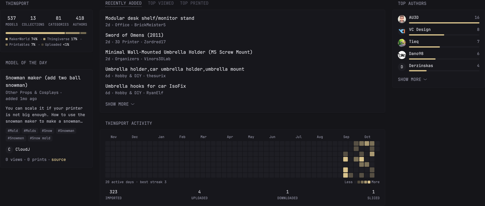
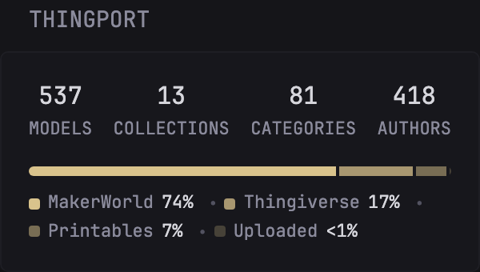
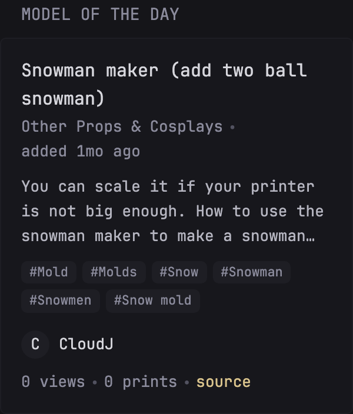
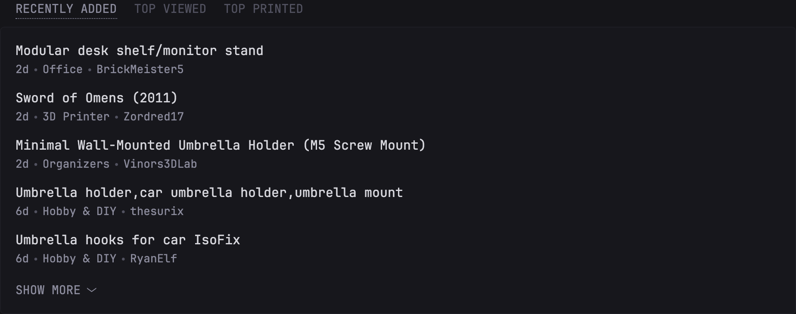
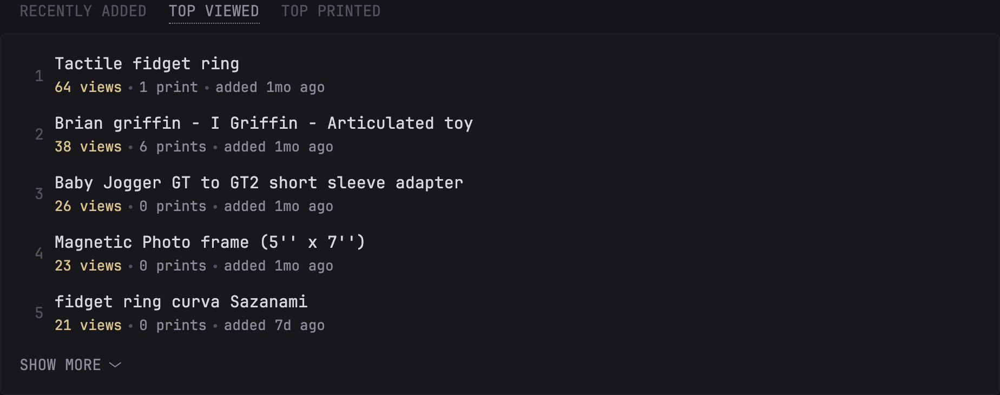
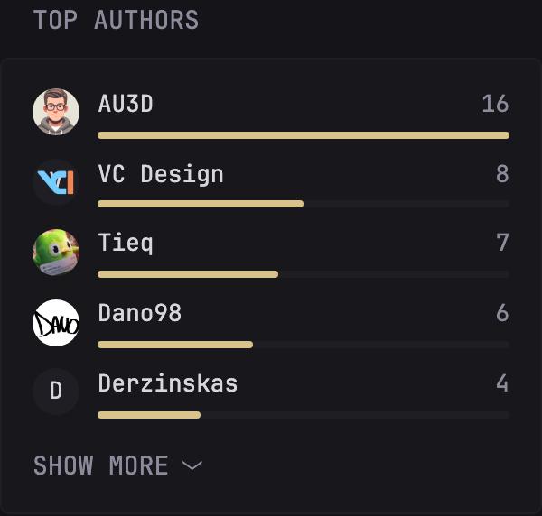
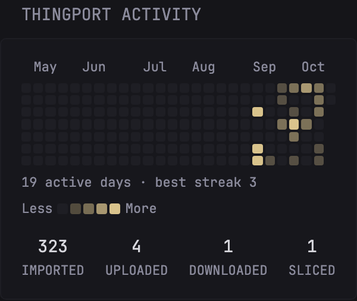
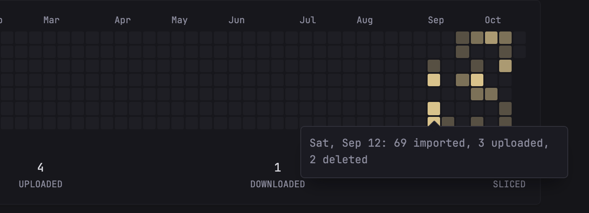
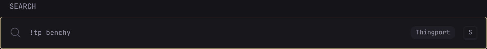

Widgets for [Thingport](https://github.com/TautvydasDerzinskas/Thingport), a self-hosted library for 3D printing models: library stats, the model of the day, recent and popular models, top authors, an activity heatmap and search bangs. Each one is a separate widget, so use as many as you like.

## Environment variables

- `THINGPORT_URL` - the URL of your Thingport server, without a trailing slash, e.g. `https://thingport.example.com`
- `THINGPORT_API_KEY` - a read-only API token. In Thingport, click your avatar, open **Profile**, and click **Generate** next to **API token**. The token is shown only once.

Needs Thingport 1.0 or later.

## Library stats

Model, collection, category and author totals, and where the models were imported from. Each count links to the matching Thingport page.



```yaml
- type: custom-api
  title: Thingport
  title-url: ${THINGPORT_URL}
  cache: 10m
  url: ${THINGPORT_URL}/api/dashboard/summary
  headers:
    Authorization: Bearer ${THINGPORT_API_KEY}
  template: |
    {{ if ne .Response.StatusCode 200 }}<p class="color-negative">Thingport answered {{ .Response.Status }}</p>{{ else }}
    <div class="flex justify-between text-center">
      <a href="${THINGPORT_URL}/models">
        <div class="color-highlight size-h3">{{ .JSON.Int "model_count" | formatNumber }}</div>
        <div class="size-h6">MODELS</div>
      </a>
      <a href="${THINGPORT_URL}/models/collections">
        <div class="color-highlight size-h3">{{ .JSON.Int "collection_count" | formatNumber }}</div>
        <div class="size-h6">COLLECTIONS</div>
      </a>
      <a href="${THINGPORT_URL}">
        <div class="color-highlight size-h3">{{ .JSON.Int "category_count" | formatNumber }}</div>
        <div class="size-h6">CATEGORIES</div>
      </a>
      <a href="${THINGPORT_URL}">
        <div class="color-highlight size-h3">{{ .JSON.Int "author_count" | formatNumber }}</div>
        <div class="size-h6">AUTHORS</div>
      </a>
    </div>
    {{ $models := .JSON.Int "model_count" }}
    {{ if gt $models 0 }}
      <div class="flex" style="height: 6px; gap: 2px; margin-top: 15px; border-radius: var(--border-radius); overflow: hidden;">
        {{ range $i, $provider := .JSON.Array "top_providers" }}
          {{ $shade := sub 1.0 (mul (toFloat $i) 0.25) }}{{ if lt $shade 0.25 }}{{ $shade = 0.25 }}{{ end }}
          <div style="flex: {{ $provider.Int "model_count" }}; background: var(--color-primary); opacity: {{ $shade }};"></div>
        {{ end }}
      </div>
      <ul class="list-horizontal-text size-h6" style="margin-top: 8px;">
        {{ range $i, $provider := .JSON.Array "top_providers" }}
          {{ $shade := sub 1.0 (mul (toFloat $i) 0.25) }}{{ if lt $shade 0.25 }}{{ $shade = 0.25 }}{{ end }}
          {{ $name := $provider.String "provider" }}
          {{ if eq $name "makerworld" }}{{ $name = "MakerWorld" }}{{ else if eq $name "thingiverse" }}{{ $name = "Thingiverse" }}{{ else if eq $name "printables" }}{{ $name = "Printables" }}{{ else if eq $name "thingport" }}{{ $name = "Uploaded" }}{{ else if eq $name "crealitycloud" }}{{ $name = "Creality Cloud" }}{{ else if eq $name "cults3d" }}{{ $name = "Cults3D" }}{{ else if eq $name "myminifactory" }}{{ $name = "MyMiniFactory" }}{{ else if eq $name "thangs" }}{{ $name = "Thangs" }}{{ else if eq $name "makeronline" }}{{ $name = "MakerOnline" }}{{ else if eq $name "nexprint" }}{{ $name = "Nexprint" }}{{ else if eq $name "snapmaker" }}{{ $name = "Snapmaker" }}{{ end }}
          <li class="flex items-center" style="gap: 5px;">
            <span style="width: 7px; height: 7px; border-radius: 2px; background: var(--color-primary); opacity: {{ $shade }};"></span>
            {{ $percent := div (mul ($provider.Int "model_count" | toFloat) 100.0) ($models | toFloat) | toInt }}
            {{ $name }} <span class="color-highlight">{{ if eq $percent 0 }}&lt;1{{ else }}{{ $percent }}{{ end }}%</span>
          </li>
        {{ end }}
      </ul>
    {{ end }}
    {{ end }}
```

## Model of the day

The same model Thingport's dashboard features today, with its category, description, tags and author. The day is the Glance server's local day, so set `TZ` on the Glance container if it isn't your time zone.



```yaml
- type: custom-api
  title: Model of the day
  title-url: ${THINGPORT_URL}
  cache: 30m
  template: |
    {{ $featured := newRequest "${THINGPORT_URL}/api/dashboard/featured"
      | withHeader "Authorization" "Bearer ${THINGPORT_API_KEY}"
      | withParameter "date" (now | formatTime "DateOnly")
      | getResponse }}
    {{ if ne $featured.Response.StatusCode 200 }}
      <p class="color-negative">Thingport answered {{ $featured.Response.Status }}</p>
    {{ else if not ($featured.JSON.Exists "print.id") }}
      <p>Nothing featured today. Import a few models first.</p>
    {{ else }}
      {{ $model := $featured.JSON }}
      {{ $name := $model.String "print.title" }}{{ if eq $name "" }}{{ $name = $model.String "print.name" }}{{ end }}
      <a class="size-h3 color-highlight block" href="${THINGPORT_URL}/models/{{ $model.String "print.id" }}">{{ $name }}</a>
      <ul class="list-horizontal-text" style="margin-top: 2px;">
        {{ if $model.Exists "print.category_name" }}<li>{{ $model.String "print.category_name" }}</li>{{ end }}
        <li>added <span {{ parseRelativeTime "rfc3339" ($model.String "print.created_at") }}></span> ago</li>
      </ul>
      {{ $notes := $model.String "print.notes" | replaceMatches "[#*_`>\\[\\]]+" "" | replaceMatches "\\(https?://[^)]*\\)" "" | replaceMatches "\\s+" " " | trimSpace }}
      {{ if ne $notes "" }}
        <p class="color-paragraph" style="margin-top: 10px; display: -webkit-box; -webkit-line-clamp: 3; -webkit-box-orient: vertical; overflow: hidden;">{{ $notes }}</p>
      {{ end }}
      {{ $tags := $model.Array "print.tags" }}
      {{ if gt (len $tags) 0 }}
        <div class="flex flex-wrap" style="gap: 5px; margin-top: 10px;">
          {{ range $i, $tag := $tags }}
            {{ if lt $i 6 }}
              <a class="size-h6" style="padding: 1px 7px; border-radius: var(--border-radius); background: var(--color-widget-background-highlight);" href="${THINGPORT_URL}/models/tags/{{ $tag.String "" }}">#{{ $tag.String "" }}</a>
            {{ end }}
          {{ end }}
        </div>
      {{ end }}
      <div class="flex flex-wrap items-center justify-between" style="gap: 10px 15px; margin-top: 15px;">
        {{ if $model.Exists "print.author.id" }}
          {{ $author := $model.String "print.author.name" }}{{ if eq $author "" }}{{ $author = $model.String "print.author.handle" }}{{ end }}
          <a class="flex items-center min-width-0" style="gap: 8px;" href="${THINGPORT_URL}/authors/{{ $model.String "print.author.id" }}">
            <span class="flex items-center justify-center color-highlight" style="position: relative; width: 2.4rem; height: 2.4rem; border-radius: 50%; flex-shrink: 0; overflow: hidden; background: var(--color-widget-background-highlight);">
              {{ findMatch "^." $author }}
              {{ if $model.Exists "print.author.avatar_url" }}
                
              {{ end }}
            </span>
            <span class="text-truncate color-highlight">{{ $author }}</span>
          </a>
        {{ else }}
          <span></span>
        {{ end }}
        <ul class="list-horizontal-text">
          <li>{{ $model.Int "print.view_count" | formatNumber }} view{{ if ne ($model.Int "print.view_count") 1 }}s{{ end }}</li>
          <li>{{ $model.Int "print.print_count" | formatNumber }} print{{ if ne ($model.Int "print.print_count") 1 }}s{{ end }}</li>
          {{ if ne ($model.String "print.source_url") "" }}<li><a class="color-primary" href="{{ $model.String "print.source_url" }}" target="_blank" rel="noreferrer">source</a></li>{{ end }}
        </ul>
      </div>
    {{ end }}
```

## Models

Recently added, top viewed and top printed models as tabs. A model's print count goes up when it's downloaded or opened in a slicer. Each tab is a separate widget, so you can drop the `group` and keep only the lists you want.





```yaml
- type: group
  widgets:
    - type: custom-api
      title: Recently added
      title-url: ${THINGPORT_URL}/models?orderBy=newest
      cache: 10m
      url: ${THINGPORT_URL}/api/prints
      parameters:
        orderBy: newest
        limit: 10
      headers:
        Authorization: Bearer ${THINGPORT_API_KEY}
      template: |
        {{ if ne .Response.StatusCode 200 }}<p class="color-negative">Thingport answered {{ .Response.Status }}</p>{{ else }}
        <ul class="list list-gap-10 collapsible-container" data-collapse-after="5">
          {{ range .JSON.Array "" }}
            {{ $name := .String "title" }}{{ if eq $name "" }}{{ $name = .String "name" }}{{ end }}
            {{ $author := .String "author.name" }}{{ if eq $author "" }}{{ $author = .String "author.handle" }}{{ end }}
            <li>
              <a class="size-title-dynamic color-highlight text-truncate block" href="${THINGPORT_URL}/models/{{ .String "id" }}">{{ $name }}</a>
              <ul class="list-horizontal-text">
                <li {{ parseRelativeTime "rfc3339" (.String "created_at") }}></li>
                {{ if .Exists "category_name" }}<li class="text-truncate">{{ .String "category_name" }}</li>{{ end }}
                {{ if ne $author "" }}<li class="text-truncate">{{ $author }}</li>{{ end }}
              </ul>
            </li>
          {{ end }}
        </ul>
        {{ end }}
    - type: custom-api
      title: Top viewed
      title-url: ${THINGPORT_URL}/models?orderBy=popular
      cache: 10m
      url: ${THINGPORT_URL}/api/dashboard/top-viewed
      headers:
        Authorization: Bearer ${THINGPORT_API_KEY}
      template: |
        {{ if ne .Response.StatusCode 200 }}<p class="color-negative">Thingport answered {{ .Response.Status }}</p>{{ else }}
        <ul class="list list-gap-10 collapsible-container" data-collapse-after="5">
          {{ range $i, $model := .JSON.Array "" }}
            {{ if lt $i 10 }}
              <li class="flex items-center" style="gap: 10px;">
                <span class="size-h4 color-subdue" style="min-width: 1.6em; text-align: right;">{{ add $i 1 }}</span>
                <div class="min-width-0">
                  <a class="size-title-dynamic color-highlight text-truncate block" href="${THINGPORT_URL}/models/{{ $model.String "id" }}">{{ $model.String "name" }}</a>
                  <ul class="list-horizontal-text">
                    <li class="color-primary">{{ $model.Int "view_count" | formatNumber }} view{{ if ne ($model.Int "view_count") 1 }}s{{ end }}</li>
                    <li>{{ $model.Int "print_count" | formatNumber }} print{{ if ne ($model.Int "print_count") 1 }}s{{ end }}</li>
                    <li>added <span {{ parseRelativeTime "rfc3339" ($model.String "created_at") }}></span> ago</li>
                  </ul>
                </div>
              </li>
            {{ end }}
          {{ end }}
        </ul>
        {{ end }}
    - type: custom-api
      title: Top printed
      title-url: ${THINGPORT_URL}/models?orderBy=downloads
      cache: 10m
      url: ${THINGPORT_URL}/api/dashboard/top-printed
      headers:
        Authorization: Bearer ${THINGPORT_API_KEY}
      template: |
        {{ if ne .Response.StatusCode 200 }}<p class="color-negative">Thingport answered {{ .Response.Status }}</p>{{ else }}
        {{ $models := .JSON.Array "" }}
        {{ if eq (len $models) 0 }}
          <p>Nothing printed yet. Prints are counted when a model is opened in a slicer or downloaded.</p>
        {{ else }}
          <ul class="list list-gap-10 collapsible-container" data-collapse-after="5">
            {{ range $i, $model := $models }}
              {{ if lt $i 10 }}
                <li class="flex items-center" style="gap: 10px;">
                  <span class="size-h4 color-subdue" style="min-width: 1.6em; text-align: right;">{{ add $i 1 }}</span>
                  <div class="min-width-0">
                    <a class="size-title-dynamic color-highlight text-truncate block" href="${THINGPORT_URL}/models/{{ $model.String "id" }}">{{ $model.String "name" }}</a>
                    <ul class="list-horizontal-text">
                      <li class="color-primary">{{ $model.Int "print_count" | formatNumber }} print{{ if ne ($model.Int "print_count") 1 }}s{{ end }}</li>
                      <li>{{ $model.Int "view_count" | formatNumber }} view{{ if ne ($model.Int "view_count") 1 }}s{{ end }}</li>
                    </ul>
                  </div>
                </li>
              {{ end }}
            {{ end }}
          </ul>
        {{ end }}
        {{ end }}
```

## Top authors

The authors you have the most models from, with their avatars from the site you imported from.



```yaml
- type: custom-api
  title: Top authors
  title-url: ${THINGPORT_URL}
  cache: 1h
  url: ${THINGPORT_URL}/api/dashboard/top-authors
  headers:
    Authorization: Bearer ${THINGPORT_API_KEY}
  options:
    limit: 10
  template: |
    {{ if ne .Response.StatusCode 200 }}<p class="color-negative">Thingport answered {{ .Response.Status }}</p>{{ else }}
    {{ $authors := .JSON.Array "" }}
    {{ $limit := .Options.IntOr "limit" 10 }}
    {{ $most := 1 }}{{ if gt (len $authors) 0 }}{{ $most = (index $authors 0).Int "model_count" }}{{ end }}
    <ul class="list list-gap-10 collapsible-container" data-collapse-after="5">
      {{ range $i, $author := $authors }}
        {{ if lt $i $limit }}
          {{ $name := $author.String "name" }}{{ if eq $name "" }}{{ $name = $author.String "handle" }}{{ end }}
          <li>
            <a class="flex items-center" style="gap: 10px;" href="${THINGPORT_URL}/authors/{{ $author.String "id" }}">
              <span class="flex items-center justify-center color-highlight" style="position: relative; width: 2.6rem; height: 2.6rem; border-radius: 50%; flex-shrink: 0; overflow: hidden; background: var(--color-widget-background-highlight);">
                {{ findMatch "^." $name }}
                {{ if $author.Exists "avatar_url" }}
                  
                {{ end }}
              </span>
              <div class="grow min-width-0">
                <div class="flex justify-between" style="gap: 10px;">
                  <span class="color-highlight text-truncate">{{ $name }}</span>
                  <span class="shrink-0">{{ $author.Int "model_count" | formatNumber }}</span>
                </div>
                <div style="height: 4px; margin-top: 4px; border-radius: 2px; background: var(--color-widget-background-highlight);">
                  <div style="height: 100%; width: {{ div (mul ($author.Int "model_count" | toFloat) 100.0) ($most | toFloat) }}%; border-radius: 2px; background: var(--color-primary);"></div>
                </div>
              </div>
            </a>
          </li>
        {{ end }}
      {{ end }}
    </ul>
    {{ end }}
```

## Activity heatmap

Imports, uploads, downloads and slicer opens per day, like the heatmap on Thingport's profile page. Hover a day to see what happened.





Set `weeks` to fit the column: 26 suits a small column, 52 a full one. Set `timezone` to the time zone you want days counted in, usually the same one as Glance's `TZ`.

```yaml
- type: custom-api
  title: Thingport activity
  title-url: ${THINGPORT_URL}/profile
  cache: 15m
  options:
    # How many weeks back to show: 26 fits a small column, 52 a full one.
    weeks: 26
    # The time zone Thingport counts days in, as an IANA name.
    timezone: UTC
  template: |
    {{ $weeks := .Options.IntOr "weeks" 26 }}
    {{ $today := startOfDay now }}
    {{ $weekday := 0 }}
    {{ $dayName := $today.Format "Mon" }}
    {{ if eq $dayName "Tue" }}{{ $weekday = 1 }}{{ else if eq $dayName "Wed" }}{{ $weekday = 2 }}{{ else if eq $dayName "Thu" }}{{ $weekday = 3 }}{{ else if eq $dayName "Fri" }}{{ $weekday = 4 }}{{ else if eq $dayName "Sat" }}{{ $weekday = 5 }}{{ else if eq $dayName "Sun" }}{{ $weekday = 6 }}{{ end }}
    {{ $days := add (mul (sub $weeks 1) 7) (add $weekday 1) }}
    {{ $start := $today.AddDate 0 0 (sub 1 $days) }}
    {{ $activity := newRequest "${THINGPORT_URL}/api/activity"
      | withHeader "Authorization" "Bearer ${THINGPORT_API_KEY}"
      | withParameter "from" ($start | formatTime "DateOnly")
      | withParameter "to" ($today | formatTime "DateOnly")
      | withParameter "tz" (.Options.StringOr "timezone" "UTC")
      | getResponse }}
    {{ if ne $activity.Response.StatusCode 200 }}
      <p class="color-negative">Thingport answered {{ $activity.Response.Status }}</p>
    {{ else }}
      {{ $active := 0 }}{{ $streak := 0 }}{{ $longest := 0 }}
      {{ $imports := 0 }}{{ $uploads := 0 }}{{ $downloads := 0 }}{{ $slicer := 0 }}
      <div style="display: grid; grid-template-columns: repeat({{ $weeks }}, 1fr); gap: 2px; margin-bottom: 4px;" class="size-h6">
        {{ $lastMonth := $start.Format "Jan" }}
        {{ range $week := $weeks }}
          {{ $month := ($start.AddDate 0 0 (mul $week 7)).Format "Jan" }}
          {{ if and (ne $month $lastMonth) (lt $week (sub $weeks 2)) }}
            <div style="grid-row: 1; grid-column: {{ add $week 1 }} / span 3; white-space: nowrap;">{{ $month }}</div>
          {{ end }}
          {{ $lastMonth = $month }}
        {{ end }}
      </div>
      <div style="display: grid; grid-template-columns: repeat({{ $weeks }}, 1fr); grid-template-rows: repeat(7, auto); grid-auto-flow: column; gap: 2px;">
        {{ range $i := $days }}
          {{ $day := $start.AddDate 0 0 $i }}
          {{ $path := printf "days.#(date==%q).counts." ($day | formatTime "DateOnly") }}
          {{ $import := $activity.JSON.Int (concat $path "import") }}{{ $upload := $activity.JSON.Int (concat $path "upload") }}{{ $download := $activity.JSON.Int (concat $path "download") }}{{ $slice := $activity.JSON.Int (concat $path "slicer") }}{{ $delete := $activity.JSON.Int (concat $path "delete") }}
          {{ $sum := add (add (add $import $upload) (add $download $slice)) $delete }}
          {{ $label := $day.Format "Mon, Jan 2" }}
          {{ if eq $sum 0 }}
            {{ $streak = 0 }}
            {{ $label = concat $label ": no activity" }}
          {{ else }}
            {{ $active = add $active 1 }}{{ $streak = add $streak 1 }}{{ if gt $streak $longest }}{{ $longest = $streak }}{{ end }}
            {{ $imports = add $imports $import }}{{ $uploads = add $uploads $upload }}{{ $downloads = add $downloads $download }}{{ $slicer = add $slicer $slice }}
            {{ $label = concat $label ":" }}
            {{ if gt $import 0 }}{{ $label = concat $label (printf " %d imported," $import) }}{{ end }}
            {{ if gt $upload 0 }}{{ $label = concat $label (printf " %d uploaded," $upload) }}{{ end }}
            {{ if gt $download 0 }}{{ $label = concat $label (printf " %d downloaded," $download) }}{{ end }}
            {{ if gt $slice 0 }}{{ $label = concat $label (printf " %d opened in slicer," $slice) }}{{ end }}
            {{ if gt $delete 0 }}{{ $label = concat $label (printf " %d deleted," $delete) }}{{ end }}
            {{ $label = trimSuffix "," $label }}
          {{ end }}
          {{ $opacity := "1" }}
          {{ if eq $sum 0 }}{{ $opacity = "0" }}{{ else if lt $sum 3 }}{{ $opacity = "0.3" }}{{ else if lt $sum 10 }}{{ $opacity = "0.5" }}{{ else if lt $sum 30 }}{{ $opacity = "0.75" }}{{ end }}
          <div data-popover-type="text" data-popover-text="{{ $label }}" style="aspect-ratio: 1; border-radius: 2px; background: var(--color-widget-background-highlight); overflow: hidden;">
            <div style="width: 100%; height: 100%; background: var(--color-primary); opacity: {{ $opacity }};"></div>
          </div>
        {{ end }}
      </div>
      <div class="flex flex-wrap justify-between items-center size-h6" style="gap: 4px 10px; margin-top: 6px;">
        <span>{{ $active }} active {{ if eq $active 1 }}day{{ else }}days{{ end }} · best streak {{ $longest }}</span>
        <span class="flex items-center" style="gap: 2px;">
          <span style="margin-right: 2px;">Less</span>
          <span style="width: 9px; height: 9px; border-radius: 2px; background: var(--color-widget-background-highlight);"></span>
          <span style="width: 9px; height: 9px; border-radius: 2px; background: var(--color-primary); opacity: 0.3;"></span>
          <span style="width: 9px; height: 9px; border-radius: 2px; background: var(--color-primary); opacity: 0.5;"></span>
          <span style="width: 9px; height: 9px; border-radius: 2px; background: var(--color-primary); opacity: 0.75;"></span>
          <span style="width: 9px; height: 9px; border-radius: 2px; background: var(--color-primary);"></span>
          <span style="margin-left: 2px;">More</span>
        </span>
      </div>
      <div class="flex justify-between text-center" style="margin-top: 12px;">
        <div><div class="color-highlight size-h4">{{ $imports | formatNumber }}</div><div class="size-h6">IMPORTED</div></div>
        <div><div class="color-highlight size-h4">{{ $uploads | formatNumber }}</div><div class="size-h6">UPLOADED</div></div>
        <div><div class="color-highlight size-h4">{{ $downloads | formatNumber }}</div><div class="size-h6">DOWNLOADED</div></div>
        <div><div class="color-highlight size-h4">{{ $slicer | formatNumber }}</div><div class="size-h6">SLICED</div></div>
      </div>
    {{ end }}
```

## Search bangs

Add these `bangs` to your existing search widget. `!tp benchy` opens Thingport's search results for "benchy", and `!tpt` opens the models with a tag.



```yaml
- type: search
  search-engine: duckduckgo
  bangs:
    - title: Thingport
      shortcut: "!tp"
      url: ${THINGPORT_URL}/search-results?q={QUERY}
    - title: Thingport tag
      shortcut: "!tpt"
      url: ${THINGPORT_URL}/models/tags/{QUERY}
```

## Notes

- **No model thumbnails.** Thingport only serves images with the API token in a request header, and an `` in Glance can't send one. Author avatars come from the original sites, so those do show.
- **Self-signed certificates.** Add `allow-insecure: true` to the stats, models and authors widgets. The model of the day and activity widgets make their requests inside the template, so add `| withAllowInsecure true` before `| getResponse` there instead.
- **Errors.** If Thingport is down or the token is wrong, each widget shows the status Thingport answered with, such as `401 Unauthorized`, instead of empty numbers.
